# DrawY 首席体验官报告：20 位真实用户 × 3 档思考强度

> 2026-11-01 · DrawY main `0b6ebf9` · 绘制模型 gpt-6.1-terra（API，Default 速度）· 生图模型 gpt-image-2.5-flare（ChatGPT 账号通道）· Chromium 1440×900

我扮演 20 位来自不同行业、不太会写提示词的普通用户，在真实浏览器里从首页开始使用 DrawY：选档位、输入需求、看它起稿、回答它的提问、提一次修改、打开创作过程，最后手动把作品标题加上档位前缀。每个案例分别用 medium、high、xhigh 各跑一遍，共 60 次。

带截图放大和交互的完整版见 [report.html](report.html)（下载后用浏览器打开）。

## 目录

- [结论摘要](#结论摘要) · [关键问题](#关键问题按严重程度) · [做得好的地方](#做得好的地方) · [档位到底改变了什么](#档位到底改变了什么) · [代码根因与修复方案](#代码根因与修复方案) · [60 次运行一览](#60-次运行一览) · [方法与口径](#方法与口径)
- 案例：[01 分数披萨](#c01) · [02 杨枝甘露](#c02) · [03 盐与血压](#c03) · [04 宝宝辅食](#c04) · [05 双十一叠加](#c05) · [06 郑和下西洋](#c06) · [07 微服务下单](#c07) · [08 深蹲对比](#c08) · [09 房贷对比](#c09) · [10 草莓农事](#c10) · [11 有丝分裂](#c11) · [12 玄幻势力](#c12) · [13 成都美食](#c13) · [14 七步洗手](#c14) · [15 会员权益](#c15) · [16 咖啡](#c16) · [17 垃圾分类](#c17) · [18 理财入门](#c18) · [19 民诉流程](#c19) · [20 US 申请](#c20)

## 结论摘要

| 体验次数 | 对话轮次 | 用户累计等待 | 总成本 | 新生成图片 | 失败轮次 |
|---|---|---|---|---|---|
| 60（20 案例 × 3 档） | 128 | 5.9 小时 | $23.49（模型 $12.63 + 生图约 $10.86） | 181 | 11 / 128（10 轮在 xhigh） |

| 档位 | 首轮成功 | 全程无失败 | 失败轮次 | 首轮平均 | 首个画面 | 追问平均 | 首轮输出 / 推理 token | 提问的案例 | 平均新图 | 平均模型费 | 平均总成本 |
|---|---|---|---|---|---|---|---|---|---|---|---|
| medium | 20/20 | 20/20 | 0/40 | 2分41秒 | 1分13秒 | 1分39秒 | 10.7k / 6.2k | 4 | 3.7 | $0.157 | **$0.379** |
| high | 20/20 | 19/20 | 1/41 | 3分10秒 | 1分32秒 | 1分42秒 | 14.5k / 9.0k | 5 | 2.1 | $0.191 | **$0.317** |
| xhigh | 17/20 | 12/20 | 10/47 | 4分35秒 | 2分01秒 | 2分23秒 | 20.6k / 14.3k | 4 | 3.2 | $0.284 | **$0.479** |

**一句话结论：** DrawY 已经能把普通人一句口语化的需求，变成一张内容准确、画风统一、能直接拿去用的图；但 xhigh 档在长作品上会因为“上下文压缩被截断”而频繁失败，失败后的提示和画面状态都会让用户困惑。

**档位建议：** 默认用 **medium**。20 个案例里 medium 零失败、首轮平均不到 3 分钟，画面质量与 high 基本相当；high 在少数案例里想得更周到（c04 辅食的质地进阶、c09 精确到分），可以作为“更细致”选项；xhigh 在修复压缩问题之前不建议开放给普通用户。它偶尔画得最好（c08 深蹲的红色纠错箭头、c03 加入肾脏调节），但首轮耗时约为 medium 的 1.7 倍，还有约五分之一的轮次失败。

**最该先修的四件事：** ① 上下文压缩：修正 token 估算，压缩调用用低推理强度、提高输出上限（P0）。这一项就能消除本次全部 11 次失败。② 生图 ID 里的 `--` 让图片被移出作品，8 个作品受影响，改两行代码即可修复（P1）。③ 失败时告诉用户“已保存到第几稿”，提供“继续”按钮，不让带运行错误的版本成为最新稿（P1）。④ 用户手动改过的标题不再被 AI 覆盖（P1）。

## 关键问题（按严重程度）

### P0 · 上下文压缩被截断，导致长作品运行整体失败

60 次体验共触发 37 次上下文压缩，其中 **11 次失败（30%）**，直接造成 xhigh 档 10 轮、high 档 1 轮失败；medium 零失败。成功的压缩也用掉了最多 3,945 个输出 token，几乎顶到 4,096 的上限。原因有两处。① 触发过早：`contextSize()` 用“JSON 字符数 ÷ 3”估算 token，而上下文里 42.6% 的字符是加密推理内容（`encrypted_content`，base64），估算比真实值高约 2.5 倍，所以真实输入只有 3.5 万～8.9 万（中位约 5.3 万）token 时就越过了 12.8 万的阈值。② 压缩调用的输出上限只有 4,096，推理强度却沿用作者设置（xhigh），推理把预算用光后响应变成 incomplete，整次运行判为失败。另外，每次压缩让用户多等约 37 秒，压缩后下一轮的缓存命中从 93% 降到 76%。

**建议：** 估算改用上一轮 API 返回的 `usage.input_tokens` 加上新增内容的估算，至少不要把 `encrypted_content` 按字符计；压缩调用固定用 low 推理强度，输出上限提到 16k；压缩失败时退化为裁掉最早的截图消息，不要让整次运行失败。代码位置：`modules/agent/index.ts:215-241`。

相关案例：c04、c10、c11、c13、c14、c17、c18、c19

### P1 · 生图 ID 带“--”时，图片会被悄悄移出作品

生成图的 ID 由英文名转成 slug，代码先去掉首尾连字符、**再截到 28 位**，截断点落在连字符上时就产生 `g-plastic-bottle-and-aluminum--2e8b` 这样带 `--` 的 ID。而 `take()` 判断“作品里的数据还在引用哪些素材”时用的正则 `/^[a-z0-9]+(?:-[a-z0-9]+)*$/` 不接受 `--`，于是只要作者这一轮没有在 `materials` 里显式列出这张图，它就被移出作品快照，画布上出现红字“素材 … 不在作品中”。我扫描了 60 个作品的全部版本，**8 个作品（13%）出现过这种坏版本**（c02 三档、c14 high/xhigh、c17 三档）。多数在作者看图后修好了，代价是多出几轮修改；c17 xhigh 恰好在坏版本上失败，报错留在了最终画面上。

**建议：** 生成 ID 时先截断再去掉首尾连字符（`modules/images/index.ts:219-225`，`materials/library.ts:356-363` 的上传 ID 同理）；`modules/materials/index.ts:100/102` 的 `ID`、`QUOTED` 正则放宽为 `-+`，兼容已经存在的旧 ID。

相关案例：c02、c14、c17

### P1 · 失败提示让用户背锅，也不说明画面已保存

失败时 `Activity.tsx:140` 原样显示 `run.error`，也就是“模型输出被截断，请缩小本轮作品修改范围”。用户只说了一句话，没法“缩小范围”。而且多数失败发生在作品已经保存新版本之后：c13、c14 的画面其实已经改好了，用户却无法判断能不能用。界面上也没有“继续”按钮，只能自己打字说“继续”。

**建议：** 失败时说明“已保存到第 N 稿”，并提供“继续完成”按钮（后端已经支持在同一作品上继续，上下文会保留）；错误原因换成用户能懂的话，技术细节放进运行记录。

相关案例：c04、c13、c14

### P1 · 失败路径不检查画面，坏版本直接成为最新稿

正常结束要经过 `finish` 里的 `requireObserved()`：必须看过最新版本，而且截图里没有运行错误。运行失败时这道检查被跳过，最后一次 `write_work` 的结果原样成为用户看到的作品。c17 xhigh 就停在了一个有运行错误的版本上。

**建议：** 运行失败时，如果最新版本还没被看过或截图里有错误，在画布上提示“这一版可能有问题，点此恢复第 N 稿”；运行错误不要以红字画进作品，改成模块位置的“图片缺失”占位。

相关案例：c17

### P1 · AI 后续运行会覆盖用户手动改的标题

我给 60 个作品都手动加了档位前缀，其中 4 个在之后的“继续 / 再试一次”运行里又被作者改回了它自己起的标题（c04、c10 xhigh，c18 high、xhigh），只能再改一次。原因有三：`store.rename()` 只改 works 表，不留版本；`ownChanges()` 只列出场景和样式的手动修改，不包括标题，作者不知道标题被用户改过；`writeWork` 收到 `edit.title` 就直接覆盖。

**建议：** 在作品上记一个“标题由用户命名”的标记，之后 `writeWork` 忽略作者传来的 `title`；或者至少在 `ownChanges()` 里加上“用户把标题改成了 X，请保留”。

相关案例：c04、c10、c18

### P2 · 新内容画进了子场景，用户找不到

c11 追问“和减数分裂对比”时，high 把对比图放进了新场景。`App.tsx` 收到运行结束事件后只刷新数据，不切换场景，所以画布仍停留在原图，只在标题旁多出一个很小的 ⌄。用户会以为没画。作者提示词鼓励把更多内容放进子场景，这种情况会越来越常见。

**建议：** 运行结束时，如果本轮的写入集中在别的场景，就自动切过去并提示“← 返回原图”；场景菜单在有新场景时加红点。

相关案例：c11

### P2 · 手机和打印时字太小

作者提示词要求“按桌面横向画布构图”（`AUTHOR` 第一段），所以时序图、成都地图、民诉流程、美国申请时间线的说明文字在适应画布后只有 8–10px。用户要发朋友圈、发小红书或打印给当事人时，都看不清。

**建议：** 把用途（社交海报、投影、打印）作为简报的一个字段，据此设定最小字号；导出时提供 3:4、1:1、A4 预设。

相关案例：c07、c13、c19、c20

### P2 · 用户说“你来决定”后，图上仍然留白

c15 会员权益图里，用户点了“你来决定”，作者却把整行生日礼写成“待确认”。给老板看的图上出现一排“待确认”，很难直接用。

**建议：** “你来决定”之后补上合理的默认值，用浅色角标“示例”标出，并在回复里列出所有假设。

相关案例：c15

### P3 · 简报引用校验对拼接引用过严

c10 xhigh 写简报时，把用户的三段原话首尾相连，写成一条依据：「“我种大棚草莓”“我们这是山东”“按山东大棚的一般时间就行”」。`setBrief` 只按 `… / ； ;` 切分，去掉标点后整段在原话里不连续，于是判为“不是用户说过的话”，重试了一轮。

**建议：** 切分时把引号（“” 「」 ""）、顿号和空格也当作分隔符（`modules/workspace/index.ts` 的 `setBrief`）。

相关案例：c10

## 做得好的地方

- **计算与事实可靠**：房贷（c09）、双十一（c05）、诉讼时限（c19）、垃圾分类上海口径（c17）、美国申请日期（c20）我都逐项复核，没有发现错误；对没把握的地方（郑和“最远一次”、成都路线）作者会主动说明。
- **提问克制而专业**：60 次中有 13 次先提问。“咖啡”这种一个词的需求一定会问；数据缺口（店铺券面额、生日礼覆盖等级）才问；需求清楚时不问。画风选项附灯塔/苹果样张，对比直观。
- **过程可看、可信**：便签写出作者的理解（主题、受众、立意、画风），铅笔起稿、图片像照片一样显影、逐笔落成，等待时有东西看。首个画面平均 1–2 分钟出现。
- **真实地图与统一画风**：geomap 能画出带地势晕渲的真实海岸线、古今地名，以及 OpenStreetMap 街道底图；同一作品里生成的插图风格统一、人物一致（c08 深蹲教练）。
- **同一用户再画同类内容更便宜**：用户自己生成过的图会进入私人素材库，下次作者直接复用：杨枝甘露 high 档零新图，成本从 $1.10 降到 $0.12。
- **追问修改又快又准**：多数追问 30–100 秒完成，作者只改需要改的部分。最快的一次（c20 把截止日标红）只用了 10 秒，作者直接改了数据。

## 用户实际看到的流程

| | | | |
|---|---|---|---|
| 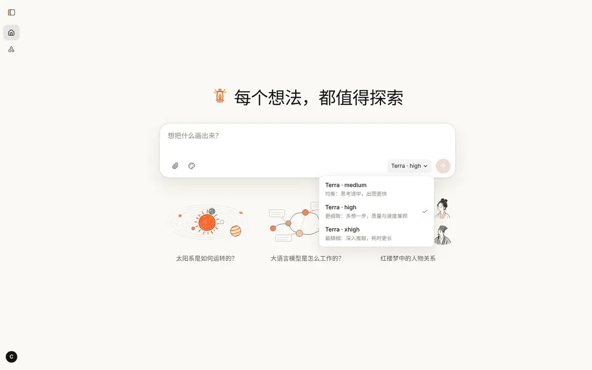<br>1. 首页：右下角选择档位 | 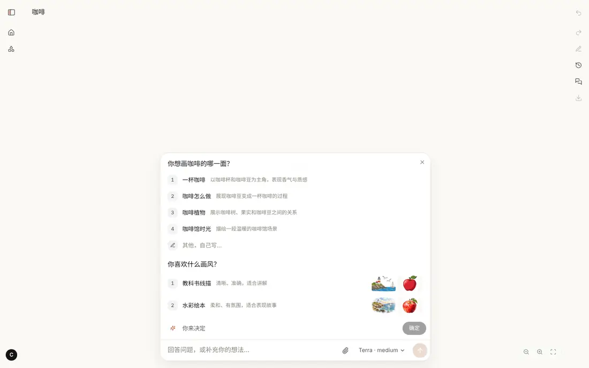<br>2. 需求模糊时，作者先提问（附画风样张） | 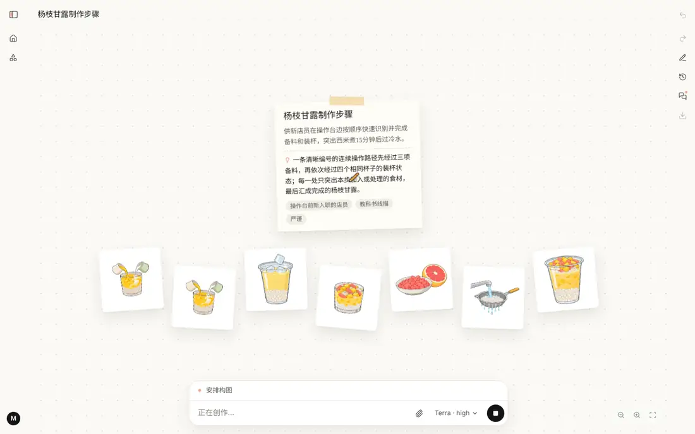<br>3. 便签写出作者的理解，图片陆续显影 | 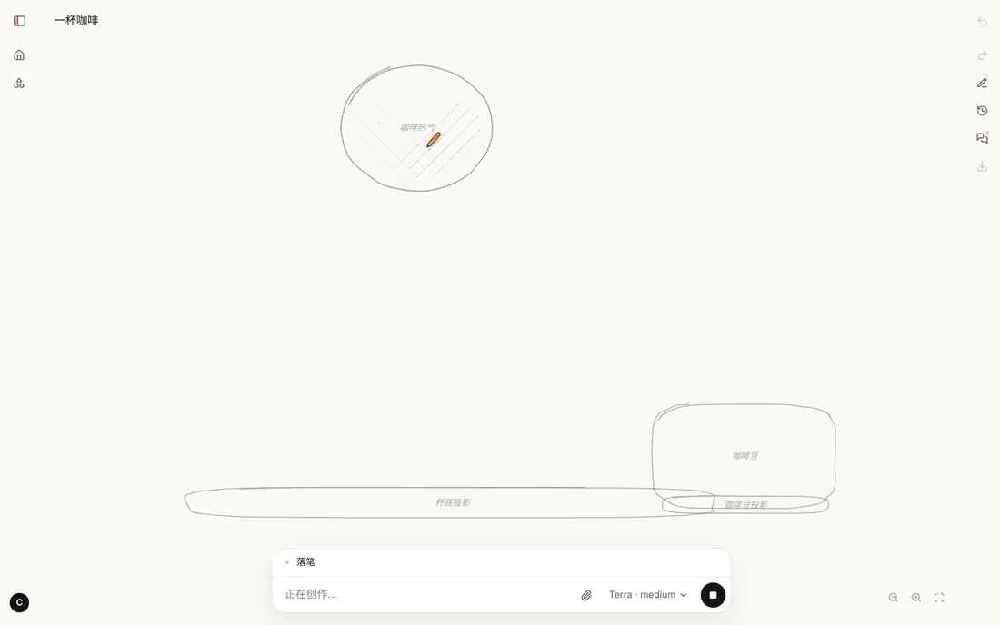<br>4. 铅笔起稿，标出每块要画什么 |
| 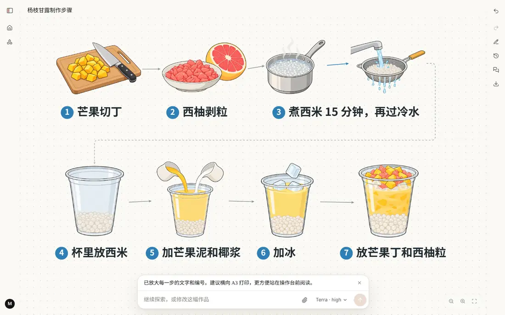<br>5. 完成，输入框上方是作者的回复 | 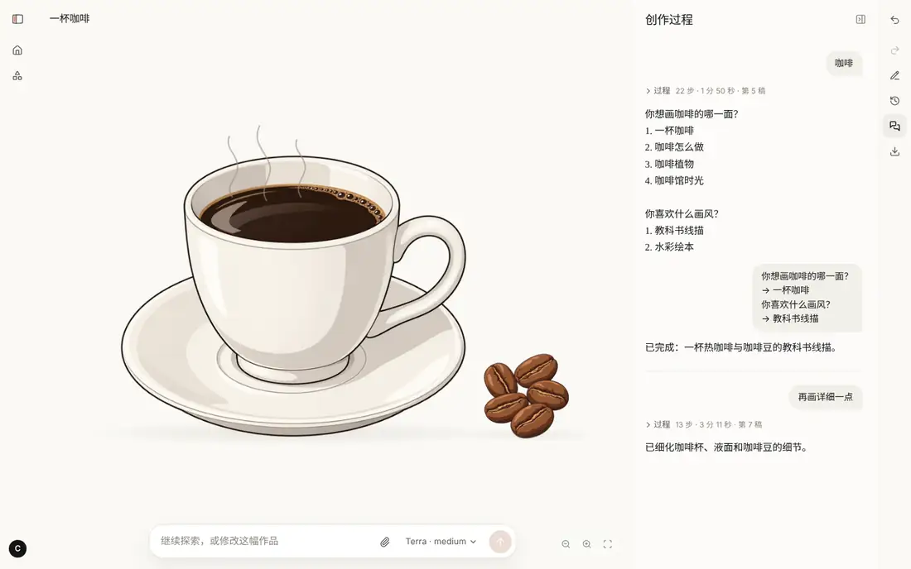<br>6. 创作过程面板：对话与每一轮的步数、用时 | 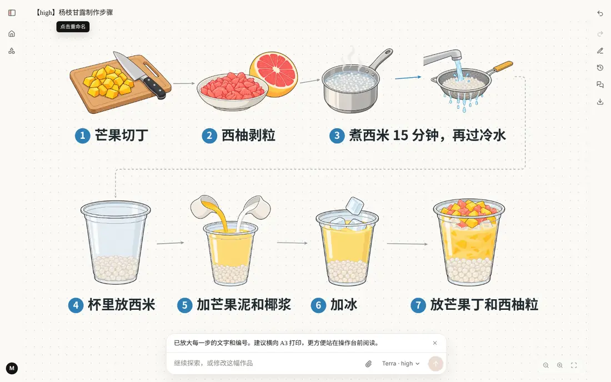<br>7. 点击标题重命名，加上档位前缀 | <br>8. 失败时的样子：画面已基本完成，但输入框显示红字 |

## 档位到底改变了什么

DrawY 的 `deliberate()` 会把两类轮次临时升到 max 推理强度：回应请求时定立意（或决定要不要提问）的那一轮，以及每次看完截图后评判的那一轮。其余写画法、改作品的执行轮，才用用户选的档位。按运行记录统计 845 个模型轮次：

| 档位 | 轮次类型 | 实际推理强度 | 轮数 | 平均推理 token | 平均输出 token | 平均每轮用时 |
|---|---|---|---|---|---|---|
| medium | 决策轮 | max | 123 | 1,345 | 1,959 | 23.4 秒 |
| medium | 执行轮 | medium | 129 | 249 | 821 | 10.6 秒 |
| high | 决策轮 | max | 131 | 1,563 | 2,247 | 26.9 秒 |
| high | 执行轮 | high | 132 | 438 | 1,066 | 13.3 秒 |
| xhigh | 决策轮 | max | 168 | 2,151 | 2,862 | 33.9 秒 |
| xhigh | 执行轮 | xhigh | 162 | 723 | 1,391 | 16.9 秒 |

- **三档的决策轮用的都是 max，但推理量并不相同。** 同样标着 max，xhigh 的决策轮平均推理 2,151 token，medium 只有 1,345。请求级的强度设置仍然在起作用。
- **执行轮的差距更大，但执行轮主要在写代码。** xhigh 的执行轮推理量约为 medium 的 2.9 倍，换来的多是更多注释文字和更细的标注，构图很少因此改变。这也是 20 个案例里三档画面经常几乎一样的原因。
- **xhigh 的轮数也更多。** 首轮平均 9.3 轮，medium 是 7.8 轮。轮数多让上下文更快变长，更容易触发会失败的压缩，这是 xhigh 失败率高的直接原因。

## 代码根因与修复方案

体验结束后，我读了运行循环、作品写入、素材取用、前端事件和存储这几块代码，并直接查询运行记录（trace.sqlite）和作品版本来核实。

### 1. 上下文压缩（P0）· `modules/agent/index.ts`

```ts
// 现状：估算把 encrypted_content 按字符算（占 42.6%），真实约 5.3 万 token 就触发
function contextSize(input) { return JSON.stringify(input, …).length / 3 }
if (size < 128000) return;
generate(store.settings().author, …, 4096, …)   // 沿用 xhigh，输出上限只有 4096

// 建议
const size = lastUsage.input_tokens + estimate(input.slice(lastSeen));   // 用真实用量
generate({ ...author, effort: "low" }, …, 16384, …);                      // 摘要不需要深度推理
try { … } catch { ctx.input = dropOldestScreenshots(ctx.input); }        // 失败时退化，不终止运行
```

证据：37 次压缩里 11 次失败；成功的压缩输出 1,515～3,945 token，已经贴近上限；触发时上一轮真实输入为 34,920～88,608 token；每次压缩用户多等约 37 秒，压缩后下一轮缓存命中从 93% 降到 76%。

### 2. 生图 ID 的 `--`（P1）· `modules/images/index.ts:219`、`modules/materials/index.ts:100`

```ts
// 现状：先去掉首尾连字符，再截断，截断点落在连字符上就剩下尾部的 "-"
.replace(/^-|-$/g, "").slice(0, 28)          →  "plastic-bottle-and-aluminum-" + "-2e8b"
const ID = /^[a-z0-9]+(?:-[a-z0-9]+)*$/;     // 不认 "--"，于是 take() 把图片移出作品

// 建议
.slice(0, 28).replace(/^-+|-+$/g, "")
const ID = /^[a-z0-9]+(?:-+[a-z0-9]+)*$/;    // QUOTED 同样改为 -+，兼容已有的旧 ID
```

证据：本次生成的图片 ID 中约 12% 带 `--`；60 个作品里 8 个出现过“素材不在作品中”的版本（c02 三档、c14 high/xhigh、c17 三档）。`materials/library.ts:356-363` 的上传 ID 有同样的写法。

### 3. 失败后的界面（P1）· `apps/web/src/Activity.tsx:140`、`modules/agent/index.ts:547`

失败时前端原样显示 `run.error`，没有“继续”入口；后端失败路径也不检查最新版本是否被看过、有没有运行错误。建议在 Run 上增加 `lastRevision` 和 `lastObservedClean`，前端据此显示“已保存到第 N 稿 · 继续完成”，或者显示“这一版可能有问题 · 恢复第 M 稿”。

### 4. 标题被覆盖（P1）· `modules/storage/index.ts:280`、`modules/workspace/index.ts`

```ts
rename(workId, title) { …UPDATE works SET data=… }          // 不留版本，作者不知道
if (edit.title !== undefined) work.title = edit.title;      // 作者每次都能覆盖

// 建议：rename 时记 work.titleByUser = true；writeWork 在 titleByUser 时忽略 edit.title
//      或在 ownChanges() 里告诉作者“用户把标题改成了 X，请保留”
```

### 5. 简报引用校验（P3）· `modules/workspace/index.ts` 的 `setBrief`

```ts
quote.split(/…|\.\.\.|\/|；|;/)                       // 现状
quote.split(/…|\.\.\.|\/|；|;|[“”「」"、\s]+/)         // 建议：引号、顿号、空格也作为分隔
```

### 6. 新场景不可见（P2）· `apps/web/src/App.tsx` 的运行事件处理

收到 `run` 事件且状态变为 completed 时，取这次运行最后一次 `write_work` 涉及的场景。如果不是当前场景，就调用 `enter(sceneId)`，或者弹出提示“新内容在「减数分裂对比」，点击查看”。

## 60 次运行一览

每格是“首轮耗时 / 该档总成本”，✕ 表示这一档有轮次失败（包括追问或补救）。

| 案例 | medium | high | xhigh |
|---|---|---|---|
| c01 分数披萨 | 89s / $0.141 | 78s / $0.088 | 201s / $0.237 |
| c02 杨枝甘露 | 275s / $1.10 | 104s / $0.123 | 314s / $0.705 |
| c03 盐与血压 | 124s / $0.176 | 131s / $0.157 | 142s / $0.281 |
| c04 宝宝辅食 | 211s / $0.707 | 341s / $0.772 | 325s / $0.821 ✕ |
| c05 双十一叠加 | 148s / $0.268 | 169s / $0.265 | 266s / $0.411 |
| c06 郑和下西洋 | 96s / $0.132 | 165s / $0.157 | 264s / $0.312 |
| c07 微服务下单 | 88s / $0.133 | 160s / $0.203 | 225s / $0.273 |
| c08 深蹲对比 | 237s / $0.412 | 201s / $0.288 | 569s / $0.631 |
| c09 房贷对比 | 190s / $0.143 | 177s / $0.144 | 299s / $0.223 |
| c10 草莓农事 | 190s / $0.257 | 284s / $0.660 | 354s / $0.308 ✕ |
| c11 有丝分裂 | 101s / $0.222 | 256s / $0.296 | 279s / $0.503 ✕ |
| c12 玄幻势力 | 139s / $0.124 | 159s / $0.149 | 211s / $0.565 |
| c13 成都美食 | 172s / $0.396 | 170s / $0.365 | 233s / $0.352 ✕ |
| c14 七步洗手 | 217s / $0.949 | 189s / $0.969 | 330s / $1.23 ✕ |
| c15 会员权益 | 69s / $0.087 | 121s / $0.120 | 120s / $0.161 |
| c16 咖啡 | 115s / $0.407 | 81s / $0.082 | 117s / $0.372 |
| c17 垃圾分类 | 246s / $1.39 | 307s / $0.766 | 297s / $1.23 ✕ |
| c18 理财入门 | 192s / $0.222 | 274s / $0.291 ✕ | 276s / $0.340 ✕ |
| c19 民诉流程 | 172s / $0.183 | 246s / $0.292 | 240s / $0.327 ✕ |
| c20 US 申请 | 149s / $0.117 | 183s / $0.154 | 436s / $0.300 |

## 方法与口径

- **部署：** 按 AGENTS.md 在本地起素材服务、截图服务和主程序（Node 25）。唯一的环境适配是让截图服务使用容器里预装的 Chromium；PlantUML 服务未启动，60 次运行都没有用到它。
- **模型配置：** 管理员账号接入三个绘制模型“Terra · medium / high / xhigh”，都是 gpt-6.1-terra，只有推理强度不同，用户在输入框右下角选择。
- **用户：** 20 个独立账号，每人一个身份。同一个人依次用 medium → high → xhigh 画同一个需求（每档一个新作品）。所以 high/xhigh 常常复用 medium 生成过的私人素材，生图成本偏低，三档之间并不完全独立。
- **操作：** Playwright 驱动真实界面：选模型、打字、按回车；遇到提问按这个人的习惯回答（点“你来决定”、选第 1 项或自己写）；成品出来后提一次修改；失败时像真人一样说“继续”；最后点击标题加上【档位】前缀。创作期间每 12 秒截一张图。
- **耗时：** 从按下发送到运行结束、用户在界面上看到结果的实际等待时间。“首个画面”是运行开始后第一次出现构图草稿的时间。
- **成本：** token 用量取自 DrawY 运行记录。gpt-6.1-terra 按标准价：输入 $1/M、缓存输入 $0.05/M、输出 $5/M（推理计入输出）。平均缓存命中约 83%。生图走 ChatGPT 账号通道，实际不按次计费；为便于比较，按官方 $30/M 图像输出 token 估算，每张约 $0.06。
- **评估：** 每一张成品都看过，并把三档截图拼成对照图逐一比较。涉及数字、法规、医学、地理、规则的内容，都按公式或公开规定复核过。

价格来源：[GPT-6.1 Terra Pricing（Apidog）](https://apidog.com/blog/gpt-6-1-terra-pricing/)、[Eden AI](https://www.edenai.co/models/gpt-6-1-terra)、[OpenAI · GPT Image 2.5 Flare](https://developers.openai.com/api/docs/models/gpt-image-2.5-flare)。

---

<a id="c01"></a>

## 01 小学数学：为什么 1/3 比 1/2 小

**王老师 · 小学三年级数学老师**

> **第一句话：** 明天要给三年级小朋友讲分数，他们老是搞不懂为什么1/3比1/2小，分母大了反而小？？帮我画个图，披萨或者蛋糕那种，孩子一看就懂的
>
> **看完后的追问：** 能不能再加一个1/4的，让孩子看出来分得越多每块越小

| 档位 | 各轮耗时（用户实际等待） | 首个画面 | 输入 token / 缓存命中 | 输出 / 其中推理 | 新生图 | 模型费 | 合计（含生图估算） |
|---|---|---|---|---|---|---|---|
| medium | 首轮 1分29秒 · 追问 47秒 | 47秒 | 220k / 85% | 7.6k / 3.8k | 1 | $0.081 | **$0.141** |
| high | 首轮 1分18秒 · 追问 42秒 | 1分02秒 | 179k / 81% | 9.3k / 5.5k | 0 | $0.088 | **$0.088** |
| xhigh | 首轮 3分21秒 · 追问 1分09秒 | 1分35秒 | 446k / 88% | 20.9k / 13.3k | 1 | $0.177 | **$0.237** |

- **medium**：最快（首轮 89s），画面已经足够上课用
- **high**：与 medium 几乎一样，复用了 medium 生成的披萨图，成本最低
- **xhigh**：多出"同样大/各取 1 份"的说明，教学味更足，但耗时 2.3 倍

### 截图：用户实际看到的过程

| medium<br><sub>【medium】同样大的披萨，分得越多每份越小</sub> | high<br><sub>【high】同样大的披萨，分得越多每份越小</sub> | xhigh<br><sub>【xhigh】披萨里的二分之一、三分之一和四分之一</sub> |
|---|---|---|
| 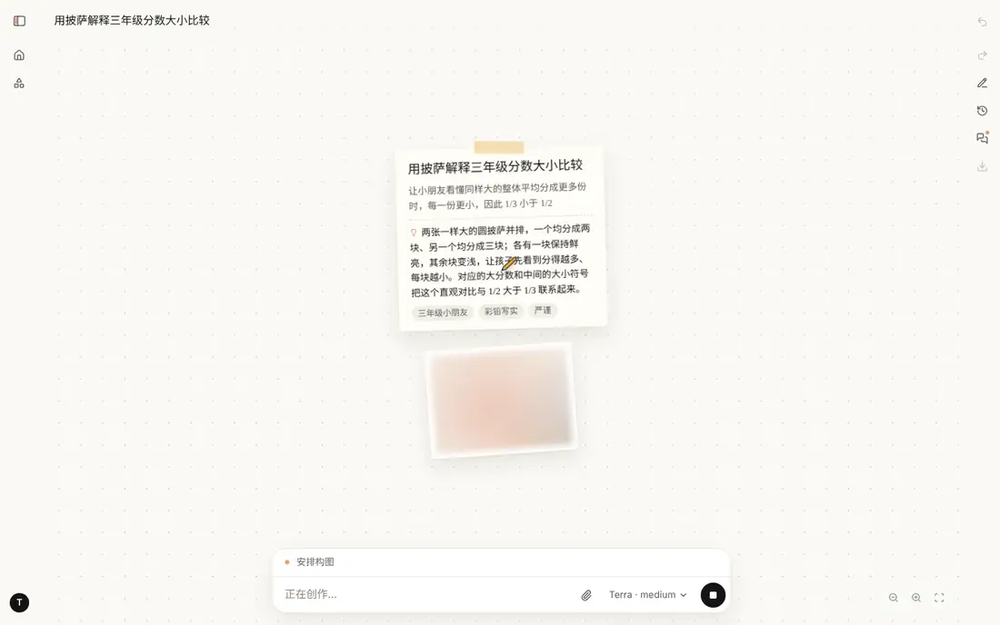<br><sub>创作中 · 28s</sub> | 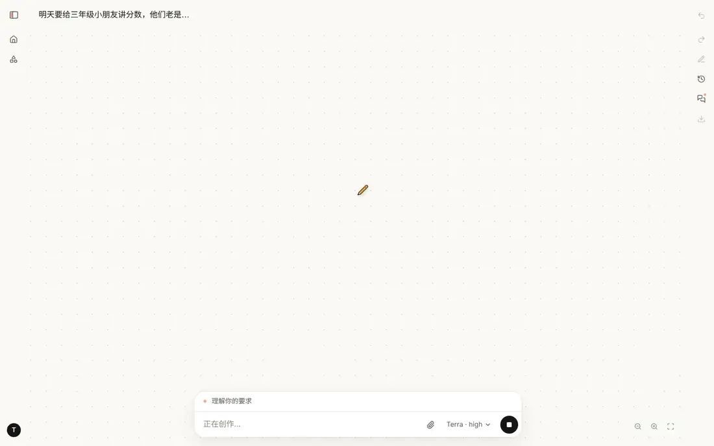<br><sub>创作中 · 15s</sub> | 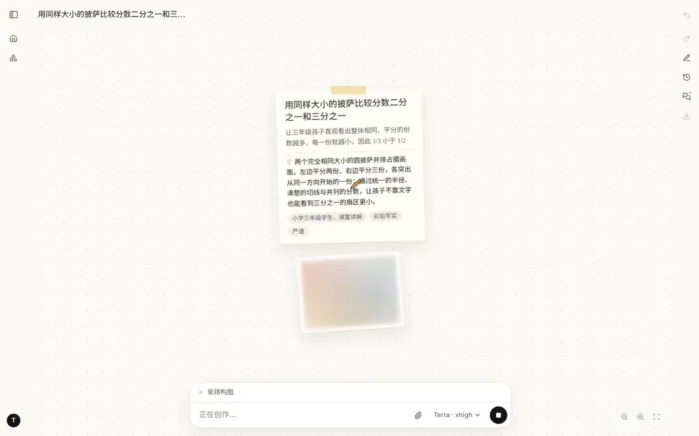<br><sub>创作中 · 53s</sub> |
| 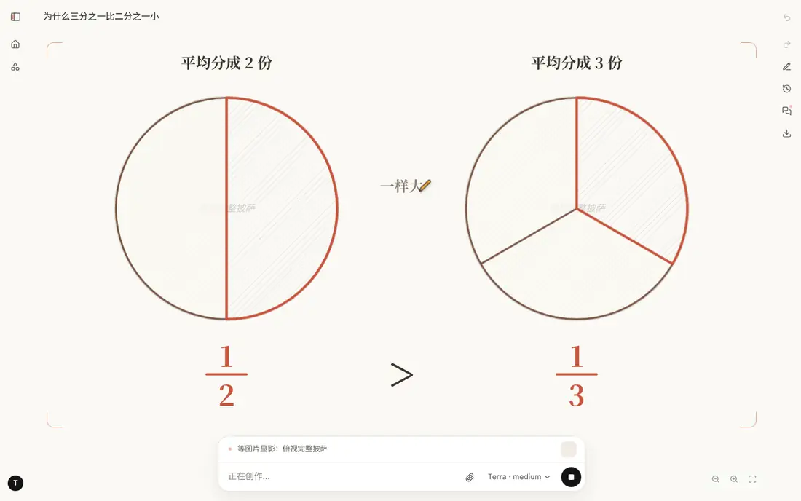<br><sub>创作中 · 53s</sub> | 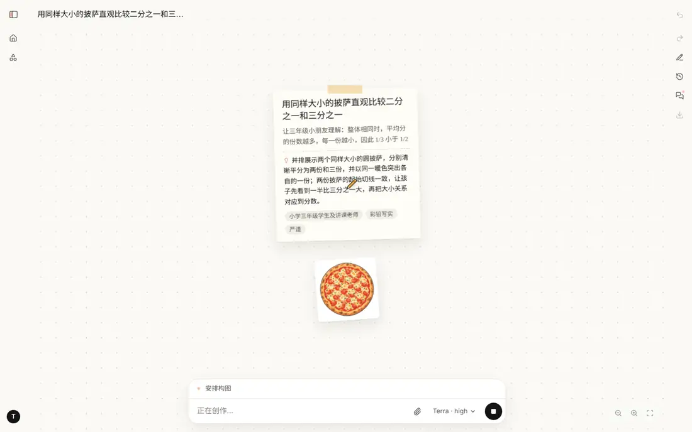<br><sub>创作中 · 41s</sub> | 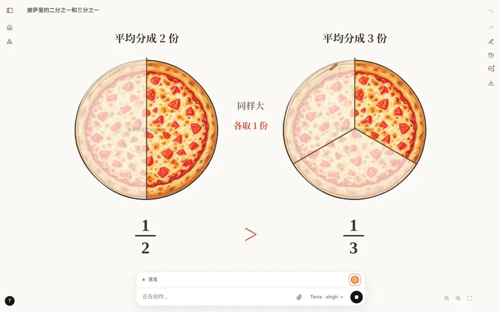<br><sub>创作中 · 130s</sub> |
| 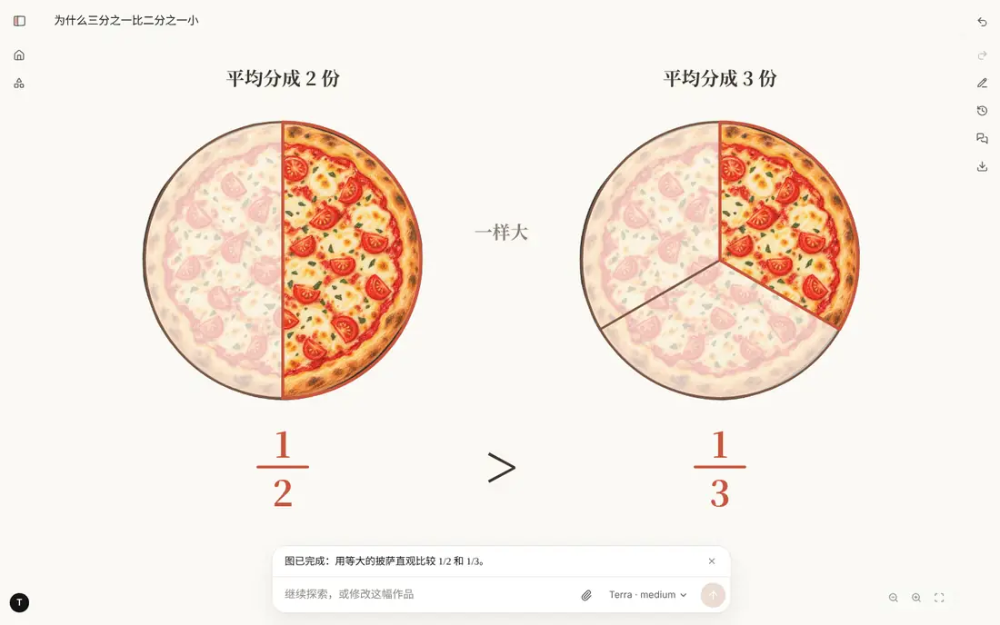<br><sub>首轮成品</sub> | 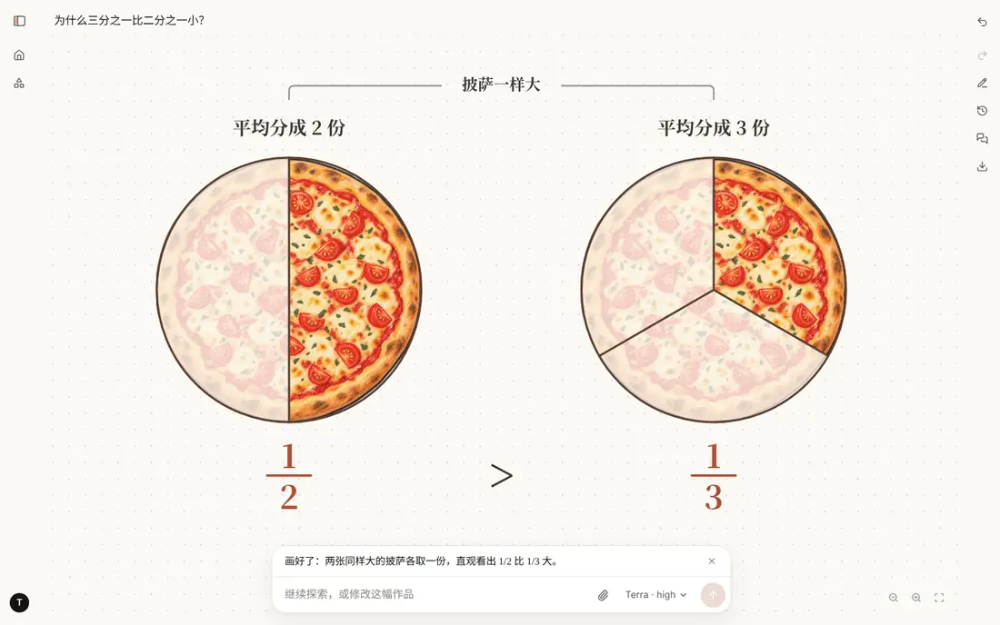<br><sub>首轮成品</sub> | 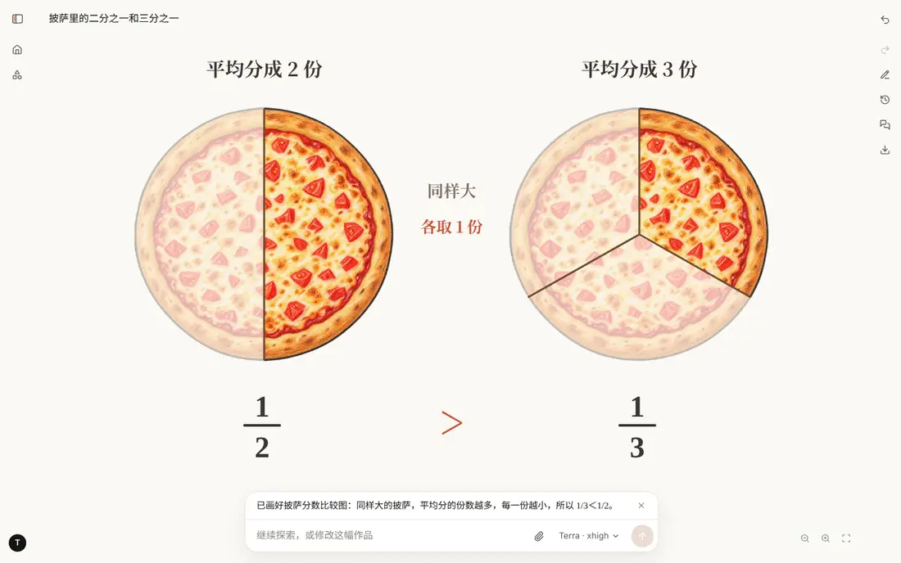<br><sub>首轮成品</sub> |
| 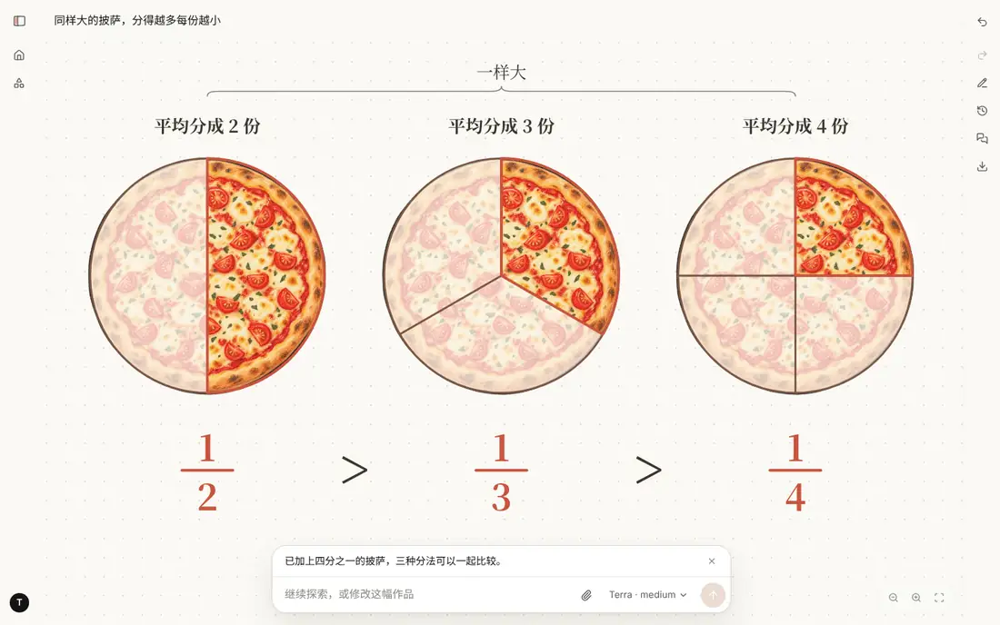<br><sub>最后一轮成品</sub> | 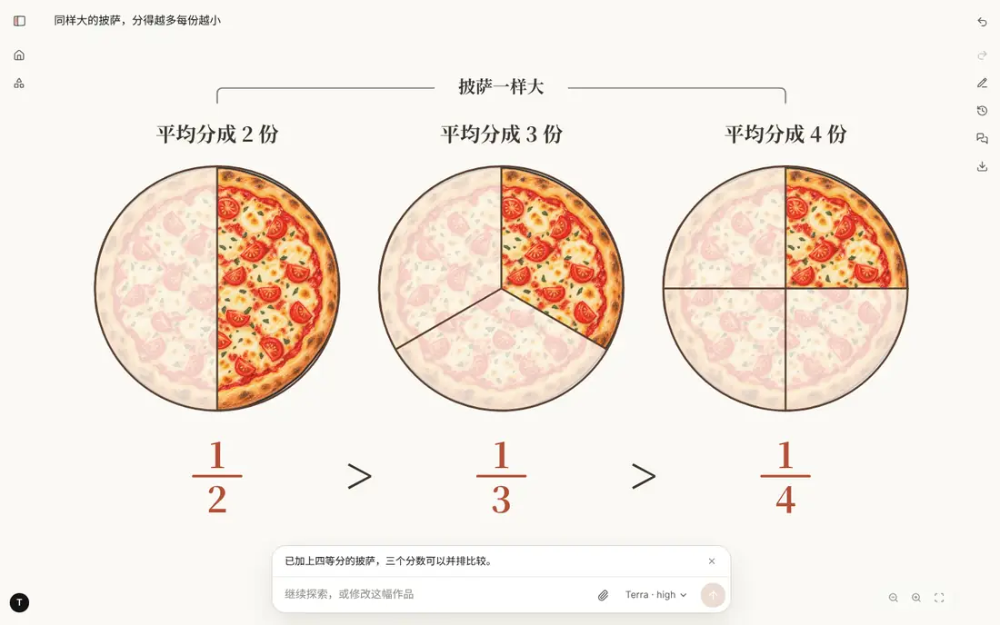<br><sub>最后一轮成品</sub> | 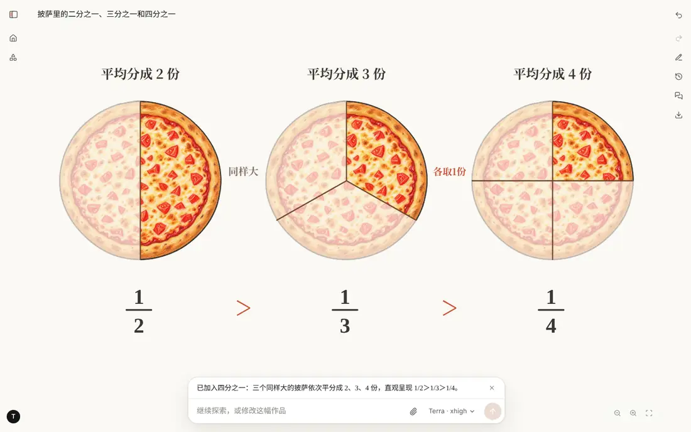<br><sub>最后一轮成品</sub> |

|   |   |   |
|---|---|---|
| 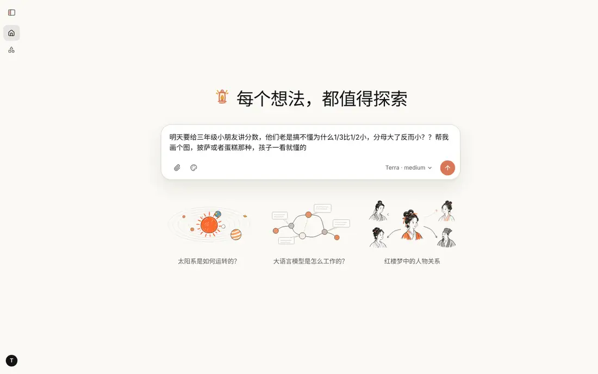<br><sub>首页：选模型、输入需求</sub> | 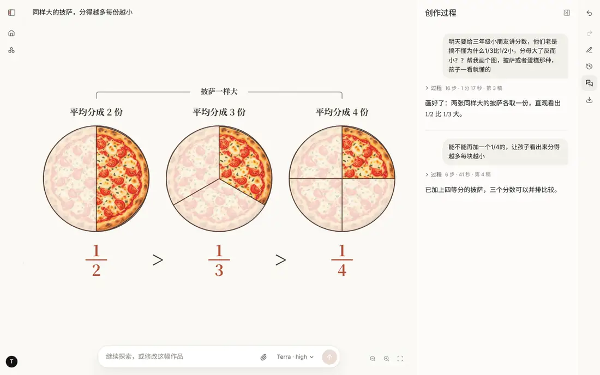<br><sub>创作过程面板（high）</sub> | 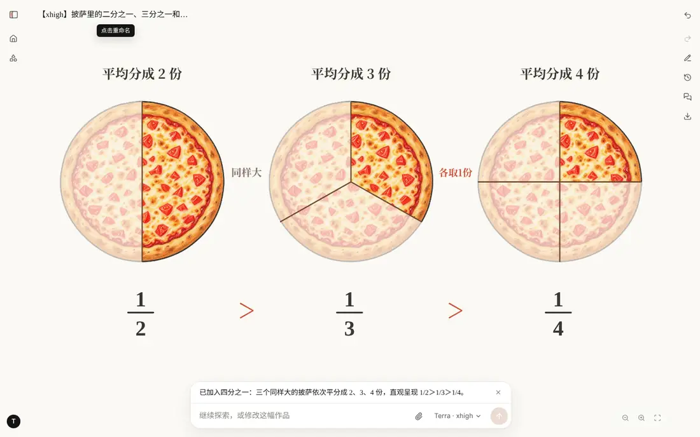<br><sub>手动加上档位前缀后的标题（xhigh）</sub> |

### 作者提问与用户回答

三档都没有提问，直接开画。

### 作者给出的最后一句话

- **medium** — 首轮：图已完成：用等大的披萨直观比较 1/2 和 1/3。<br>追问：已加上四分之一的披萨，三种分法可以一起比较。
- **high** — 首轮：画好了：两张同样大的披萨各取一份，直观看出 1/2 比 1/3 大。<br>追问：已加上四等分的披萨，三个分数可以并排比较。
- **xhigh** — 首轮：已画好披萨分数比较图：同样大的披萨，平均分的份数越多，每一份越小，所以 1/3＜1/2。<br>追问：已加入四分之一：三个同样大的披萨依次平分成 2、3、4 份，直观呈现 1/2＞1/3＞1/4。

### 作者的立意

- **medium**（风格 colored-pencil · 语域 formal）：两张一样大的圆披萨并排，一个均分成两块、另一个均分成三块；各有一块保持鲜亮，其余块变浅，让孩子先看到分得越多、每块越小。对应的大分数和中间的大小符号把这个直观对比与 1/2 大于 1/3 联系起来。
  - 想过的画法：把两个一样大的披萨分别平均分成两份和三份，各突出其中一份，让份数和每份大小同时可见。
  - 想过的画法：把同样大小披萨的一半和三分之一扇形从相同边缘对齐叠放，用真实面积直接比较。
  - 想过的画法：用两个小朋友各分同样大的披萨，分别分给两人和三人，让分到的一块体现差异。
- **high**（风格 colored-pencil · 语域 formal）：并排展示两个同样大小的圆披萨，分别清晰平分为两份和三份，并以同一暖色突出各自的一份；两份披萨的起始切线一致，让孩子先看到一半比三分之一大，再把大小关系对应到分数。
  - 想过的画法：将两个同样大小的披萨分别平分成两份和三份，各突出其中一份，用面积直接比较。
  - 想过的画法：从同一个圆出发叠合二等分与三等分的一份，让共同部分和多出来的面积说明大小差。
  - 想过的画法：在同一条数轴上标出三分之一和二分之一，以左右位置表示大小。
- **xhigh**（风格 colored-pencil · 语域 formal）：两个完全相同大小的圆披萨并排占据画面，左边平分两份、右边平分三份，各突出从同一方向开始的一份；通过统一的半径、清楚的切线与并列的分数，让孩子不靠文字也能看到三分之一的扇区更小。
  - 想过的画法：把两个完全一样大的圆形披萨并排放置，分别准确平分为两份和三份，各突出一份，直接比较扇形面积。
  - 想过的画法：同一个披萨从平分两份变成平分三份，用对应的切口和一份的大小变化表现分得越细每份越小。
  - 想过的画法：把一个披萨的一半与三分之一画成共用中心和起始边的扇区，用角度和面积的嵌套说明大小。

### 我的体验

- 需求说得很清楚（三年级、1/3 和 1/2、披萨），三档都没有多问，直接开画，这是对的。
- 起稿阶段先在纸上钉出一张便签写着"给三年级小朋友、同样大的披萨"，老师能马上确认"它懂我了"。
- 成品：两块同样大的披萨，一块对半、一块三等分，各取一份上色，下面是大号 1/2 > 1/3。这正是数学老师会在黑板上画的样子，但更好看。
- 追问"加一个 1/4"：三档都顺势扩成三块披萨 + 1/2 > 1/3 > 1/4，medium/high 还加了顶部大括号"一样大"，把"整体相同"这个关键前提画了出来。

### 我的思考

这是 DrawY 的"甜蜜区"：概念清楚、视觉隐喻明确、元素少。三档质量差距很小，xhigh 的额外推理主要变成了更多标注文字，对 8 岁孩子反而是负担。这类需求应当默认用 medium。

### 优化建议

1. 对"给小朋友看"的请求，建议作者主动提供"去掉文字版/投影版"——课堂投影时说明文字越少越好。
2. 首页可以给教师类用户一个"课堂投影 16:9 / 打印 A4"的出图比例选项。
3. 1/4 披萨的十字分割线略偏，图像素材 + 矢量分割线叠加时应对齐圆心（可在画法里按图片可见内容框计算圆心）。

---

<a id="c02"></a>

## 02 奶茶店：杨枝甘露制作步骤

**阿杰 · 奶茶店老板**

> **第一句话：** 新招的店员老记不住杨枝甘露怎么做，帮我画个制作步骤图贴在操作台上。步骤是：芒果切丁、西柚剥粒、煮西米15分钟过冷水、杯里放西米、加芒果泥和椰浆、加冰、最后放芒果丁和西柚粒。要清楚不要花里胡哨
>
> **看完后的追问：** 每一步的字再大一点，站着离一米也能看清

| 档位 | 各轮耗时（用户实际等待） | 首个画面 | 输入 token / 缓存命中 | 输出 / 其中推理 | 新生图 | 模型费 | 合计（含生图估算） |
|---|---|---|---|---|---|---|---|
| medium | 首轮 4分35秒 · 追问 57秒 | 1分36秒 | 654k / 90% | 21.8k / 8.2k | 15 | $0.201 | **$1.10** |
| high | 首轮 1分44秒 · 追问 49秒 | 1分18秒 | 461k / 89% | 10.8k / 7.3k | 0 | $0.123 | **$0.123** |
| xhigh | 首轮 5分14秒 · 追问 1分45秒 | 1分44秒 | 658k / 89% | 24.6k / 13.3k | 8 | $0.225 | **$0.705** |

- **medium**：生成 15 张步骤插图，首轮 275s，图片费占大头
- **high**：0 张新图（全部复用），104s、$0.12，性价比最高
- **xhigh**：画面最精致（补了舀西米、倒椰浆的动作图），但"过冷水"没编号

### 截图：用户实际看到的过程

| medium<br><sub>【medium】杨枝甘露制作步骤</sub> | high<br><sub>【high】杨枝甘露制作步骤</sub> | xhigh<br><sub>【xhigh】杨枝甘露制作步骤</sub> |
|---|---|---|
| 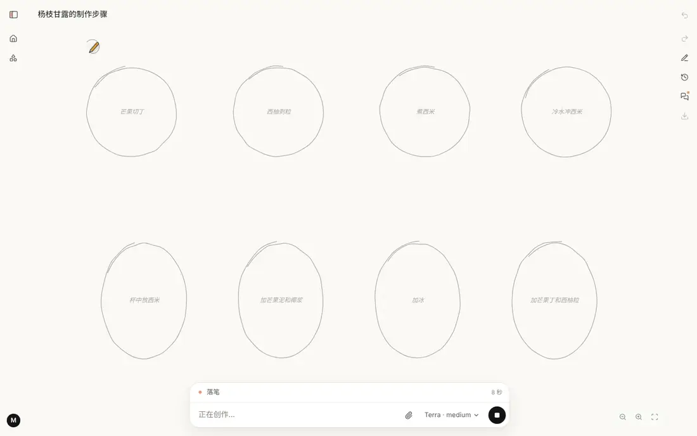<br><sub>创作中 · 79s</sub> | <br><sub>创作中 · 28s</sub> | 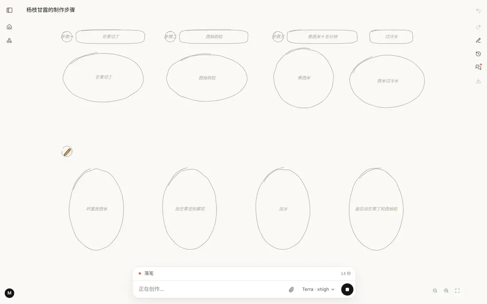<br><sub>创作中 · 92s</sub> |
| 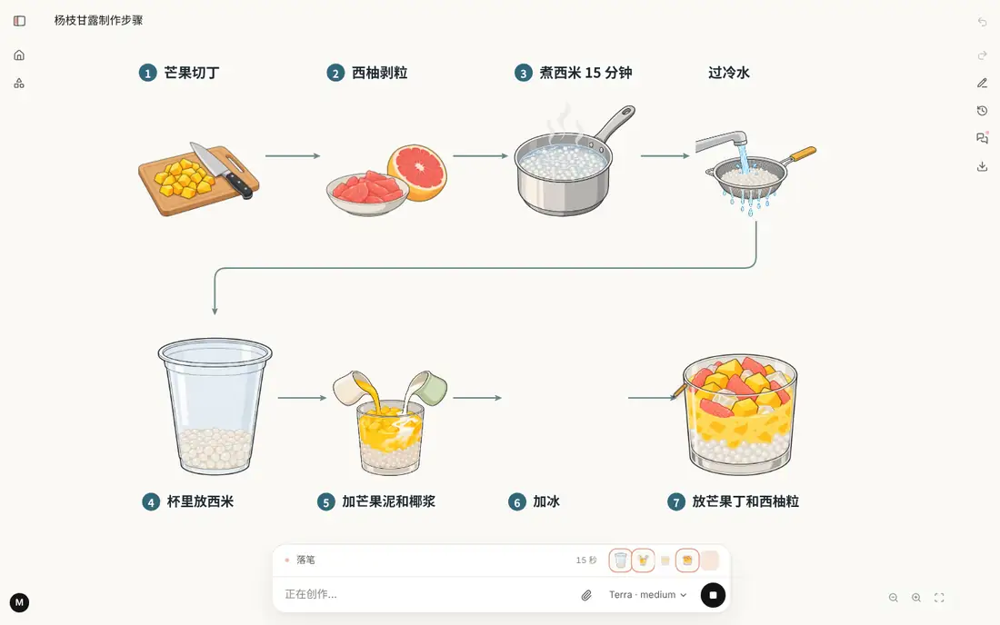<br><sub>创作中 · 182s</sub> | 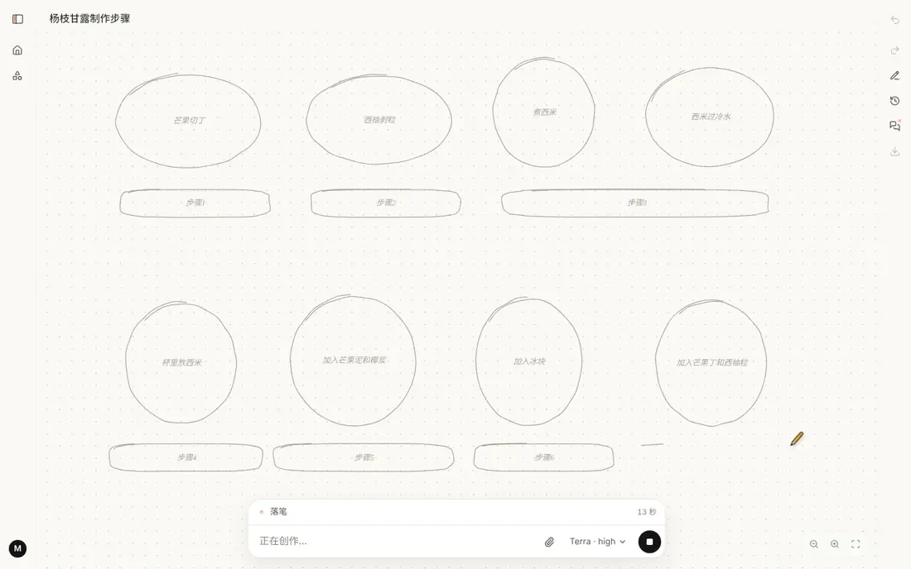<br><sub>创作中 · 66s</sub> | 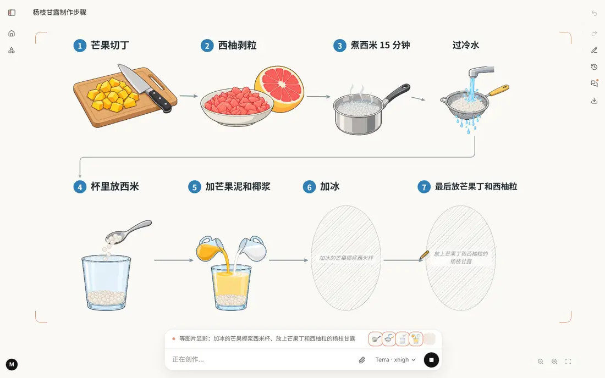<br><sub>创作中 · 207s</sub> |
| 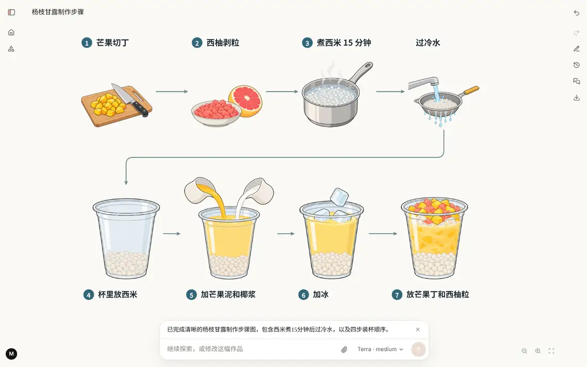<br><sub>首轮成品</sub> | 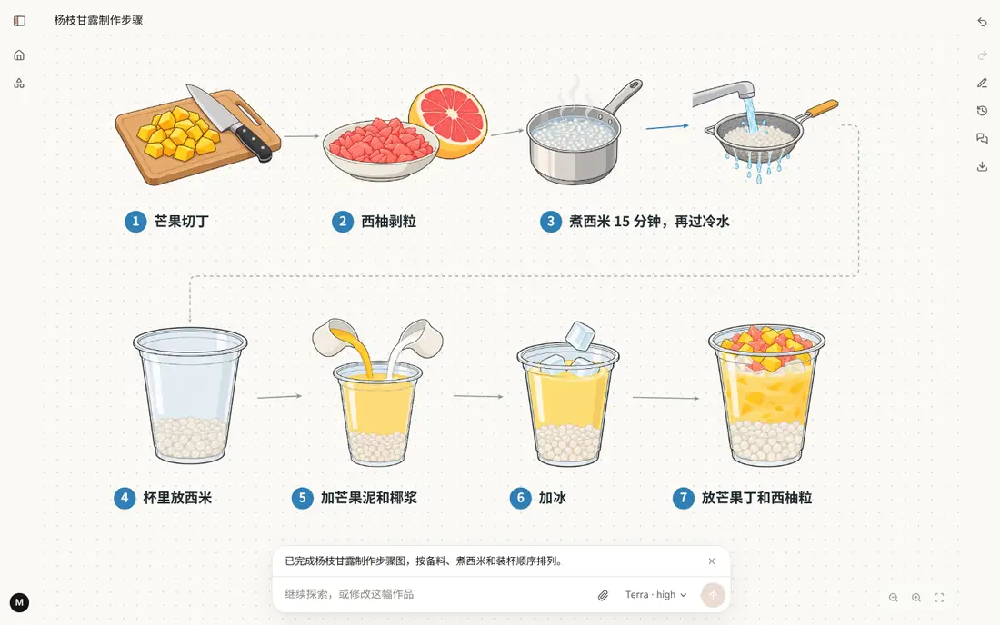<br><sub>首轮成品</sub> | 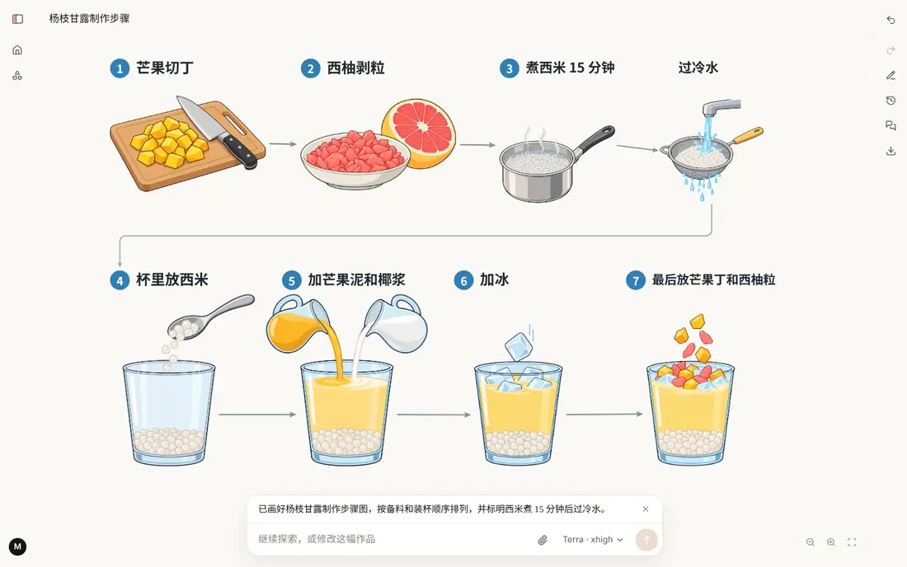<br><sub>首轮成品</sub> |
| 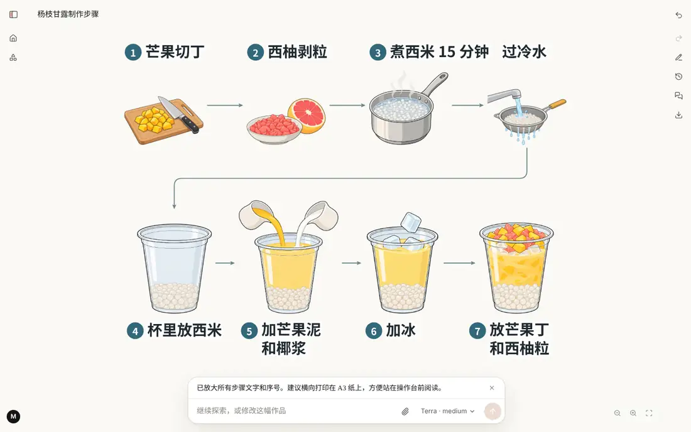<br><sub>最后一轮成品</sub> | <br><sub>最后一轮成品</sub> | 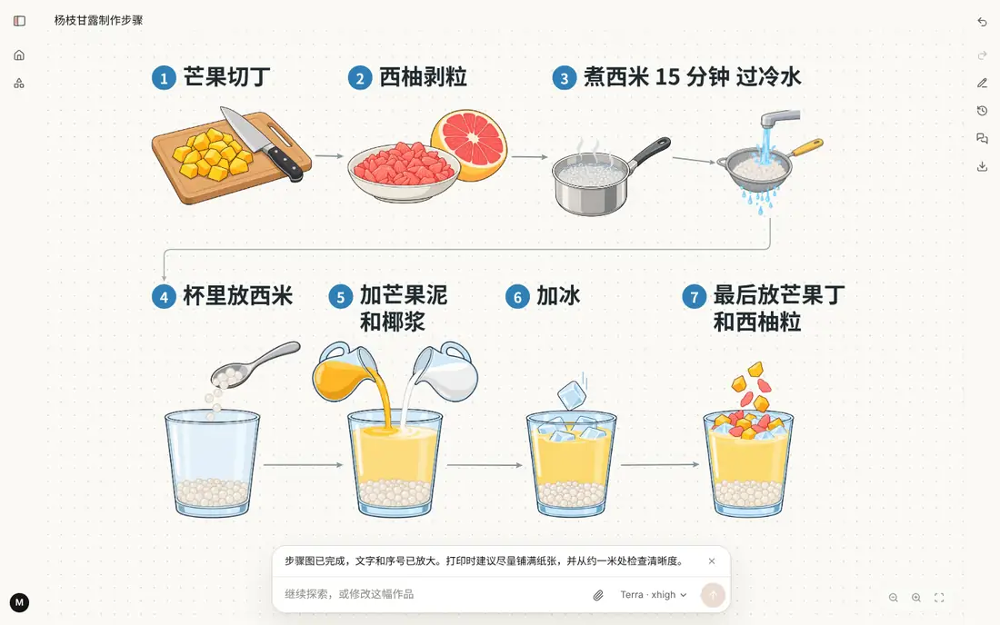<br><sub>最后一轮成品</sub> |

|   |   |   |
|---|---|---|
| 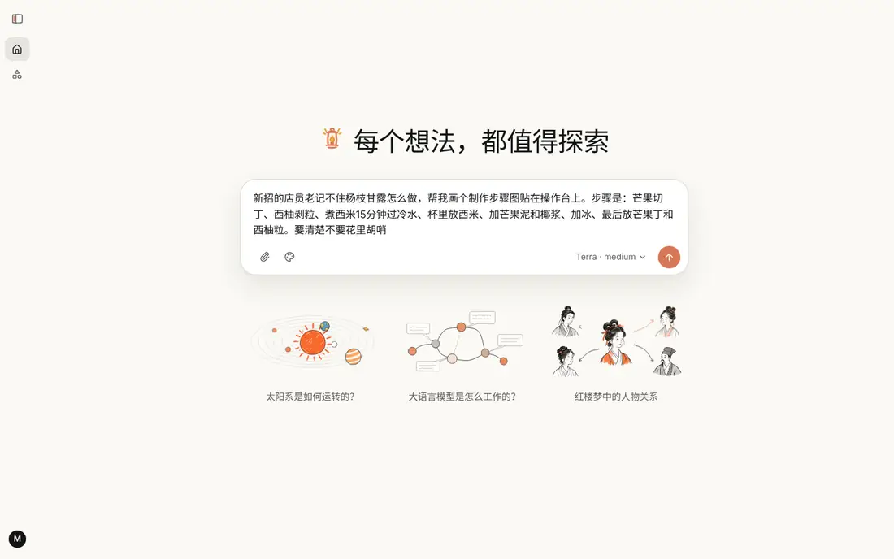<br><sub>首页：选模型、输入需求</sub> | 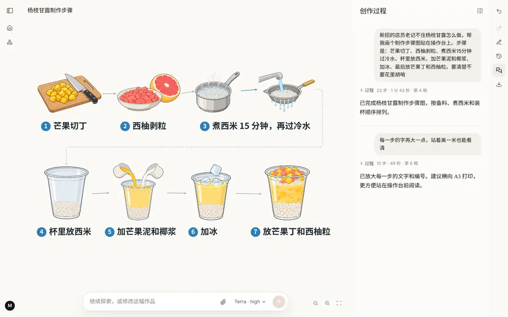<br><sub>创作过程面板（high）</sub> | 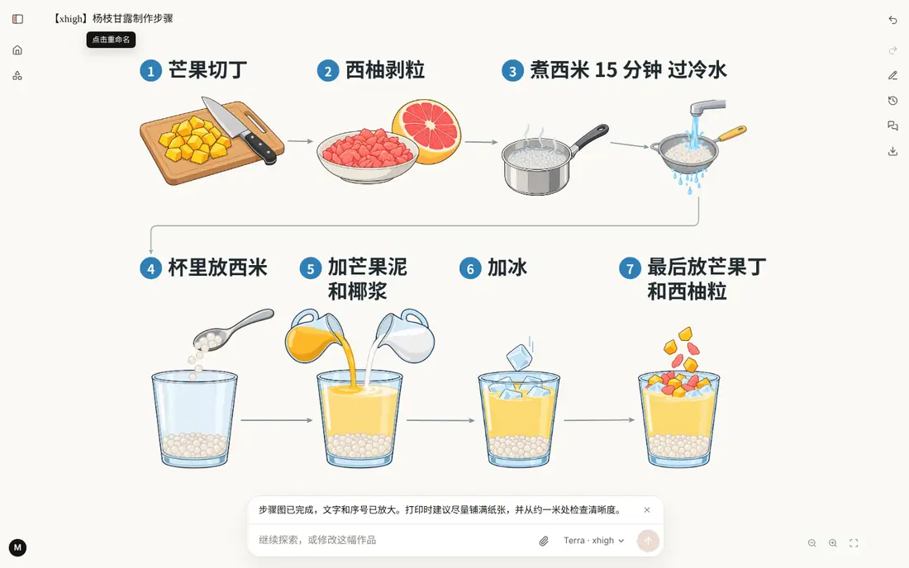<br><sub>手动加上档位前缀后的标题（xhigh）</sub> |

### 作者提问与用户回答

三档都没有提问，直接开画。

### 作者给出的最后一句话

- **medium** — 首轮：已完成清晰的杨枝甘露制作步骤图，包含西米煮15分钟后过冷水，以及四步装杯顺序。<br>追问：已放大所有步骤文字和序号。建议横向打印在 A3 纸上，方便站在操作台前阅读。
- **high** — 首轮：已完成杨枝甘露制作步骤图，按备料、煮西米和装杯顺序排列。<br>追问：已放大每一步的文字和编号。建议横向 A3 打印，更方便站在操作台前阅读。
- **xhigh** — 首轮：已画好杨枝甘露制作步骤图，按备料和装杯顺序排列，并标明西米煮 15 分钟后过冷水。<br>追问：步骤图已完成，文字和序号已放大。打印时建议尽量铺满纸张，并从约一米处检查清晰度。

### 作者的立意

- **medium**（风格 textbook · 语域 formal）：以一条七步的可追踪路径贯穿整个画面：先沿上方依次准备芒果、西柚和西米，再沿下方从左到右逐杯完成装配；每个步骤紧挨对应动作，西米的煮制与冷水处理明确相连。
  - 想过的画法：把备料到装杯画成连续的编号路径，杯子依次增加西米、芒果泥和椰浆、冰及果粒。
  - 想过的画法：以一杯完成的杨枝甘露为主体，分解显示西米、果泥椰浆、冰和果粒的位置，并在旁边交代备料。
  - 想过的画法：用七个编号步骤和短文字顺序排列制作过程。
- **high**（风格 textbook · 语域 formal）：一条清晰编号的连续操作路径先经过三项备料，再依次经过四个相同杯子的装杯状态；每一处只突出本步加入或处理的食材，最后汇成完成的杨枝甘露。
  - 想过的画法：用七个编号的操作动作和箭头逐项展示从备料到装杯的顺序。
  - 想过的画法：让芒果、西柚和西米沿操作路径进入同一只逐步装满的杯子，直观看见每一步新增的东西。
  - 想过的画法：突出同一只杯子从空杯到成品的连续变化，把前置备料动作放在杯子之前。
- **xhigh**（风格 textbook · 语域 formal）：上排从左到右依次处理芒果、西柚和西米，其中西米的煮制与冷水冲洗用小箭头衔接；路径回到左下方，四只相同的透明杯从左到右逐步增加西米、芒果泥和椰浆、冰以及最后的水果粒，借杯中变化直接显示制作顺序。
  - 想过的画法：沿一条编号路径先处理两种水果和西米，再用一系列透明杯展示西米、果泥椰浆、冰和果粒的逐次加入。
  - 想过的画法：以完成的杨枝甘露透明杯为主角，分解杯中原料并用路径连接左侧的备料动作。
  - 想过的画法：把七个操作按编号排成紧凑的步骤图，每个动作对应一幅清晰插图。

### 我的体验

- 奶茶店老板给了完整的 7 步，作者没有提问，直接排成"上 4 下 4"的蛇形流程，每步一张统一画风的插图 + 圆形编号 + 粗体动作词，贴在操作台很合适。
- 起稿时空白纸上先钉出便签（受众：操作台前新入职的店员；风格：教科书线描；语域：严谨），随后 7 张图片像照片一样一张张显影——这个过程本身很有观赏性。
- 追问"字再大一点，站着一米也能看清"：三档都放大了文字，并主动回复"建议横向 A3 打印"，这句话很贴心，是懂场景的表现。
- 创作过程中，三档都出现过某张步骤图突然变成红色报错小字的版本（例如"加冰"那张，ID 是 g-adding-ice-cubes-to-dessert--c45f）。这是生图 ID 带 "--" 的 bug（见关键问题 P1），作者看图后补回了图片，但多花了轮次，用户也会看到画面闪过报错。
- 瑕疵：medium 和 xhigh 里"过冷水"是第 3 步之后的一个无编号格子，新员工会疑惑它算不算一步；high 把它合并成"③ 煮西米 15 分钟，再过冷水"，最准确。

### 我的思考

同一个用户第二、三次画同一题材时，作者会在素材库里找到自己之前生成的私人图片并直接复用（high 0 张新图），成本从 $1.10 降到 $0.12。这是 DrawY 素材库设计的真实红利，但也让三档对比不完全独立。对小商家来说，"做一次图、以后改字就行"的体验非常值钱。

### 优化建议

1. 用户给出编号步骤时，作者应保持"用户的步数 = 画面的编号数"，不要拆出无编号的中间格（可在看图评判时加一条：编号与用户列出的步骤一一对应）。
2. 给"贴墙/打印"类请求提供一键"打印版"导出（A3/A4、出血、加粗字号）。
3. 把"复用了你之前的 N 张图，节省了约 X 元/秒"显示给用户，让用户感知素材库价值。

---

<a id="c03"></a>

## 03 退休大爷：盐吃多了为什么血压高

**李大爷 · 68 岁退休工人，高血压**

> **第一句话：** 医生说我血压高要少吃盐 我想知道盐吃多了为什么血压就高了 给我画个图看看 字大点 我眼神不好
>
> **看完后的追问：** 那我平时一天吃多少盐合适 也画上

| 档位 | 各轮耗时（用户实际等待） | 首个画面 | 输入 token / 缓存命中 | 输出 / 其中推理 | 新生图 | 模型费 | 合计（含生图估算） |
|---|---|---|---|---|---|---|---|
| medium | 首轮 2分04秒 · 追问 1分02秒 | 59秒 | 348k / 88% | 11.8k / 6.6k | 1 | $0.116 | **$0.176** |
| high | 首轮 2分11秒 · 追问 1分35秒 | 1分16秒 | 364k / 87% | 18.4k / 12.6k | 0 | $0.157 | **$0.157** |
| xhigh | 首轮 2分22秒 · 追问 1分32秒 | 1分19秒 | 392k / 87% | 18.7k / 11.7k | 2 | $0.161 | **$0.281** |

- **medium**：盐→留水→血量增加→血管壁受压，清楚
- **high**：同样的链条，多了"钠也吃多了"
- **xhigh**：加入"肾脏调节"一环，医学上最完整

### 截图：用户实际看到的过程

| medium<br><sub>【medium】盐吃多了为什么会升高血压</sub> | high<br><sub>【high】盐吃多了，为什么血压容易升高？</sub> | xhigh<br><sub>【xhigh】盐吃多了为什么容易升高血压</sub> |
|---|---|---|
| 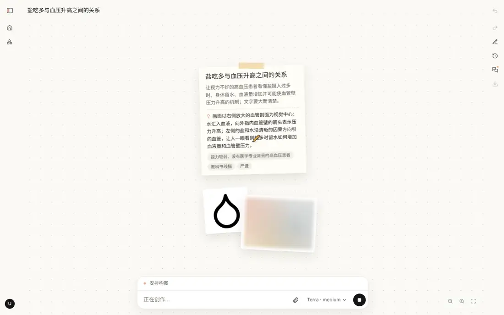<br><sub>创作中 · 41s</sub> | 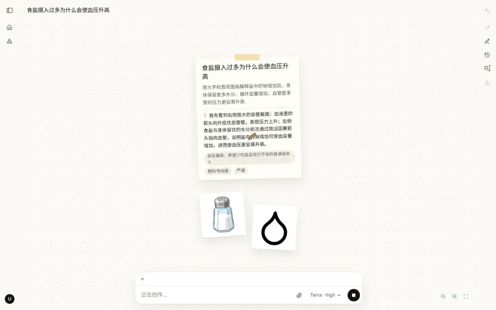<br><sub>创作中 · 41s</sub> | 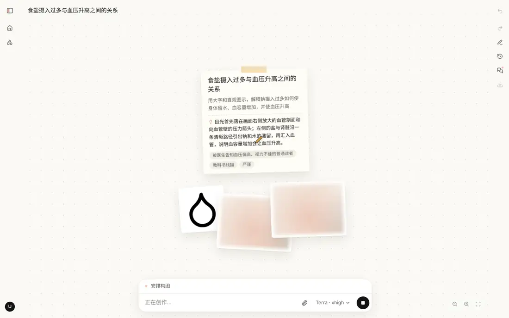<br><sub>创作中 · 41s</sub> |
| 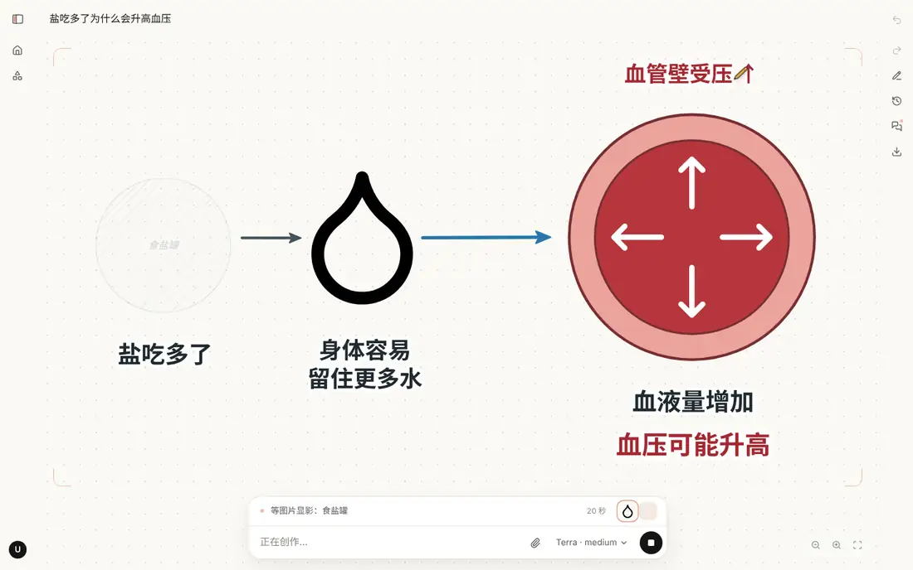<br><sub>创作中 · 79s</sub> | 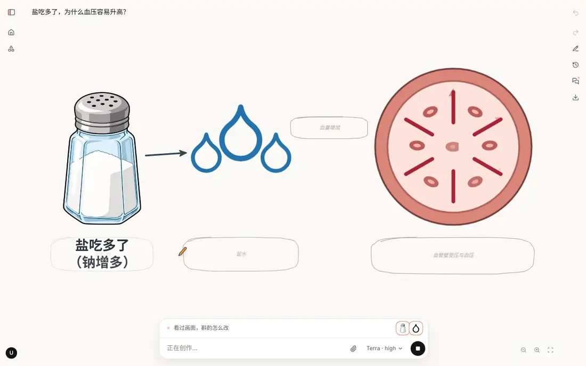<br><sub>创作中 · 79s</sub> | 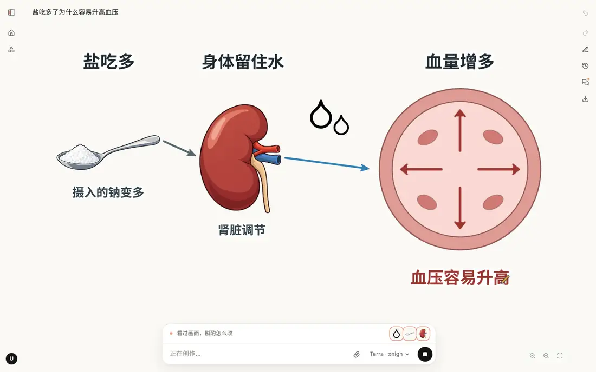<br><sub>创作中 · 92s</sub> |
| 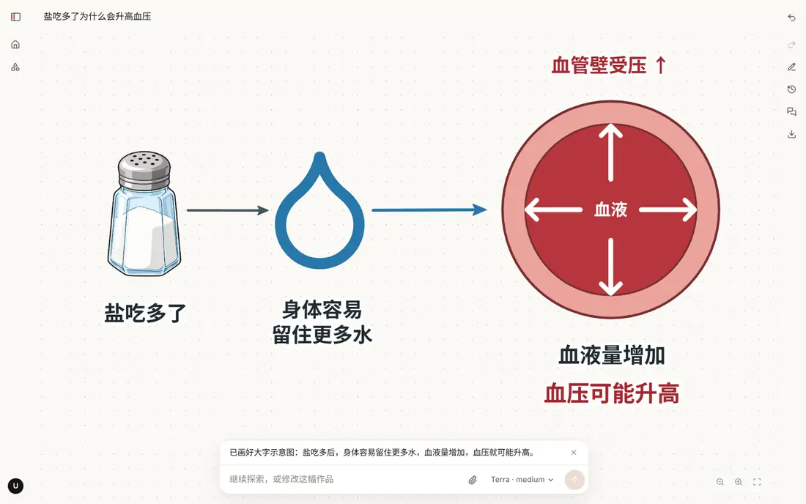<br><sub>首轮成品</sub> | 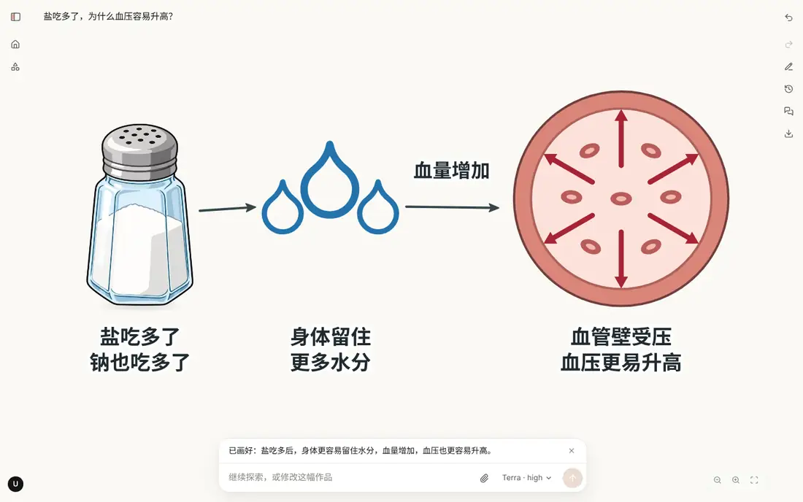<br><sub>首轮成品</sub> | 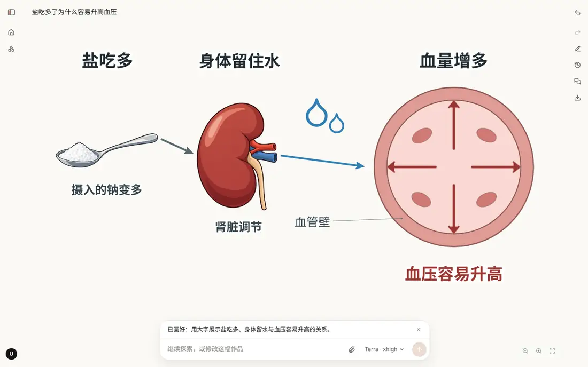<br><sub>首轮成品</sub> |
| 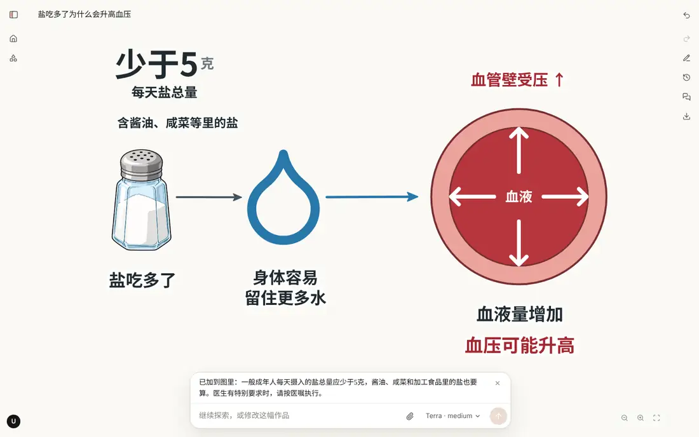<br><sub>最后一轮成品</sub> | 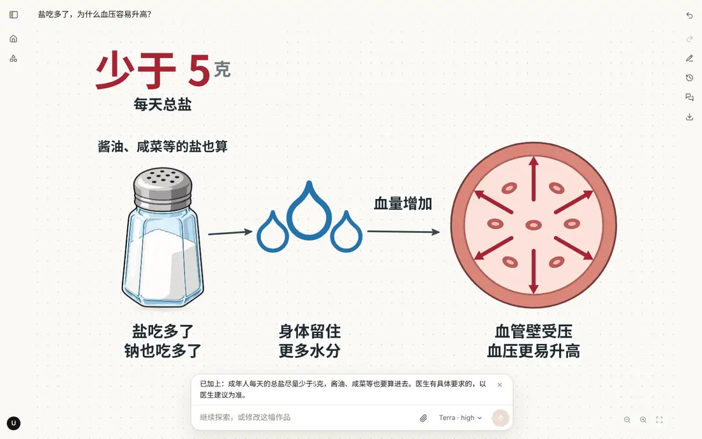<br><sub>最后一轮成品</sub> | 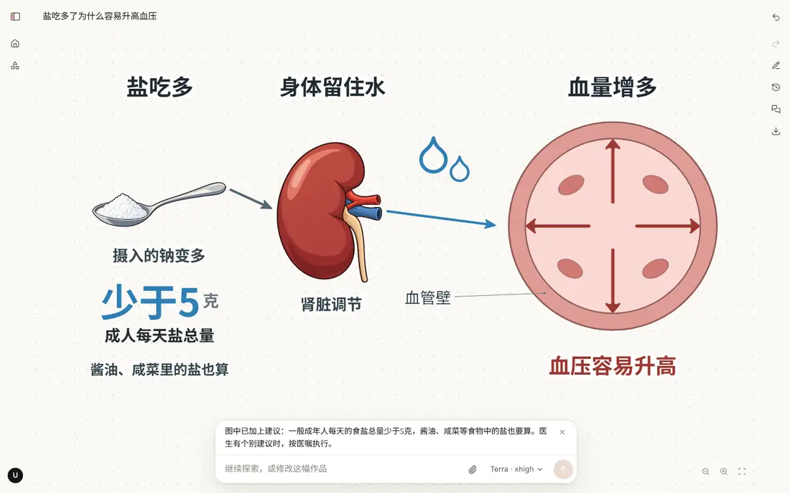<br><sub>最后一轮成品</sub> |

|   |   |   |
|---|---|---|
| <br><sub>首页：选模型、输入需求</sub> | 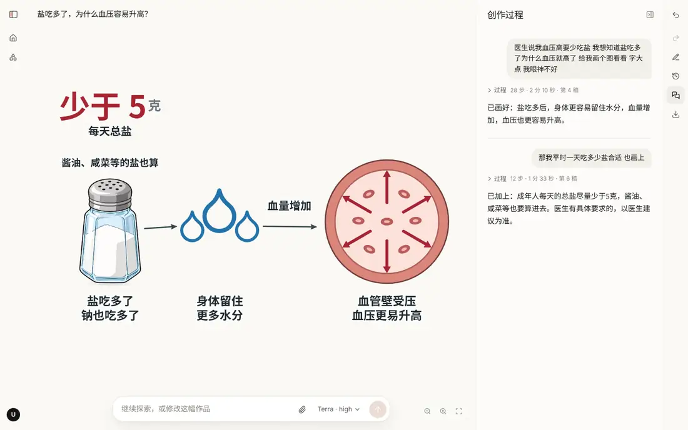<br><sub>创作过程面板（high）</sub> | 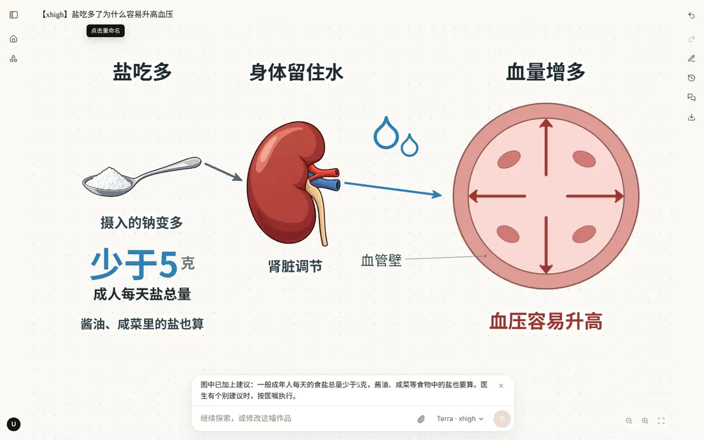<br><sub>手动加上档位前缀后的标题（xhigh）</sub> |

### 作者提问与用户回答

三档都没有提问，直接开画。

### 作者给出的最后一句话

- **medium** — 首轮：已画好大字示意图：盐吃多后，身体容易留住更多水，血液量增加，血压就可能升高。<br>追问：已加到图里：一般成年人每天摄入的盐总量应少于5克，酱油、咸菜和加工食品里的盐也要算。医生有特别要求时，请按医嘱执行。
- **high** — 首轮：已画好：盐吃多后，身体更容易留住水分，血量增加，血压也更容易升高。<br>追问：已加上：成年人每天的总盐尽量少于5克，酱油、咸菜等也要算进去。医生有具体要求的，以医生建议为准。
- **xhigh** — 首轮：已画好：用大字展示盐吃多、身体留水与血压容易升高的关系。<br>追问：图中已加上建议：一般成年人每天的食盐总量少于5克，酱油、咸菜等食物中的盐也要算。医生有个别建议时，按医嘱执行。

### 作者的立意

- **medium**（风格 textbook · 语域 formal）：画面以右侧放大的血管剖面为视觉中心：水汇入血液，向外指向血管壁的箭头表示压力升高；左侧的盐和水沿清晰的因果方向引向血管，让人一眼看到盐多时留水如何增加血液量和血管壁压力。
  - 想过的画法：用进入血液的水和指向血管壁的压力箭头，表现留水使血液量增加、血压可能升高。
  - 想过的画法：把盐摄入、身体留水、血液量增加和血压升高沿一条从左到右的路径展开。
  - 想过的画法：用四个依次相连的概念节点，分别说明盐多、留水、血液增多和血压升高。
- **high**（风格 textbook · 语域 formal）：首先看到右侧放大的血管截面：血液里的箭头向外抵住血管壁，表现压力上升；左侧食盐与身体留住的水分依次通过简洁因果箭头指向血管，说明盐中的钠增加可使血容量增加，进而使血压更容易升高。
  - 想过的画法：用食盐、水分滞留与一段受压的血管串起因果，让指向血管壁的箭头直接表现压力。
  - 想过的画法：用人体循环和肾脏的简化剖视图展示钠与水分如何影响血容量，再标出血管受压。
  - 想过的画法：以装满水的软管受压来类比循环血量增加带来的血管壁压力，但避免暗示人体血管是封闭的死端软管。
- **xhigh**（风格 textbook · 语域 formal）：目光首先落在画面右侧放大的血管剖面和向血管壁的压力箭头；左侧的盐与肾脏沿一条清晰路径引出钠和水的潴留，再汇入血管，说明血容量增加会让血压升高。
  - 想过的画法：把吃进去的盐、肾脏对钠和水的调节、增多的循环血量与血管壁上的压力连成一条可见的因果通路。
  - 想过的画法：用肾脏与血管的简化解剖图表现钠和水的去向，并在血管壁上标出压力。
  - 想过的画法：用密闭水路里水量增加、管壁承压变化的类比辅助理解循环血量和压力，但避免把血管误画成僵硬的水管。

### 我的体验

- 老人的话很口语（"给我画个图看看 字大点 我眼神不好"），作者正确识别出"字大"的要求，三档的标签字号都明显比别的案例大。
- 因果链是横向四格：盐瓶 → 水滴 → 血管截面（箭头向外撑）→ 红字"血压可能升高"。xhigh 还画出肾脏，说明"钠多了，肾脏为了平衡会留住水"。
- 追问"一天吃多少盐合适"：三档都加了大字"少于 5 克/每天总量（酱油、咸菜里的盐也算）"，并在回复里补一句"医生另有要求时按医嘱"——既准确又负责任。
- 对 68 岁的老人来说，"血管横截面 + 四个箭头"仍然有理解门槛，不如"水管里水多了压力变大"这类生活类比直观。

### 我的思考

DrawY 的提示词要求作者先发散"惯例/剖面/机理/类比……"几种画法再选一种，但三档都选了"机理"。对老年用户，"类比"（水管、气球）会更好懂。说明作者在选立意时对"受众"权重不够。

### 优化建议

1. 受众是老人/儿童时，立意选择应优先"类比/情景"而不是"机理/剖面"，可以在 set_brief 的选择规则里加入受众加权。
2. 健康类内容统一在图角落加"仅供科普，遵医嘱"的小字，而不是只放在聊天回复里（图会被转发，回复不会）。
3. "字大点"可以变成作品级设置：一键把全图最小字号提升到 24px。

---

<a id="c04"></a>

## 04 新手妈妈：6 个月到 1 岁辅食

**小雨妈妈 · 新手宝妈**

> **第一句话：** 宝宝6个月了要开始加辅食了 网上说法太多看晕了 能不能画一个6个月到1岁什么时候可以吃什么的图 比如米粉 蛋黄 肉泥 什么时候加 哪些1岁前不能吃（蜂蜜？）
>
> **看完后的追问：** 把1岁前不能吃的东西用红色标出来更醒目一点

| 档位 | 各轮耗时（用户实际等待） | 首个画面 | 输入 token / 缓存命中 | 输出 / 其中推理 | 新生图 | 模型费 | 合计（含生图估算） |
|---|---|---|---|---|---|---|---|
| medium | 首轮 3分31秒 · 追问 54秒 | 2分11秒 | 401k / 86% | 18.9k / 8.1k | 9 | $0.167 | **$0.707** |
| high | 首轮 5分41秒 · 追问 1分35秒 | 2分41秒 | 555k / 89% | 29.5k / 14.8k | 9 | $0.232 | **$0.772** |
| xhigh | 首轮 5分25秒 ✕失败 · 补救 4分21秒 ✕失败 | 3分10秒 | 628k / 79% | 36.9k / 23.1k | 8 | $0.341 | **$0.821** |

- **medium**：时间轴 + 食物插图，禁忌项标红，顺利
- **high**：最完整：质地进阶小流程 + 过敏提示 + 每个禁忌项红 × 角标
- **xhigh**：首轮与补救两次都在"上下文压缩"处被截断失败

### 截图：用户实际看到的过程

| medium<br><sub>【medium】6个月到1岁：辅食怎么加</sub> | high<br><sub>【high】6个月到1岁：辅食与饮食安全</sub> | xhigh<br><sub>【xhigh】6个月到1岁：辅食怎么加</sub> |
|---|---|---|
| 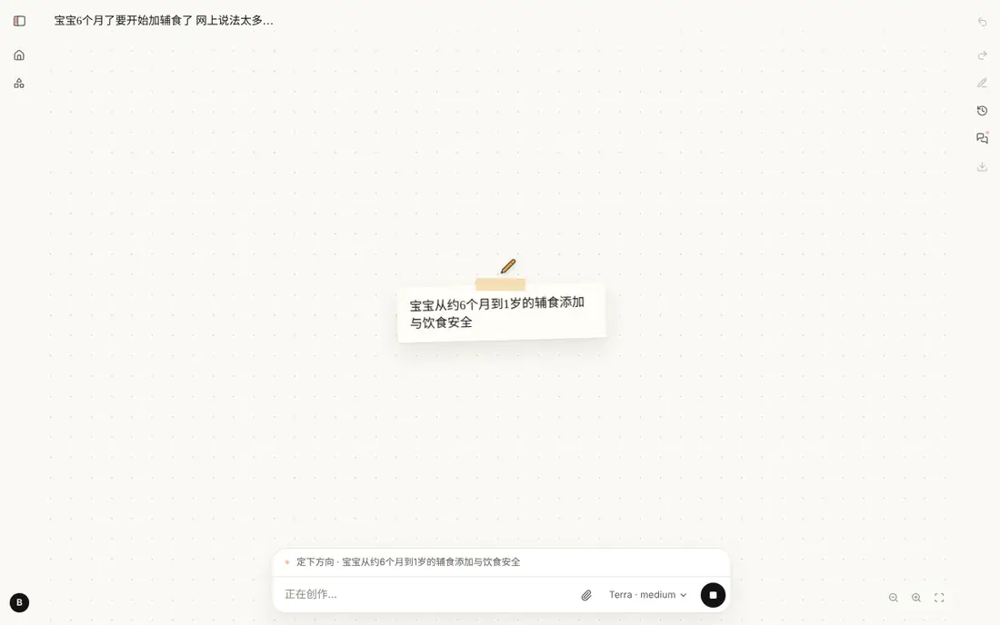<br><sub>创作中 · 66s</sub> | <br><sub>创作中 · 104s</sub> | <br><sub>创作中 · 91s</sub> |
| <br><sub>创作中 · 143s</sub> | <br><sub>创作中 · 219s</sub> | <br><sub>创作中 · 206s</sub> |
| <br><sub>首轮成品</sub> | <br><sub>首轮成品</sub> | <br><sub>首轮成品</sub> |
| <br><sub>最后一轮成品</sub> | <br><sub>最后一轮成品</sub> | <br><sub>补救后成品</sub> |

|   |   |   |
|---|---|---|
| <br><sub>首页：选模型、输入需求</sub> | <br><sub>创作过程面板（high）</sub> | <br><sub>手动加上档位前缀后的标题（xhigh）</sub> |

### 作者提问与用户回答

三档都没有提问，直接开画。

### 作者给出的最后一句话

- **medium** — 首轮：已完成辅食时间图：从约6个月起的食物选择、质地变化，以及一岁前和持续需要避开的食物都标在图中。<br>追问：已用红色突出一岁前的限制及持续需要避开的食物，并统一了可尝试食物的线条颜色。
- **high** — 首轮：图已画好：米粉、熟肉泥和熟全蛋通常都可从约6个月、宝宝做好准备后逐一尝试。蜂蜜及含蜂蜜的食品，熟制过也要等满1岁。进食时让宝宝坐直并全程看护；如有严重湿疹或已知食物过敏，添加致敏食物前先咨询医生。<br>追问：已将底部需要避免或特别注意的食物用红色突出，并保留牛奶主饮和噎食风险的区别。
- **xhigh** — 首轮：❌ Error: 模型输出被截断，请缩小本轮作品修改范围<br>补救：❌ Error: 模型输出被截断，请缩小本轮作品修改范围

### 作者的立意

- **medium**（风格 colored-pencil · 语域 formal）：目光先落在所有从约6个月即可逐一尝试的食物，它们并排从同一个起点延伸，强调米粉、全熟鸡蛋和肉泥无需按月龄排队；同一条年龄标尺下，食物质地逐渐变粗，蜂蜜和牛奶饮品的限制则止于12个月边界。另把需持续防范的呛噎和生食与一岁界限分开。
  - 想过的画法：以6至12个月的共享时间轴，把各类可从6个月左右引入的食物平行展开，同时将蜂蜜和牛奶饮品的限制画到12个月边界。
  - 想过的画法：用同一份食物从细泥到软碎再到软块的变化体现进食能力发展，并在各处标记适合引入的食物。
  - 想过的画法：用年龄分栏的表格列出各月龄可吃和不可吃的食物。
- **high**（风格 colored-pencil · 语域 formal）：眼睛首先看到从约6个月延伸至1岁的时间轴，几种重点食物在同一早期起点开始并持续可吃，说明米粉、肉和熟蛋并无必须错开的固定月龄；同轴展示食物由泥糊向软碎和软块过渡，并在末端以内标出一岁前的安全限制。
  - 想过的画法：在从约6个月通向1岁的同一时间轴上，让可尝试的食物从共同起点延续，并随年龄展示质地的变化。
  - 想过的画法：以同一餐盘从细泥到软碎、再到柔软手指食物的变化，表现宝宝咀嚼能力逐渐发展。
  - 想过的画法：按月龄列出每组食物的可添加时期，并单独标出一岁前的食物安全限制。
- **xhigh**（风格 colored-pencil · 语域 formal）：用一条横跨6至12个月的等距时间轴统领全图：几种常见辅食从同一个约6个月起点并行延伸，明确它们无需按僵硬月龄排序；下方蜂蜜和作为主饮的牛奶在满12个月前以禁用轨迹表示。轴上方提示食物质地随能力渐进变化，旁边保留奶源与防噎的必要提示。
  - 想过的画法：把6到12个月画成真实等距的时间轴，让可从约6个月尝试的食物从同一位置开始，限制到1岁的食物则在12个月处解除限制。
  - 想过的画法：让同一餐食沿着时间轴从细软泥糊逐渐变成粗泥、碎末和软块，以质地的变化而不是凭空规定食物的加入先后表达成长。
  - 想过的画法：以食物为行、月龄为列画一张添加时间表，直接比较每种食物可尝试的范围与禁忌。

### 我的体验

- 宝妈的问题很典型（"网上说法太多看晕了"），作者用"时间轴 + 每种食物一条横线"表达"从约 6 个月起都可以尝试"，并把蜂蜜、牛奶作主饮画成"满 12 个月前不吃"的红色禁区——信息与最新喂养指南一致。
- high 额外画了"质地逐渐进阶：泥糊 → 碎末 → 软块"，并写"严重湿疹或已知过敏先咨询医生"，非常像儿保医生会给的单页。
- 追问"1 岁前不能吃的用红色标出来"：medium 把禁忌整行变红加禁止符，high 给每个禁忌食物加红色 × 角标，都到位。
- xhigh 首轮跑了 325 秒后，输入框上方出现红字"模型输出被截断，请缩小本轮作品修改范围"。宝妈只说了一句话，根本不知道"修改范围"指什么。她输入"怎么停了？继续画完吧"，260 秒后又是同一条红字。

### 我的思考

这是本次体验最严重的问题。我读了代码和运行记录：上下文超过 128k 时，作者会先"压缩上下文"，这个调用只给 4096 个输出 token，却沿用 xhigh 的推理强度；xhigh 的推理把 4096 用光，响应被截断，整次运行失败。画面其实已经基本画好了，却以失败告终，并把错误归咎于用户。

### 优化建议

1. 修复：压缩调用固定用 low/medium 推理强度并把输出上限提到 ≥16k；压缩失败时回退为"丢弃最早的截图消息"而不是让整次运行失败。
2. 运行失败但作品已有新版本时，提示应是"画面已保存到第 N 稿，点此继续完善"，并给一个"继续"按钮。
3. 错误文案不要让用户背锅："请缩小本轮作品修改范围"对普通用户毫无可操作性。

---

<a id="c05"></a>

## 05 电商客服培训：双十一优惠叠加

**小周 · 电商运营**

> **第一句话：** 双十一规则太复杂了客服天天被问懵，帮我画张图给客服培训用：定金膨胀（付50抵100）、跨店每满300减50、店铺券、88VIP再95折，叠加顺序是啥，举个例子一件原价899的衣服最后到手多少钱
>
> **看完后的追问：** 例子里再加一个买两件的情况

| 档位 | 各轮耗时（用户实际等待） | 首个画面 | 输入 token / 缓存命中 | 输出 / 其中推理 | 新生图 | 模型费 | 合计（含生图估算） |
|---|---|---|---|---|---|---|---|
| medium | 首轮 2分28秒 · 追问 2分28秒 | 1分18秒 | 558k / 88% | 23.2k / 12.2k | 1 | $0.208 | **$0.268** |
| high | 首轮 2分49秒 · 追问 2分13秒 | 1分33秒 | 460k / 86% | 24.6k / 16.0k | 1 | $0.205 | **$0.265** |
| xhigh | 首轮 4分26秒 · 追问 5分58秒 | 3分38秒 | 464k / 83% | 50.5k / 37.3k | 1 | $0.351 | **$0.411** |

- **medium**：先问店铺券面额与规则口径，数学正确
- **high**：同样先问，额外拆出"已付定金/待付尾款"，客服最实用
- **xhigh**：不问，直接假设"满 500 减 50"并标注示例口径

### 截图：用户实际看到的过程

| medium<br><sub>【medium】双十一优惠叠加示例</sub> | high<br><sub>【high】双十一优惠叠加：一件与两件的模拟结算</sub> | xhigh<br><sub>【xhigh】双十一优惠叠加与到手价示例</sub> |
|---|---|---|
| <br><sub>作者的提问</sub> | <br><sub>作者的提问</sub> | <br><sub>创作中 · 79s</sub> |
| <br><sub>创作中 · 32s</sub> | <br><sub>创作中 · 34s</sub> | <br><sub>创作中 · 168s</sub> |
| <br><sub>创作中 · 96s</sub> | <br><sub>创作中 · 111s</sub> | <br><sub>首轮成品</sub> |
| <br><sub>首轮成品</sub> | <br><sub>首轮成品</sub> | <br><sub>最后一轮成品</sub> |
| <br><sub>最后一轮成品</sub> | <br><sub>最后一轮成品</sub> |   |

|   |   |   |
|---|---|---|
| <br><sub>首页：选模型、输入需求</sub> | <br><sub>创作过程面板（high）</sub> | <br><sub>手动加上档位前缀后的标题（xhigh）</sub> |

### 作者提问与用户回答

**medium**
- 店铺券的门槛和面额是多少？这会影响最后的到手价。（选项：满600减50 / 满700减100 / 无门槛减50 / 其他）
- 这张培训图采用哪种规则口径？（选项：按题设做示例 / 按真实活动规则）
- 用户：点击「你来决定」

**high**
- 示例里的店铺券是哪一种？（选项：无门槛减50元 / 满500减100元 / 满800减100元 / 其他）
- 培训图采用哪种活动规则口径？（选项：教学模拟 / 真实活动规则）
- 用户：点击「你来决定」

### 作者给出的最后一句话

- **medium** — 首轮：已完成客服培训图：示例中到手总价为 ¥664.05，扣除已付定金后尾款为 ¥614.05。实际优惠以活动规则和结算页为准。<br>追问：已加入两件示例，并可切换查看单件计算。按示例假设，两件到手总价为 ¥1,328.10，已付定金 ¥100，待付尾款 ¥1,228.10。
- **high** — 首轮：图已完成。按示例假设，到手总价为 **664.05元**；已付定金50元，还需付尾款 **614.05元**。图示为模拟顺序，实际以活动规则和订单结算为准。<br>追问：已加入两件的例子，并可切换查看一件或两件。按模拟规则，两件到手总价 **1,328.10元**；已付定金100元，剩余尾款 **1,228.10元**。
- **xhigh** — 首轮：已完成培训图。示例假设店铺券满500减50，且各项优惠均可叠加：到手总价为664.05元，其中定金50元已付，尾款614.05元。实际适用资格和叠加顺序以结算页为准。<br>追问：已完成一件与两件的优惠叠加对照图，并标明示例条件及定金、尾款。

### 作者的立意

- **medium**（风格 flat · 语域 formal）：一件衣服和原价引出一条从左上向右下的价格阶梯；阶梯的每次下降对应一种优惠，显示扣减前后的总价，最后以醒目的到手价收束，并拆出已付定金与待付尾款。
  - 想过的画法：把衣服价格画成从899元逐步下降的阶梯，每次落差直接标明对应优惠，终点拆出已付定金和尾款。
  - 想过的画法：把50元定金兑换为100元抵扣额的差额放大，再让店铺券、跨店满减和会员折扣作用于剩余总价。
  - 想过的画法：按结算顺序排列四个优惠项目及其前后金额，末端标出最后应付总价。
- **high**（风格 flat · 语域 formal）：目光先落在左侧的衣服和原价，沿一条从左向右逐级下降的价格路径读过四个优惠，路径上的金额显示每一步计算后的总价，最终以醒目的到手总价收束；已付定金从总价中另行分出尾款。
  - 想过的画法：让一件衣服的价格沿一条连续的计算路径经过定金优惠、店铺券、跨店满减和会员折扣，在出口汇聚成实际总价。
  - 想过的画法：把原价画成可拆分的价格条，用不同长度的扣减部分逐项揭示每项优惠及其触发基数。
  - 想过的画法：以逐行结算清单呈现每项优惠和最终应付金额，模拟订单账单的阅读方式。
- **xhigh**（风格 flat · 语域 formal）：左侧衣服的899元标价引出向右逐段下降的价格路径，四处降阶分别对应定金的额外优惠、示例店铺券、跨店满减与88VIP折扣；路径终点将总到手价清楚拆成已付定金和待付尾款，让优惠顺序及定金不重复扣减一眼可见。
  - 想过的画法：让衣服的标价沿从左到右的结算路径逐步下降，到终点后拆成已付定金和待付尾款。
  - 想过的画法：把原价画成等比例金额，在四次减让中依次切除优惠，再把剩下的价格切分为定金与尾款。
  - 想过的画法：用四个标有优惠名称的步骤和算式串成流程，最后标出价格。

### 我的体验

- 用户没说店铺券面额，medium/high 先弹出两道题："店铺券的门槛和面额是多少？""这张图采用哪种规则口径？"——问得专业，选项也具体（满 600 减 50 / 满 700 减 100 / 无门槛减 50）。
- 用户点了"你来决定"，作者自己假设并在图上写明"示例口径：优惠均可叠加，95 折按优惠后总价计算"。这对培训材料是正确做法。
- 我逐步复算：899 → 定金膨胀 -50 → 849 → 店铺券 -50 → 799 → 跨店每满 300 减 50（-100）→ 699 → ×0.95 = 664.05；两件：1798 → 1698 → 1648 → -250 → 1398 → 1328.10。三档全对。
- 视觉上是一条"价格台阶下降"的折线 + 衣服插图，第一眼就能看出"一步一步减"，比表格更适合客服背。

### 我的思考

提问的时机和质量都很好。值得注意的是 xhigh 没有提问、直接假设并标注——同一需求，档位越高反而越"敢自己拿主意"。对规则类培训图，假设一定要醒目，否则客服会把示例当成真实规则讲给顾客。

### 优化建议

1. 规则类图解应在图上醒目标出"示例假设"区块，避免客服把示例当真实规则讲给顾客。
2. 对于计算题，作者可以在图下附一张可展开的"计算明细"（detail），点开看到每步公式。
3. 数字一致性校验：图上所有金额由同一份数据计算生成（库画法支持参数化），避免手写数字出错。

---

<a id="c06"></a>

## 06 历史课：郑和下西洋路线图

**陈老师 · 初中历史老师**

> **第一句话：** 郑和下西洋的路线图，要在地图上，标出主要到过的地方，给初二学生上课用
>
> **看完后的追问：** 把七次下西洋里走得最远的那次单独标出来

| 档位 | 各轮耗时（用户实际等待） | 首个画面 | 输入 token / 缓存命中 | 输出 / 其中推理 | 新生图 | 模型费 | 合计（含生图估算） |
|---|---|---|---|---|---|---|---|
| medium | 首轮 1分36秒 · 追问 1分38秒 | 1分00秒 | 356k / 88% | 14.7k / 8.9k | 0 | $0.132 | **$0.132** |
| high | 首轮 2分45秒 · 追问 1分17秒 | 1分48秒 | 382k / 87% | 18.0k / 12.9k | 0 | $0.157 | **$0.157** |
| xhigh | 首轮 4分24秒 · 追问 6分27秒 | 2分00秒 | 527k / 86% | 43.1k / 34.1k | 0 | $0.312 | **$0.312** |

- **medium**：96s 就给出真实底图 + 古今地名，惊艳
- **high**：取景更宽，含爪哇
- **xhigh**：最远一次选了第七次并画分舰队，但追问耗时 387s

### 截图：用户实际看到的过程

| medium<br><sub>【medium】郑和下西洋的主要航路</sub> | high<br><sub>【high】郑和下西洋：第五次东非方向航线示意</sub> | xhigh<br><sub>【xhigh】郑和下西洋的主要航路</sub> |
|---|---|---|
| <br><sub>创作中 · 28s</sub> | <br><sub>创作中 · 41s</sub> | <br><sub>创作中 · 79s</sub> |
| <br><sub>创作中 · 66s</sub> | <br><sub>创作中 · 104s</sub> | <br><sub>创作中 · 168s</sub> |
| <br><sub>首轮成品</sub> | <br><sub>首轮成品</sub> | <br><sub>首轮成品</sub> |
| <br><sub>最后一轮成品</sub> | <br><sub>最后一轮成品</sub> | <br><sub>最后一轮成品</sub> |

|   |   |   |
|---|---|---|
| <br><sub>首页：选模型、输入需求</sub> | <br><sub>创作过程面板（high）</sub> | <br><sub>手动加上档位前缀后的标题（xhigh）</sub> |

### 作者提问与用户回答

三档都没有提问，直接开画。

### 作者给出的最后一句话

- **medium** — 首轮：已完成郑和下西洋主要航路图，标出了沿途重要地点及部分对应的现代地名；航线为七次远航的综合示意。<br>追问：已用红线突出第五次远航（1417—1419）通向东非的示意航向。多次远航都到达过东非，因此不将第五次断言为唯一“最远”的一次。
- **high** — 首轮：已完成适合初二课堂使用的郑和下西洋路线图，标出了主要到访地和概略航线。<br>追问：已突出第五次远航至东非的示意航线。其他航次也曾到达东非，现存资料不足以确定唯一“最远的一次”。
- **xhigh** — 首轮：已完成郑和下西洋主要航路图，标出了代表性到达地点；航线为七次航行的综合示意。<br>追问：已完成课堂路线图：蓝色突出第七次远航及分遣航线，灰色保留综合航路，均为示意。多次航行曾抵达东非，不能直接认定第七次是唯一最远的一次。

### 作者的立意

- **medium**（风格 textbook · 语域 formal）：以一幅覆盖中国至东非的真实地图为主体，视线沿从中国出发的海上示意航线，经东南亚和印度次大陆向西行进，在阿拉伯半岛与非洲东岸分出航向；港口标记和简短古今地名帮助学生将史实与当代地理对应。航路是七次航行的主要方向综合示意，不把各支航线误称为同一次完整航程。
  - 想过的画法：以真实海岸线为地理底图，从中国沿海出发，沿东南亚和印度洋的主要航点向西延伸，并在阿拉伯海和东非方向分支。
  - 想过的画法：按地理位置标出主要港口，用连续箭头依次连接以呈现航行路线。
  - 想过的画法：在同一幅地图上保留从中国到东非的真实空间尺度，用航点分布展示远航跨越的区域。
- **high**（风格 textbook · 语域 formal）：以横跨中国、东南亚、印度洋和东非的真实地图为主体，航线从中国海岸向西，经马六甲海峡和印度次大陆延伸，再分向阿拉伯半岛和东非；沿途的历史地名落在实际港口或地区，并用箭头表示出海方向。
  - 想过的画法：在历史航线地图上标出起点和主要到访地，用箭头连出概括性的出海路线。
  - 想过的画法：沿真实海岸从中国、东南亚经印度洋延伸，至阿拉伯海和东非形成分支，让海上旅程与港口的空间关系一眼可见。
- **xhigh**（风格 textbook · 语域 formal）：以中国至印度洋的真实海域地图为整幅画的主体，一条醒目的示意航路从中国东南沿岸通向印度，再向西亚、红海和东非分出支线；港口标在地理原位，让学生先从空间关系读懂航程与范围。
  - 想过的画法：在真实的亚洲—印度洋—非洲海岸地图上，沿海路连接出发地与代表性港口，并用分支表达航线的延伸。
  - 想过的画法：在同一张地图上区分早期以印度为重点的航程与后来通向西亚、非洲海岸的扩展。
  - 想过的画法：用地图上的主要港口与箭头展示郑和下西洋涉及的地点，并按海域排列站点。

### 我的体验

- 这是最让我惊喜的一例：作者用库里的 geomap 画法，在真实的海岸线、河流、地势晕渲底图上标出南京、长乐、占城、满剌加、苏门答剌、锡兰、古里、忽鲁谟斯、阿丹、木骨都束、麻林，并附"今马六甲/今科泽科德"等现代地名——这就是历史老师想要的课件。
- 航线用带箭头的红线、按"每段走短的一侧"在海上绕行，没有穿越陆地。
- 追问"把走得最远的那次单独标出来"：medium/high 选第五次（赴东非），xhigh 选第七次并单独画出分舰队；三档都主动说明"多次远航都到过东非，史料不足以断言唯一最远"——史学态度谨慎，令人放心。
- 小遗憾：地图上地名字号偏小，投影到教室后排可能看不清。

### 我的思考

地图能力是 DrawY 的护城河之一：通用 AI 绘图工具很难同时做到"真实地理底图 + 精确经纬度落点 + 可改的标注"。历史、地理、旅行类用户会很依赖它。

### 优化建议

1. 为课堂场景提供"投影模式"：一键放大全部地名、加粗航线。
2. 对历史题材，可在图例里写清"航线为示意，据《瀛涯胜览》等"之类出处，提高教学可信度。
3. xhigh 在地图追问上耗时明显偏长（387s），地图类修改可优先改数据参数而不是重写画法。

---

<a id="c07"></a>

## 07 新人培训：微服务下单链路

**小林 · 后端开发（刚转正）**

> **第一句话：** 我们系统是微服务，用户下单的时候：App -> 网关 -> 订单服务，订单服务调库存服务扣库存，然后调支付服务，支付成功后发消息到MQ，积分服务和通知服务消费消息。帮我画个图给新来的同事讲，最好能看出哪些是同步调用哪些是异步的
>
> **看完后的追问：** 如果库存扣减失败了流程怎么走，也画进去

| 档位 | 各轮耗时（用户实际等待） | 首个画面 | 输入 token / 缓存命中 | 输出 / 其中推理 | 新生图 | 模型费 | 合计（含生图估算） |
|---|---|---|---|---|---|---|---|
| medium | 首轮 1分28秒 · 追问 1分11秒 | 36秒 | 417k / 86% | 11.7k / 7.8k | 0 | $0.133 | **$0.133** |
| high | 首轮 2分40秒 · 追问 2分22秒 | 54秒 | 549k / 89% | 24.2k / 12.6k | 0 | $0.203 | **$0.203** |
| xhigh | 首轮 3分45秒 · 追问 3分44秒 | 2分16秒 | 506k / 84% | 34.2k / 22.8k | 0 | $0.273 | **$0.273** |

- **medium**：时序图，同步/异步区分清楚，但缩小后字极小
- **high**：拓扑图（订单服务居中，MQ 扇出），新人最好懂
- **xhigh**：时序图 + alt 失败分支，最"教科书"

### 截图：用户实际看到的过程

| medium<br><sub>【medium】下单流程：库存成功与失败</sub> | high<br><sub>【high】微服务下单链路</sub> | xhigh<br><sub>【xhigh】下单链路：库存成功与失败</sub> |
|---|---|---|
| <br><sub>创作中 · 28s</sub> | <br><sub>创作中 · 41s</sub> | <br><sub>创作中 · 66s</sub> |
| <br><sub>创作中 · 53s</sub> | <br><sub>创作中 · 105s</sub> | <br><sub>创作中 · 142s</sub> |
| <br><sub>首轮成品</sub> | <br><sub>首轮成品</sub> | <br><sub>首轮成品</sub> |
| <br><sub>最后一轮成品</sub> | <br><sub>最后一轮成品</sub> | <br><sub>最后一轮成品</sub> |

|   |   |   |
|---|---|---|
| <br><sub>首页：选模型、输入需求</sub> | <br><sub>创作过程面板（high）</sub> | <br><sub>手动加上档位前缀后的标题（xhigh）</sub> |

### 作者提问与用户回答

**medium**
- 库存扣减失败后，你们系统实际怎么处理？（选项：立即返回失败 / 先更新订单状态 / 先重试扣库存 / 不确定，先画常见方案）
- 用户：点击「你来决定」

**high**
- 你们系统里，库存扣减失败后实际怎么处理？（选项：直接终止 / 先重试 / 转异步处理 / 不确定，画常见方案）
- 用户：点击「你来决定」

**xhigh**
- 库存扣减失败后，你们系统实际怎么处理？（选项：直接终止并返回失败 / 先重试库存扣减 / 进入待处理状态 / 还不确定，按常见方案示意）
- 用户：点击「你来决定」

### 作者给出的最后一句话

- **medium** — 首轮：已完成下单时序图。图中暂按支付同步返回成功、订单服务发布消息绘制；如果实际是支付回调或由其他服务发消息，可以再调整。<br>追问：已加入库存扣减失败分支：失败后返回下单失败，不进入支付或发送支付成功消息。这是按直接失败返回的常见方案绘制，未假设订单状态或重试机制。
- **high** — 首轮：已绘制下单链路：蓝色实线表示同步调用，橙色虚线表示异步消息。图中按直接调用为同步、订单服务在支付成功后发送消息来绘制。<br>追问：已加入库存扣减失败的示例路径：订单服务经网关向 App 返回失败，不继续支付，也不发送支付成功消息。库存超时等结果不明的情况需另行处理。
- **xhigh** — 首轮：已完成下单链路图，区分了同步调用、返回和 MQ 异步消费。<br>追问：已完成下单链路图：区分同步调用与异步消息，并以示例标明库存扣减失败时经网关返回下单失败、不进入支付流程。

### 作者的立意

- **medium**（风格 flat · 语域 formal）：各服务从左至右排列，消息沿生命线由上向下展开：订单服务先等待库存扣减，再等待支付结果；支付成功后事件进入 MQ，并由积分与通知服务分别消费。同步请求和异步消息以不同颜色及直接标记区分，返回用虚线表示。
  - 想过的画法：用时序图把各服务排成纵向生命线，按时间由上至下画出同步请求、支付结果与消息消费。
  - 想过的画法：让下单请求从 App 经网关进入订单服务，在订单服务处分出先后编号的库存、支付调用与消息路径。
  - 想过的画法：以等待返回的调用往返和经消息队列解耦的分发作对照，突出同步与异步的区别。
- **high**（风格 flat · 语域 formal）：以居中的订单服务为枢纽，左侧的 App 和网关逐级送入请求；上下分支按序指向库存和支付，支付成功返回后，消息向右进入 MQ 并分叉至积分与通知服务。同步调用与异步消息用一致且不同的线型、颜色和简短标注区分。
  - 想过的画法：用按调用先后排列的服务节点和箭头画出完整链路，并用线型区分同步请求和异步消息。
  - 想过的画法：让请求由左向右进入订单服务，在订单服务处依次引出库存与支付调用，再由支付成功后的消息流分叉到积分和通知。
  - 想过的画法：以订单服务为中心，分别展示它等待的库存及支付调用和它经消息队列解耦触发的两个消费者。
- **xhigh**（风格 flat · 语域 formal）：一张可移动的服务交互时序图：八个参与者从左到右排列，时间自上而下依次显示下单、扣库存、支付与支付成功后的消息发布；MQ 再向两侧的积分、通知服务在同一时间层分发，表示两者各自消费而不预设先后。同步请求与返回、消息传递使用不同的线型和颜色，并直接标明同步或异步。
  - 想过的画法：让请求沿参与者的生命线自上而下发生，支付成功后的消息从 MQ 在同一时间层分别到达积分和通知服务。
  - 想过的画法：用独立服务节点和有序箭头画系统调用图，以不同线型区分直接调用与消息传递。
  - 想过的画法：把订单服务置于枢纽，分别表现其等待库存和支付结果，以及通过消息队列解耦后续消费者。

### 我的体验

- 程序员给出了完整链路，三档都正确区分同步（蓝色实线）与异步（橙色虚线），并在 MQ 后并行分出积分服务、通知服务。
- medium/xhigh 选了 UML 时序图（8 个参与者一字排开），high 选了以订单服务为中心的拓扑图。对"给新同事讲"，拓扑图第一眼更好懂，时序图更严谨。
- 追问"库存扣减失败怎么走"：medium/xhigh 用 alt 分支框画"扣减失败 → 下单失败返回 App"，high 在拓扑图上加了红色回退箭头"扣减失败·同步返回（示例）"，并在回复里提醒"实际要看是否有补偿/重试"。专业度很高。
- 缺点：时序图在适应画布后文字约 8px，必须放大才能读。

### 我的思考

"有没有画对"已经不是问题，"画成哪种图"才是差异所在。三档选了两种不同图式，说明作者的 ideas 发散是真的在起作用；但用户无法在画完后切换"另一种画法"，只能重新提要求。

### 优化建议

1. 在创作过程面板里，把作者"想过的画法"做成可点击的"换成这种画法再画一版"。
2. 时序图参与者 ≥ 6 时自动改为纵向长图，或提示"放大查看"。
3. 技术图支持导出 Mermaid/PlantUML 源码，方便贴进团队 Wiki。

---

<a id="c08"></a>

## 08 健身教练：深蹲正确与错误

**大壮 · 健身私教**

> **第一句话：** 学员深蹲老是做错，膝盖内扣、弯腰、脚跟离地。帮我画一张正确和错误动作对比的图，我发朋友圈也发给学员
>
> **看完后的追问：** 加一句每个错误该怎么纠正

| 档位 | 各轮耗时（用户实际等待） | 首个画面 | 输入 token / 缓存命中 | 输出 / 其中推理 | 新生图 | 模型费 | 合计（含生图估算） |
|---|---|---|---|---|---|---|---|
| medium | 首轮 3分57秒 · 追问 34秒 | 44秒 | 371k / 88% | 10.5k / 4.2k | 5 | $0.112 | **$0.412** |
| high | 首轮 3分21秒 · 追问 51秒 | 1分03秒 | 386k / 85% | 19.0k / 11.2k | 2 | $0.168 | **$0.288** |
| xhigh | 首轮 9分29秒 · 追问 1分00秒 | 1分26秒 | 691k / 86% | 40.9k / 30.9k | 5 | $0.331 | **$0.631** |

- **medium**：四个人物，正误对比清楚，但"膝盖内扣"不明显
- **high**：正面 + 侧面两组，并标注"髋适当前倾 ≠ 背部塌弯"，最专业
- **xhigh**：5 人一排 + 红色箭头指出内扣/弓背/脚跟离地，错误最一眼可见

### 截图：用户实际看到的过程

| medium<br><sub>【medium】深蹲动作：正确与常见错误</sub> | high<br><sub>【high】深蹲动作：正确与常见错误</sub> | xhigh<br><sub>【xhigh】深蹲：正确动作与常见错误</sub> |
|---|---|---|
| <br><sub>创作中 · 66s</sub> | <br><sub>创作中 · 54s</sub> | <br><sub>创作中 · 169s</sub> |
| <br><sub>创作中 · 156s</sub> | <br><sub>创作中 · 130s</sub> | <br><sub>创作中 · 373s</sub> |
| <br><sub>首轮成品</sub> | <br><sub>首轮成品</sub> | <br><sub>首轮成品</sub> |
| <br><sub>最后一轮成品</sub> | <br><sub>最后一轮成品</sub> | <br><sub>最后一轮成品</sub> |

|   |   |   |
|---|---|---|
| <br><sub>首页：选模型、输入需求</sub> | <br><sub>创作过程面板（high）</sub> | <br><sub>手动加上档位前缀后的标题（xhigh）</sub> |

### 作者提问与用户回答

三档都没有提问，直接开画。

### 作者给出的最后一句话

- **medium** — 首轮：已完成深蹲正确与错误动作对照图，可用于朋友圈分享和学员教学。<br>追问：已为膝盖内扣、弓背和脚跟离地分别加入纠正提示。
- **high** — 首轮：已完成深蹲正误对比图：正面看膝盖，侧面看背部和脚跟，适合发给学员或分享到朋友圈。<br>追问：已为膝盖内扣、背部塌弯和脚跟离地分别加入一句纠正方法。
- **xhigh** — 首轮：已完成深蹲动作对比图，涵盖膝盖内扣、腰背弓起和脚跟离地。<br>追问：已为膝盖内扣、腰背弓起和脚跟离地各补上一句纠正提示。

### 作者的立意

- **medium**（风格 textbook · 语域 formal）：左右两组分别呈现正确与错误，同一人物在每组中以正面、侧面两个角度蹲到相近深度：正面直接比较膝盖和脚尖的对齐，侧面直接比较背部与脚跟；少量对位标记把视线引到三个关键差异。
  - 想过的画法：用正面和侧面的动作对照分别暴露膝盖轨迹、脊柱形态与脚跟接地状态。
  - 想过的画法：让一个深蹲人物从错误姿势逐步调整到正确姿势，标出三个修正点。
  - 想过的画法：把正确和错误的深蹲姿势并列，分别用简洁标记指出差异。
- **high**（风格 textbook · 语域 formal）：四个等尺度的人物共用一条地面，从左到右是正面正确、正面错误、侧面正确、侧面错误；相同视角相邻，让人先从姿态看出差别，再用少量贴近膝、背和脚跟的颜色标记指出三个偏差。
  - 想过的画法：用正确与错误的深蹲并排对照，将三个常见偏差标在身体对应的位置。
  - 想过的画法：把深蹲拆成正面与侧面两个真实视角，同视角正误相邻，分别看清膝脚对线和背部、脚跟。
  - 想过的画法：以脚掌支撑、膝盖朝向和躯干脊柱作为三个力学线索，让偏离与正确位置的关系直接显形。
- **xhigh**（风格 textbook · 语域 formal）：以中间较醒目的正确侧面深蹲为锚点，左边并排比较正面的正确动作与膝内扣，右边比较同一侧面的过度弯腰和脚跟离地；所有人物站在同一条地面基线上，姿势和局部对位线先于短标签说明差异。
  - 想过的画法：用同一人的正面和侧面深蹲姿势，分别把膝盖对位、腰背形态与足跟支撑放到可直接比较的位置。
  - 想过的画法：用正确与错误两组动作图，逐项列出三个常见问题。
  - 想过的画法：围绕身体支撑和关节运动方向，用膝盖朝向脚尖、脊柱形态和足底接触地面的线索解释错误。

### 我的体验

- 作者生成了一组同一个人物（青色 T 恤、同一发型）的教练插画，角色一致性非常好，像是同一套教材里的图。
- high 的版式最好：正面"膝盖朝向脚尖 vs 膝盖内扣"、侧面"背部保持中立 vs 背部塌弯·脚跟离地"，并在脚跟处用红色小标记指出问题。
- medium 那张"膝盖内扣"图里内扣并不明显——生图模型对"细微的错误姿势"表达力有限，作者看图时没有发现；xhigh 则在人物膝盖处加了一对红色内收箭头、在背部加了红色弧线、在脚跟处加了上下箭头，用矢量标注弥补了插画的不足，是三档里教学效果最好的。
- 追问"每个错误怎么纠正"：三档都在错误动作下加了一行口令（"下蹲时让膝盖对准脚尖""收紧腹部，背部保持中立"），但字偏小，发朋友圈后在手机上难以阅读。

### 我的思考

DrawY 的"看图评判"环节主要检查构图与文字，对"图片里人物动作是否真的错得明显"缺少针对性检查。对健身/医疗/操作规范类内容，图像细节就是信息本身。

### 优化建议

1. 看图评判时，对"正确 vs 错误"对比图，单独放大每张人物图检查"差异是否一眼可见"，不明显就重画或加辅助线（膝盖-脚尖连线）。
2. "发朋友圈"是明确的分发渠道，应自动选 3:4 或 1:1 画幅并放大文字。
3. 人物一致性做得很好，可以把这个角色保存为用户的"专属教练形象"，下次直接调用。

---

<a id="c09"></a>

## 09 房产中介：等额本息 vs 等额本金

**张姐 · 房产中介**

> **第一句话：** 客户总问等额本息和等额本金哪个划算，我讲不明白。贷款100万30年利率3.1%，帮我画个图对比一下，每月还多少、总利息多少，让客户一看就懂
>
> **看完后的追问：** 加一句什么样的人适合选哪种

| 档位 | 各轮耗时（用户实际等待） | 首个画面 | 输入 token / 缓存命中 | 输出 / 其中推理 | 新生图 | 模型费 | 合计（含生图估算） |
|---|---|---|---|---|---|---|---|
| medium | 首轮 3分10秒 · 追问 34秒 | 1分46秒 | 363k / 88% | 16.9k / 11.1k | 0 | $0.143 | **$0.143** |
| high | 首轮 2分57秒 · 追问 29秒 | 1分01秒 | 353k / 87% | 16.6k / 10.3k | 0 | $0.144 | **$0.144** |
| xhigh | 首轮 4分59秒 · 追问 1分12秒 | 1分38秒 | 362k / 83% | 29.5k / 20.0k | 0 | $0.223 | **$0.223** |

- **medium**：数字全对，坐标简写"6 千"
- **high**：数字精确到分，右侧总利息条形对比
- **xhigh**：同 high，标注未加千分位

### 截图：用户实际看到的过程

| medium<br><sub>【medium】等额本息与等额本金：月供和利息对比</sub> | high<br><sub>【high】等额本息与等额本金：月供与利息对比</sub> | xhigh<br><sub>【xhigh】两种房贷还款方式对比</sub> |
|---|---|---|
| <br><sub>创作中 · 53s</sub> | <br><sub>创作中 · 53s</sub> | <br><sub>创作中 · 92s</sub> |
| <br><sub>创作中 · 117s</sub> | <br><sub>创作中 · 117s</sub> | <br><sub>创作中 · 193s</sub> |
| <br><sub>首轮成品</sub> | <br><sub>首轮成品</sub> | <br><sub>首轮成品</sub> |
| <br><sub>最后一轮成品</sub> | <br><sub>最后一轮成品</sub> | <br><sub>最后一轮成品</sub> |

|   |   |   |
|---|---|---|
| <br><sub>首页：选模型、输入需求</sub> | <br><sub>创作过程面板（high）</sub> | <br><sub>手动加上档位前缀后的标题（xhigh）</sub> |

### 作者提问与用户回答

三档都没有提问，直接开画。

### 作者给出的最后一句话

- **medium** — 首轮：已完成对比图。等额本金总利息约少 7.1 万元，但首月月供约高 1,091 元；等额本息的月供则保持固定。<br>追问：已加上选择建议：重视月供稳定、希望前期压力较小，可考虑等额本息；能承受较高首月月供、看重省息，可考虑等额本金。
- **high** — 首轮：已完成对比图：等额本金总利息约少 7.10 万元，但首月还款约多 1,090.95 元。<br>追问：已加上适合人群的选择建议。
- **xhigh** — 首轮：已完成对比图：等额本金总利息较少，但前期月供较高；等额本息月供固定。<br>追问：已在图中补充两种还款方式各自适合的人群，并沿用原有配色。

### 作者的立意

- **medium**（风格 flat · 语域 formal）：首先看到同一还款时间轴上的两条月供线：等额本息水平不变，等额本金从较高处逐月下降；每条线延伸到与其颜色对应的利息总额和同尺度条形，使较低总利息与较高首月负担的取舍一眼可见。
  - 想过的画法：用同一条30年时间轴描出固定月供和逐月递减月供，直接标出首月、末月和两条线的交汇。
  - 想过的画法：用同一比例的条形比较两种方式的总利息，并并列给出各自的月供范围。
  - 想过的画法：用两列数字表逐项比较两种贷款方式的月供和总利息。
- **high**（风格 flat · 语域 formal）：视线先落在共享 30 年时间轴上的两条月供轨迹：等额本息保持水平，等额本金由高到低；终点旁以同一尺度的利息长度和金额对照，直观呈现先还得多与总利息较少的取舍。
  - 想过的画法：将两种月供放在同一条 30 年时间轴上，一条水平、一条逐月递减，并在各自路径旁对照总利息。
  - 想过的画法：用并排的比较表逐项列出两种方式的首月、末月和利息总额。
  - 想过的画法：以每月还款中的本金和利息面积变化解释两种方式为何会产生不同的总利息。
- **xhigh**（风格 flat · 语域 formal）：视线首先落在共同时间轴上的两条月供线：等额本息保持水平，等额本金从高到低；相同的颜色延续到右边的同尺度总利息条，直接呈现前期月供与最终利息的取舍。
  - 想过的画法：在共同时间轴上画出两种月供，一条水平、一条逐月下降，并在末端对应标出总利息。
  - 想过的画法：用两组同尺度的金额长度分别比较首月月供与全部利息，凸显开始时的压力和最终成本。
  - 想过的画法：用一张两列对照表列出每种还法的首月、末月和总利息。

### 我的体验

- 我用公式复算：等额本息月供 4,270.16、总利息 537,259.04；等额本金首月 5,361.11、末月 2,784.95、每月递减 7.18、总利息 466,291.67、少付 70,967.37——三档全部正确。
- 图式选得好：左边"月供随时间"折线（一条水平、一条斜降），右边"总利息"两根条形，中介跟客户讲时可以一手指月供、一手指总利息。
- 追问"什么人适合哪种"：一句话结论加在图下（"希望月供稳定、前期压力小选等额本息；能承受较高首月月供、希望少付利息选等额本金"），简洁准确。
- 图里没有说明"提前还款"的影响，而这恰恰是客户第二个会问的问题。

### 我的思考

金融计算类需求，DrawY 表现可靠——作者显然是用代码算的而不是"编"数字。这类图对中介、银行客户经理很有商业价值。

### 优化建议

1. 把贷款金额、年限、利率做成画法参数，进入手动编辑后就能直接改数字、图自动重算——一张图服务所有客户。
2. 大数字统一千分位格式（xhigh 的"537259.04 元"不易读）。
3. 加一个"若第 5 年提前还 20 万"的情景切换（场景交互），会是中介的杀手锏。

---

<a id="c10"></a>

## 10 种植户：山东大棚草莓全年农事

**老刘 · 草莓大棚种植户**

> **第一句话：** 我种大棚草莓，想给新来帮工的人看一年里每个月该干啥，什么时候育苗定植什么时候覆膜什么时候施肥打药什么时候摘，我们这是山东
>
> **看完后的追问：** 把最忙的采摘季标出来

| 档位 | 各轮耗时（用户实际等待） | 首个画面 | 输入 token / 缓存命中 | 输出 / 其中推理 | 新生图 | 模型费 | 合计（含生图估算） |
|---|---|---|---|---|---|---|---|
| medium | 首轮 3分10秒 · 追问 41秒 | 1分13秒 | 368k / 88% | 15.3k / 11.1k | 2 | $0.137 | **$0.257** |
| high | 首轮 4分44秒 · 追问 49秒 | 1分33秒 | 530k / 90% | 20.5k / 13.5k | 8 | $0.180 | **$0.660** |
| xhigh | 首轮 5分54秒 ✕失败 · 追问 48秒 · 补救 2分50秒 | 2分14秒 | 675k / 88% | 39.6k / 30.7k | 0 | $0.308 | **$0.308** |

- **medium**：不问直接画，1–12 月甘特 + 用药安全提示
- **high**：先问采摘期与育苗方式，按"6 月 → 次年 5 月"生产年度排
- **xhigh**：引用校验失败一次 + 压缩截断失败；用户说"接着画"后完成

### 截图：用户实际看到的过程

| medium<br><sub>【medium】山东日光温室草莓一年农事参考</sub> | high<br><sub>【high】山东大棚草莓全年农事</sub> | xhigh<br><sub>【xhigh】山东大棚草莓：冬春茬月度作业参考</sub> |
|---|---|---|
| <br><sub>创作中 · 53s</sub> | <br><sub>作者的提问</sub> | <br><sub>作者的提问</sub> |
| <br><sub>创作中 · 117s</sub> | <br><sub>创作中 · 68s</sub> | <br><sub>创作中 · 93s</sub> |
| <br><sub>首轮成品</sub> | <br><sub>创作中 · 183s</sub> | <br><sub>创作中 · 233s</sub> |
| <br><sub>最后一轮成品</sub> | <br><sub>首轮成品</sub> | <br><sub>首轮成品</sub> |
|   | <br><sub>最后一轮成品</sub> | <br><sub>最后一轮成品</sub> |

|   |   |   |
|---|---|---|
| <br><sub>首页：选模型、输入需求</sub> | <br><sub>创作过程面板（high）</sub> | <br><sub>手动加上档位前缀后的标题（xhigh）</sub> |

### 作者提问与用户回答

**high**
- 你棚里的草莓通常从什么时候开始采摘？这会影响定植、扣棚和覆膜时间。（选项：入冬前后开始摘 / 开春以后开始摘 / 不太确定）
- 草莓苗一般怎么准备？（选项：自己育苗 / 主要买苗 / 自己育苗，也会买苗）
- 用户：自己写：你看着画，按山东大棚的一般时间就行

**xhigh**
- 您家的草莓一般什么时候摘？不同棚的月历会不一样。（选项：冬春采摘 / 春季采摘 / 不太确定）
- 用户：自己写：你看着画，按山东大棚的一般时间就行

### 作者给出的最后一句话

- **medium** — 首轮：已完成山东日光温室草莓全年农事参考图。具体时间可按您棚里的品种、温度和当地天气调整。<br>追问：已标出采摘忙季：约11月下旬至次年5月，具体高峰随棚内品种和气温变化。
- **high** — 首轮：已画好山东日光温室草莓全年农事参考图，从夏季育苗排到次年春末采收，区分了棚膜和地膜，并标明病虫按需防治与采收安全间隔。<br>追问：已在图上标出采摘忙季：一般为12月至次年5月，具体高峰随成熟批次变化。
- **xhigh** — 首轮：❌ Error: 模型输出被截断，请缩小本轮作品修改范围<br>追问：已标出采摘旺季（约2—4月）。实际忙季会随品种、天气和管理条件有所变化。<br>补救：画好了：这是山东大棚草莓冬春茬的全年作业参考图。具体时间可随品种、棚型和天气调整；打药要按病虫情况和药剂标签执行。

### 作者的立意

- **medium**（风格 textbook · 语域 formal）：以一月至十二月的统一时间轴为骨架，将各项农事排在同一月格中：育苗居夏季，定植和覆膜落在秋季，采收分布于年初与年末，直观表达跨年生长。棚膜、地膜与底肥、追肥分别标出，巡查与用药用不同表述避免误读为固定月月打药。
  - 想过的画法：以一月至十二月为横轴，将各项农事放进同一张按月排列的生产日历。
  - 想过的画法：以一株草莓从育苗、定植到开花结果的变化贯穿一年，并让跨年的采摘出现在时间轴两端。
  - 想过的画法：让棚里的帮工围绕草莓植株作业，用四季环境变化提示工作时机。
- **high**（风格 textbook · 语域 formal）：以六月至次年五月的一条连续月份轴组织整张农事图，让育苗、定植、覆膜、采摘的实物图在对应时间上方依次出现，各项农活在同一时间坐标上展开，清楚显示跨年采收与同期管理。施肥与病虫防治用条件性标注，避免把打药画成固定月度任务。
  - 想过的画法：以同一株草莓从母株繁苗、定植、覆膜到结果的形态变化表示一年农事。
  - 想过的画法：沿着从夏季育苗到次年春末采收的月份路径排列实际农事，并把重叠的管理期并列标出。
  - 想过的画法：用月份作横轴、农事作行的年度进度图，比较每项工作的起止和重叠。
- **xhigh**（风格 textbook · 语域 formal）：眼睛先看到一条贯穿1至12月的作业日历，每项工作对齐同一月轴；跨年的采摘和追肥在首尾以相同标记衔接，让春季育苗与上一茬采摘的重叠也一眼可见。
  - 想过的画法：用一条从1月到12月的共用月轴，将每项工作放在相应的时间带上，跨年的采摘和水肥在两端衔接。
  - 想过的画法：从春季母株繁苗出发，沿着幼苗入棚、秋季覆膜到冬春结果的路径走过一个种植季。
  - 想过的画法：让同一株草莓依次从匍匐茎小苗长到定植、开花结果，用月份标记每一阶段。

### 我的体验

- 种植户的话很朴素，medium 直接按山东日光温室的常规节奏画了甘特图：育苗约 3–8 月、定植约 9 月（红色）、扣棚覆膜 10 月、采摘 12 月–次年 5 月（红色），并加了"选草莓登记药剂·按标签保护蜜蜂·遵守采收安全间隔期"——这是会真正帮到帮工的提醒。
- high/xhigh 先问"什么时候开始采摘""苗怎么来"，种植户自己打字回答"你看着画，按山东大棚的一般时间就行"。high 随后把时间轴改成"6 月到次年 5 月"的生产年度，更符合农民的思维（从育苗开始算一年）。
- xhigh 第一次写简报时，把用户的三段原话首尾相连写成一条依据，系统只按省略号和分号切分，判为"不是用户说过的话"而报错重试；随后又在上下文压缩处截断失败。种植户看到红字后输入"咋没画完 接着画"，178 秒后完成，追问"把采摘季标出来"也顺利完成。
- 甘特图左侧配了草莓苗、扣棚、地膜的小插图，帮工不识字也能大致认出。

### 我的思考

同一需求，medium 不问、high/xhigh 问——对农民来说多一轮问答是负担，而他的回答（"你看着画"）也说明这次提问价值不高。"该不该问"的判断还需要更稳定。

### 优化建议

1. 简报引用校验应把引号、顿号、空格也当作分隔符（目前多段原话拼在一起就会被判为不是原话，见 setBrief）。
2. 当用户已说明地域（"我们这是山东"）时，作者应直接按当地常规时间作答并在图上注明"按山东一般情况"，不必再问。
3. 农事日历非常适合"按月翻页"的交互场景：点某个月份，展开当月详细操作。

---

<a id="c11"></a>

## 11 考研生物：有丝分裂四个时期

**小赵 · 考研党（生物）**

> **第一句话：** 有丝分裂各个时期总是记混，前期中期后期末期染色体到底在干嘛，帮我画个图要能用来背的
>
> **看完后的追问：** 再把减数分裂和它的区别画个对比

| 档位 | 各轮耗时（用户实际等待） | 首个画面 | 输入 token / 缓存命中 | 输出 / 其中推理 | 新生图 | 模型费 | 合计（含生图估算） |
|---|---|---|---|---|---|---|---|
| medium | 首轮 1分41秒 · 追问 3分45秒 | 1分14秒 | 434k / 85% | 27.2k / 14.6k | 0 | $0.222 | **$0.222** |
| high | 首轮 4分16秒 · 追问 4分01秒 | 2分55秒 | 516k / 84% | 38.7k / 23.6k | 0 | $0.296 | **$0.296** |
| xhigh | 首轮 4分39秒 · 追问 1分56秒 ✕失败 · 补救 8分03秒 | 2分57秒 | 786k / 81% | 64.3k / 37.6k | 0 | $0.503 | **$0.503** |

- **medium**：四期一排 + 关键词，追问后把原图挪进子场景
- **high**：环形四期 + 口诀"缩、排、分、松"，最适合背诵
- **xhigh**：同样有口诀，追问在压缩时失败，"继续"后 491s 才完成

### 截图：用户实际看到的过程

| medium<br><sub>【medium】有丝分裂与减数分裂对比</sub> | high<br><sub>【high】有丝分裂：缩、排、分、松</sub> | xhigh<br><sub>【xhigh】有丝分裂：凝、排、分、散</sub> |
|---|---|---|
| <br><sub>创作中 · 28s</sub> | <br><sub>创作中 · 79s</sub> | <br><sub>创作中 · 79s</sub> |
| <br><sub>创作中 · 66s</sub> | <br><sub>创作中 · 168s</sub> | <br><sub>创作中 · 181s</sub> |
| <br><sub>首轮成品</sub> | <br><sub>首轮成品</sub> | <br><sub>首轮成品</sub> |
| <br><sub>最后一轮成品</sub> | <br><sub>最后一轮成品</sub> | <br><sub>补救后成品</sub> |

|   |   |   |
|---|---|---|
| <br><sub>首页：选模型、输入需求</sub> | <br><sub>创作过程面板（high）</sub> | <br><sub>手动加上档位前缀后的标题（xhigh）</sub> |

### 作者提问与用户回答

三档都没有提问，直接开画。

### 作者给出的最后一句话

- **medium** — 首轮：已完成有丝分裂四期记忆图。<br>追问：已完成有丝分裂与减数分裂对比图，并保留原来的四期记忆图。
- **high** — 首轮：已画好有丝分裂四时期记忆图：前期缩、中期排、后期分、末期松。<br>追问：已保留有丝分裂四时期图，并补上有丝分裂与减数分裂的对比图。记忆口诀：有丝分姐妹；减数先分同源，再分姐妹。
- **xhigh** — 首轮：已画好有丝分裂四时期记忆图：前凝、中排、后分、末散。图中以 2n＝4 的细胞为例，展示同一组染色体的变化。<br>追问：❌ Error: 模型输出被截断，请缩小本轮作品修改范围<br>补救：已完成有丝分裂与减数分裂对比，并保留“凝、排、分、散”四时期图。点击图中的“有丝分裂”可查看。预览和跳转均未复现报错；若仍有问题，可以把错误提示发给我。

### 作者的立意

- **medium**（风格 textbook · 语域 formal）：以从左到右的四个同尺度细胞展示同一组染色体的连续变化：凝缩成双染色单体、在中央排列、姐妹染色单体向两极分离、到极后逐渐舒展并重建细胞核；用四个紧贴细胞的短动词构成记忆线。
  - 想过的画法：沿一条时间路径依次展示同一细胞的四个时期，让染色体从凝缩、排列、分离到舒展的变化一眼可见。
  - 想过的画法：以中期的纺锤体和染色体为中心，展示姐妹染色单体如何被拉向细胞两极并重新形成细胞核。
  - 想过的画法：用四个阶段的名称、关键词和箭头排成线性记忆图。
- **high**（风格 textbook · 语域 formal）：眼睛从左下的凝缩染色体出发，沿始终向右的折线路径依次看到赤道板排列、姐妹染色单体分离和重新松散；四个细胞中的染色体数量、颜色和对应关系持续可追踪。
  - 想过的画法：让同一个细胞沿着一条有序路径依次呈现四个时期，并以染色体形态与位置的变化贯穿始终。
  - 想过的画法：把一个分裂中的细胞放大剖示，用不同位置的染色体和纺锤丝解释结构关系。
  - 想过的画法：用聚拢、列队、分开和放松四个熟悉动作对应染色体的变化。
- **xhigh**（风格 textbook · 语域 formal）：以同一个 2n＝4 的动物细胞为线索，让四个细胞状态沿从左到右的舒缓弧线依次推进：四条已复制染色体由散布凝缩到居中排列，再分向两极，最后在两个新细胞核中解螺旋；用凝、排、分、散四个字把动作钉在各自状态旁。
  - 想过的画法：沿一条从左到右的路径，连续展示同一个示例细胞内染色体凝缩、排列、分离和解螺旋。
  - 想过的画法：以中央排列的染色体和两极纺锤体为焦点，突出姐妹染色单体如何被拉向两极。
  - 想过的画法：将四个时期按顺序排列，以阶段名和染色体示意图逐一对照。

### 我的体验

- 考研党要"能背的"，high 给出了"前期·缩、中期·排、后期·分、末期·松"的环形记忆图，每期一个大字 + 一句解释，图形用 2n=4 的同色染色体一路追踪——这是好老师的做法。
- 生物学内容正确：中期着丝点排列在赤道板，后期姐妹染色单体分开移向两极，末期核膜重建。
- 追问"再和减数分裂对比"：medium 直接把主画面换成了对比树（有丝分裂 1 次 → 2 个 2n 细胞；减数分裂 2 次 → 4 个 n 细胞），原来的四期图被移到子场景；high 则保留原图、把对比放进了新场景。
- 问题在 high：画完后画布仍停在原来的四期图，标题旁只多了一个小小的 ⌄，用户会以为"没画对比啊？"——新画的内容需要自己去场景菜单里找。

### 我的思考

"新建子场景"是 DrawY 支持可探索作品的核心能力，但它的可发现性很差。作者把新内容放进子场景后，应当带用户过去，或在原场景里留一个明显的入口卡片。

### 优化建议

1. 运行结束后，如果本轮新增/修改的主要内容在另一个场景，自动跳转过去并提示"新内容在这里，← 返回四期图"。
2. 场景菜单 ⌄ 在有新场景时加红点提醒。
3. 学习类作品可提供"遮住关键词自测"的交互（点击才显示"缩/排/分/松"）。

---

<a id="c12"></a>

## 12 网文作者：五大势力关系图

**墨白 · 网文作者**

> **第一句话：** 我在写玄幻小说，有五大势力：天剑宗（正道魁首）、万药谷（中立，跟谁都做生意）、血煞门（魔道，和天剑宗世仇）、青云书院（跟天剑宗结盟）、北冥皇朝（表面中立暗中扶持血煞门）。主角是天剑宗弃徒后来进了青云书院。帮我画个势力关系图，我自己理设定用
>
> **看完后的追问：** 把主角的经历路线也在图上画出来

| 档位 | 各轮耗时（用户实际等待） | 首个画面 | 输入 token / 缓存命中 | 输出 / 其中推理 | 新生图 | 模型费 | 合计（含生图估算） |
|---|---|---|---|---|---|---|---|
| medium | 首轮 2分19秒 · 追问 36秒 | 1分09秒 | 268k / 85% | 14.3k / 8.8k | 0 | $0.124 | **$0.124** |
| high | 首轮 2分39秒 · 追问 54秒 | 59秒 | 350k / 87% | 17.2k / 9.0k | 0 | $0.149 | **$0.149** |
| xhigh | 首轮 3分31秒 · 追问 2分36秒 | 1分41秒 | 347k / 84% | 26.9k / 18.7k | 6 | $0.205 | **$0.565** |

- **medium**：卡片 + 语义连线，清晰好改
- **high**：同构，线条更细雅
- **xhigh**：生成水墨宗门意象图，氛围最佳，但节点字变小

### 截图：用户实际看到的过程

| medium<br><sub>【medium】五大势力与主角</sub> | high<br><sub>【high】五大势力关系图</sub> | xhigh<br><sub>【xhigh】五大势力关系图</sub> |
|---|---|---|
| <br><sub>创作中 · 41s</sub> | <br><sub>创作中 · 41s</sub> | <br><sub>创作中 · 66s</sub> |
| <br><sub>创作中 · 92s</sub> | <br><sub>创作中 · 104s</sub> | <br><sub>创作中 · 143s</sub> |
| <br><sub>首轮成品</sub> | <br><sub>首轮成品</sub> | <br><sub>首轮成品</sub> |
| <br><sub>最后一轮成品</sub> | <br><sub>最后一轮成品</sub> | <br><sub>最后一轮成品</sub> |

|   |   |   |
|---|---|---|
| <br><sub>首页：选模型、输入需求</sub> | <br><sub>创作过程面板（high）</sub> | <br><sub>手动加上档位前缀后的标题（xhigh）</sub> |

### 作者提问与用户回答

三档都没有提问，直接开画。

### 作者给出的最后一句话

- **medium** — 首轮：已完成五大势力关系图，节点和关系文字均可编辑。<br>追问：已在图中突出主角的经历路线：天剑宗弃徒 → 加入青云书院。
- **high** — 首轮：已画好五大势力关系图，包含主角从天剑宗弃徒到进入青云书院的经历。<br>追问：已在原图中突出主角的经历路线：天剑宗 → 成为弃徒 → 进入青云书院。
- **xhigh** — 首轮：已画好五大势力关系图，包含各方立场、交易、结盟、世仇、暗中扶持和主角经历。<br>追问：已将主角从天剑宗弃徒到加入青云书院的经历路线标入势力关系图，并保留各方的交易、结盟、世仇和暗中扶持关系。

### 作者的立意

- **medium**（风格 textbook · 语域 formal）：以万药谷居中，四条贸易联系向周围四方辐射；天剑宗与青云书院在左、血煞门与北冥皇朝在右，外围连接结盟、世仇与暗中扶持，主角在左侧承接天剑宗与书院之间的经历。
  - 想过的画法：将五大势力作为平等的节点，以不同线型和方向连接贸易、联盟、世仇及暗中扶持，并把主角作为独立节点接入。
  - 想过的画法：沿主角从天剑宗到青云书院的经历展开一条路径，再在路径周围布置其他势力及其关联。
- **high**（风格 ink-wash · 语域 expressive）：将天剑宗与血煞门的世仇横贯图的上方，两侧分别连接青云书院和北冥皇朝；万药谷居中与四个势力交易，主角在天剑宗与书院之外形成一条从弃徒到入院的路径。不同色线、虚实与箭头明确区分关系及方向。
  - 想过的画法：以五个势力节点和一名主角节点构成关系图，用不同线型和方向区分世仇、结盟、交易、扶持与个人经历。
  - 想过的画法：让主角从天剑宗到青云书院的经历形成一条路径，并在路径周围展开两派争斗和中立交易。
  - 想过的画法：以天剑宗和血煞门的世仇为主轴，将盟友与暗中支持者置于各自一侧，万药谷向四方连通交易。
- **xhigh**（风格 ink-wash · 语域 expressive）：以五方势力的关系网为主体：万药谷居中，四条交易线分别通往外围四方；外围的天剑宗、青云书院、血煞门和北冥皇朝之间单独标出联盟、世仇和暗中扶持。主角位于天剑宗与青云书院之间，以有方向的路径串起弃徒身份和入院经历，与两派联盟线并行而不混同。
  - 想过的画法：将五个势力作为关系网络中的独立节点，以不同线型与文字标出盟约、世仇、交易和暗中扶持，并在旁边呈现主角的去向。
  - 想过的画法：以主角从天剑宗到青云书院的路线为视线，将其余势力的互动围绕路线铺展。
  - 想过的画法：把万药谷放在往来网络中心，让连接四方的生意与外围的敌盟关系共同呈现江湖格局。

### 我的体验

- 作者把五大势力的关系翻译成连线语义：世仇 = 红色实线、结盟 = 绿色、交易 = 棕色、暗中扶持 = 红色虚线，并标注"正道魁首/中立/魔道/表面中立"。北冥皇朝 → 血煞门的"暗中扶持"用虚线，恰好表达了"表面中立"的暗线。
- xhigh 为每个势力生成了水墨意象（剑、魔刀、药草、书卷、宫殿）和主角人物，像小说设定集的插页，网文作者会很喜欢。
- 追问"把主角经历画上"：三档都画出 ①天剑宗弃徒 ②加入青云书院 的有序箭头，时间顺序正确。
- 作者自己理设定用，接下来大概率会频繁增删势力和关系——这时手动编辑能力就很关键。

### 我的思考

关系图是 DrawY 的强项之一（结构清楚 + 可编辑）。xhigh 的水墨意象说明更高档位会在"氛围"上下功夫，适合需要传播的场景；自用整理时 medium 就够了。

### 优化建议

1. 关系图应支持"在手动编辑里拖一条线 → 选关系类型（世仇/结盟/交易…）"，作者自动套用对应样式。
2. 为写作者提供"人物/势力卡片详情"：点击节点打开 detail，写设定。
3. 支持导出为 JSON/表格，便于和写作软件同步。

---

<a id="c13"></a>

## 13 旅游博主：成都三天两夜美食地图

**Momo · 小红书旅游博主**

> **第一句话：** 成都三天两夜美食路线，第一天宽窄巷子-人民公园喝茶-春熙路太古里，第二天武侯祠锦里-玉林路-九眼桥，第三天大熊猫基地-建设路小吃街。要在地图上画出来，好看一点我要发小红书
>
> **看完后的追问：** 每天用不同颜色区分，再标上推荐吃的东西

| 档位 | 各轮耗时（用户实际等待） | 首个画面 | 输入 token / 缓存命中 | 输出 / 其中推理 | 新生图 | 模型费 | 合计（含生图估算） |
|---|---|---|---|---|---|---|---|
| medium | 首轮 2分52秒 · 追问 1分38秒 | 1分09秒 | 394k / 85% | 15.7k / 9.2k | 4 | $0.156 | **$0.396** |
| high | 首轮 2分50秒 · 追问 1分25秒 | 1分14秒 | 565k / 87% | 17.1k / 10.6k | 3 | $0.185 | **$0.365** |
| xhigh | 首轮 3分53秒 · 追问 2分09秒 ✕失败 · 补救 54秒 | 1分41秒 | 534k / 85% | 26.3k / 17.6k | 2 | $0.232 | **$0.352** |

- **medium**：竖版海报 + 真实街道底图 + 三色路线
- **high**：标题"逛吃路线地图"更像小红书，点位编号清楚
- **xhigh**：追问在压缩处失败，但新版本其实已保存，红字让人困惑

### 截图：用户实际看到的过程

| medium<br><sub>【medium】成都三天两夜美食路线</sub> | high<br><sub>【high】成都三天两夜逛吃路线地图</sub> | xhigh<br><sub>【xhigh】成都三天两夜美食路线</sub> |
|---|---|---|
| <br><sub>创作中 · 53s</sub> | <br><sub>创作中 · 41s</sub> | <br><sub>创作中 · 66s</sub> |
| <br><sub>创作中 · 117s</sub> | <br><sub>创作中 · 105s</sub> | <br><sub>创作中 · 144s</sub> |
| <br><sub>首轮成品</sub> | <br><sub>首轮成品</sub> | <br><sub>首轮成品</sub> |
| <br><sub>最后一轮成品</sub> | <br><sub>最后一轮成品</sub> | <br><sub>补救后成品</sub> |

|   |   |   |
|---|---|---|
| <br><sub>首页：选模型、输入需求</sub> | <br><sub>创作过程面板（high）</sub> | <br><sub>手动加上档位前缀后的标题（xhigh）</sub> |

### 作者提问与用户回答

三档都没有提问，直接开画。

### 作者给出的最后一句话

- **medium** — 首轮：已完成成都三天两夜美食路线竖版地图，三天行程分别用不同颜色标出，适合发小红书。<br>追问：已更新：三天路线分别用红、青、金色区分，并补上每天的成都美食推荐。
- **high** — 首轮：已完成适合小红书分享的成都三天两夜逛吃路线图。三天路线用不同颜色标示；虚线表示游览顺序，不代表实际导航路线。<br>追问：已按每天的颜色区分路线，并补上锅盔、盖碗茶、三大炮、串串香、蛋烘糕等吃喝推荐。
- **xhigh** — 首轮：已完成竖版成都三天两夜美食地图：三种颜色区分每日路线，并配有熊猫、盖碗茶和串串插画。路线仅示意游览顺序，实际出行请以导航为准。<br>追问：❌ Error: 模型输出被截断，请缩小本轮作品修改范围<br>补救：已完成成都三天两夜美食路线图：每天用不同颜色标出游览顺序，并附上推荐美食。连线仅示意行程，实际出行请以导航为准。

### 作者的立意

- **medium**（风格 colored-pencil · 语域 expressive）：画面首先是一张纵向展开的真实成都地图：三条不同颜色的行程在各自地点间穿行，地名和顺序直接落在地图上；熊猫、盖碗茶与四川小吃作为地图边缘的独立手绘点缀，让路线兼具旅行感和美食感。
  - 想过的画法：把三天行程分别画在真实成都地图上，让颜色和编号标出各自的路线与先后顺序。
  - 想过的画法：以喝茶、吃小吃和看熊猫的旅行瞬间构成成都的热闹印象，再用地图串起地点。
  - 想过的画法：将每天的地点排成三行清单，用箭头显示各站先后。
- **high**（风格 watercolor · 语域 expressive）：一张成都真实地图占据竖版画面的中心：三条不同颜色的虚线分别按每天的游览顺序连接站点，地图北端的熊猫基地与市区的茶馆、小吃街形成清晰空间关系；轻盈的食物和熊猫小插画点缀地图边缘，不遮挡地点。
  - 想过的画法：以真实成都地图为画面主体，用三种颜色在同一地图上串起每天的地点，标明每一天的游览顺序。
  - 想过的画法：用成都茶馆、小吃与熊猫构成旅行手账场景，再用地图线索贯穿其间。
  - 想过的画法：将三天各自列成三行站点，配上成都地图作为背景索引。
- **xhigh**（风格 watercolor · 语域 expressive）：一张竖版成都街道地图占据卡片主体，北面的熊猫基地和南面的市区以真实方位相连；三条不同颜色的箭头路线分别穿过当天地点，让行程次序和地理关系一眼可见。盖碗茶、小吃和熊猫作为独立小插画点出成都气息，不遮挡路线。
  - 想过的画法：把三天的目的地落在真实成都街道地图上，用三种颜色的有向路线分别串起每天的停靠点。
  - 想过的画法：围绕一只憨态可掬的熊猫和一盏盖碗茶摆出成都街头小吃的旅行瞬间，让读者先感受悠闲的城市气息。
  - 想过的画法：将三天写成三个行程清单，每天配一串地点和小吃插画。

### 我的体验

- 作者自动选了竖版 3:4 海报（适合小红书），上面是"成都 3天2夜 美食路线"的大标题和熊猫插画，下面是 OpenStreetMap 真实街道底图，三天路线三种颜色，底部画了盖碗茶、串串、蛋烘糕和熊猫。
- 地点相对位置正确：熊猫基地在东北、宽窄巷子/人民公园在市中心偏西、武侯祠锦里在西南、九眼桥在东南。作者也在回复里说明"路线仅示意游览顺序，实际出行以导航为准"。
- 追问"每天不同颜色，再标推荐吃的"：medium/high 在图例里给每天配了推荐（第一天 盖碗茶·甜水面·龙抄手；第二天 三大炮·串串香·冰粉；第三天 蛋烘糕·烤苕皮·狼牙土豆），选得很地道。
- 问题：地图上的地名标签很小（约 9px），在手机上看不清；xhigh 追问失败时，画面其实已经更新到了带推荐美食的版本，但输入框仍显示红字，博主不知道该信哪个。

### 我的思考

"真实地图 + 网红海报风"的组合非常适合旅游博主，这是很有爆款潜力的使用场景。差的只是"手机端可读性"这最后一公里。

### 优化建议

1. 社交平台海报模式：最小字号 ≥ 28px（按 1080 宽导出计算），地名带白色描边。
2. 失败时如果已有新版本，提示改为"已保存第 N 稿，最后一步没完成"。
3. 下载图片时提供"小红书 3:4 / 朋友圈 1:1 / 公众号 16:9"的预设。

---

<a id="c14"></a>

## 14 社区护士：七步洗手法宣教

**刘护士 · 社区医院护士**

> **第一句话：** 要给病人家属做宣教，七步洗手法，画一个大家都能看懂的图，社区医院宣传栏用
>
> **看完后的追问：** 加上什么时候需要洗手

| 档位 | 各轮耗时（用户实际等待） | 首个画面 | 输入 token / 缓存命中 | 输出 / 其中推理 | 新生图 | 模型费 | 合计（含生图估算） |
|---|---|---|---|---|---|---|---|
| medium | 首轮 3分37秒 · 追问 3分02秒 | 1分07秒 | 702k / 89% | 24.7k / 11.1k | 12 | $0.229 | **$0.949** |
| high | 首轮 3分09秒 · 追问 3分12秒 | 1分32秒 | 697k / 89% | 27.7k / 13.6k | 12 | $0.249 | **$0.969** |
| xhigh | 首轮 5分30秒 ✕失败 · 追问 3分05秒 ✕失败 · 补救 2分57秒 | 1分47秒 | 1019k / 89% | 46.5k / 25.1k | 14 | $0.389 | **$1.23** |

- **medium**：七步齐全，写"揉搓至少 15 秒"
- **high**：写"至少 20 秒"并逐步注"双手交换"，加 7 个洗手时机图标
- **xhigh**：画面最好（每步"左右手交换"、20 秒），但首轮与追问各失败一次

### 截图：用户实际看到的过程

| medium<br><sub>【medium】七步洗手法</sub> | high<br><sub>【high】七步洗手法与洗手时机</sub> | xhigh<br><sub>【xhigh】七步洗手法</sub> |
|---|---|---|
| <br><sub>创作中 · 66s</sub> | <br><sub>创作中 · 54s</sub> | <br><sub>创作中 · 92s</sub> |
| <br><sub>创作中 · 143s</sub> | <br><sub>创作中 · 118s</sub> | <br><sub>创作中 · 206s</sub> |
| <br><sub>首轮成品</sub> | <br><sub>首轮成品</sub> | <br><sub>首轮成品</sub> |
| <br><sub>最后一轮成品</sub> | <br><sub>最后一轮成品</sub> | <br><sub>最后一轮成品</sub> |

|   |   |   |
|---|---|---|
| <br><sub>首页：选模型、输入需求</sub> | <br><sub>创作过程面板（high）</sub> | <br><sub>手动加上档位前缀后的标题（xhigh）</sub> |

### 作者提问与用户回答

三档都没有提问，直接开画。

### 作者给出的最后一句话

- **medium** — 首轮：已完成适合社区医院宣传栏的七步洗手法图，包含流水洗手、七个动作和揉搓时间提示。<br>追问：已补充常见洗手时机，并保留七步动作、揉搓时间及冲净擦干提示。
- **high** — 首轮：已完成适合社区医院宣传栏使用的七步洗手法图。<br>追问：已完成七步洗手法宣教图，并补充接触病人前后、换药前等常见洗手时机。
- **xhigh** — 首轮：❌ Error: 模型输出被截断，请缩小本轮作品修改范围<br>追问：❌ Error: 模型输出被截断，请缩小本轮作品修改范围<br>补救：已完成七步洗手法宣教图，包含动作方向、换手提示和完整的洗手提醒。

### 作者的立意

- **medium**（风格 textbook · 语域 formal）：七幅易模仿的双手动作是画面的主体，沿连续回折的路径排列：上排从左到右为1至4，下排从右到左为5至7；编号、方向和简短动作词共同说明顺序，起终点补充淋湿取皂液与冲净擦干。
  - 想过的画法：将七个标准手部姿势逐一编号，配上简短动作名称和顺序箭头。
  - 想过的画法：让视线沿一条回折的洗手路径依次经过七个手部姿势，从掌心一路到手腕。
  - 想过的画法：以一双大手标出掌心、手背、指缝、关节、拇指、指尖和手腕，再说明对应的揉搓动作。
- **high**（风格 textbook · 语域 formal）：画面由七组大而清楚的双手动作组成，按阅读习惯从左至右、由上至下编号排列；每一组都直接表现对应的搓洗手势，手边的方向标记与简短动作词帮助照做，湿手、用皂和冲净擦干作为流程两端的轻量提示。
  - 想过的画法：把七个准确的手部动作作为等大的连续图示，以编号和极短的动作提示标出顺序。
  - 想过的画法：沿一条从湿手、打皂到七种揉搓动作再到冲净擦干的路径，让读者跟着双手完成洗手。
  - 想过的画法：以双手为中心突出需要清洁的掌心、手背、指缝、指背、拇指、指尖和手腕。
- **xhigh**（风格 textbook · 语域 formal）：用一条清晰的往返路线串起七组大幅双手动作：上排从左到右，右侧转入下排从右到左，数字和局部揉搓箭头让顺序与手的运动一眼可循；每组手势旁只用短语标明洗的部位。
  - 想过的画法：将七个手势按标准顺序编号排列，逐一示范对应部位的揉搓动作。
  - 想过的画法：让一条连续的路线穿过七个放大的双手动作，沿着路线就能依次完成洗手。
  - 想过的画法：围绕双手的不同清洁部位展示手掌、手背、指缝、指背、拇指、指尖和手腕。

### 我的体验

- 七步洗手法（内、外、夹、弓、大、立、腕）每步一张手部插画，编号 + 动作名，蛇形排列，社区宣传栏直接能贴。
- high 和 xhigh 的中间版本里，"接触血液、体液后"和"弯指搓指背"的图片都曾被移出作品、显示成报错小字。原因是这两张图的 ID 带 "--"（见关键问题 P1）。作者看图后补回了图片，但为此多花了一轮写入和一次看图。
- 口径不一致：medium 写"揉搓至少 15 秒"，high 写"至少 20 秒"。两种说法在国内宣教材料中都出现过，但同一产品给出不同答案会让护士犹豫。
- 追问"加上什么时候需要洗手"：high 在右侧加了一列图标（接触病人前后、吃东西前、上厕所后、咳嗽打喷嚏后、接触血液体液后、接触病房物品后、换药前），非常规范。
- xhigh 是本次最不顺的一例：首轮 330s 后截断失败，护士说"继续画"后 185s 完成，再提追问又在 193s 后失败——但画面其实已经加好了 6 个洗手时机图标，只是输入框仍显示红字"模型输出被截断"，护士无法判断能不能直接用。

### 我的思考

医疗宣教对"口径"非常敏感。作者在不同档位给出不同的时长，说明它没有一个确定的依据来源。对这类"有标准答案"的主题，应该优先查/引用权威标准。

### 优化建议

1. 医疗、法律、金融等主题，在简报阶段要求作者写明依据（如"WS/T 313《医务人员手卫生规范》"），并在图角标注。
2. 宣传栏海报应自动加医院/科室署名位，方便替换。
3. 修复上下文压缩截断（同 c04），xhigh 在长作品上几乎必现。

---

<a id="c15"></a>

## 15 产品经理：会员等级权益对比

**Ivy · 互联网产品经理**

> **第一句话：** 我们App会员分普通、银卡、金卡、黑卡四级，升级看年消费（0/2000/8000/30000），权益有积分倍数1/1.2/1.5/2倍、免运费次数0/2/5/不限、生日礼、专属客服(只有黑卡)。做一个会员权益对比图，老板明天要看
>
> **看完后的追问：** 黑卡那一列要更突出高级一点

| 档位 | 各轮耗时（用户实际等待） | 首个画面 | 输入 token / 缓存命中 | 输出 / 其中推理 | 新生图 | 模型费 | 合计（含生图估算） |
|---|---|---|---|---|---|---|---|
| medium | 首轮 1分09秒 · 追问 49秒 | 27秒 | 238k / 86% | 8.7k / 6.5k | 0 | $0.087 | **$0.087** |
| high | 首轮 2分01秒 · 追问 54秒 | 33秒 | 270k / 85% | 13.9k / 10.6k | 0 | $0.120 | **$0.120** |
| xhigh | 首轮 2分00秒 · 追问 1分53秒 | 49秒 | 516k / 90% | 17.7k / 13.4k | 0 | $0.161 | **$0.161** |

- **medium**：先问再画，表格干净
- **high**：同上，"市种待确认"等小注更多
- **xhigh**：同上，黑卡改深色 + 金色"不限"最高级

### 截图：用户实际看到的过程

| medium<br><sub>【medium】会员等级与权益对比</sub> | high<br><sub>【high】App 会员等级与权益对比</sub> | xhigh<br><sub>【xhigh】App 会员等级与权益对比</sub> |
|---|---|---|
| <br><sub>作者的提问</sub> | <br><sub>作者的提问</sub> | <br><sub>作者的提问</sub> |
| <br><sub>创作中 · 3s</sub> | <br><sub>创作中 · 15s</sub> | <br><sub>创作中 · 15s</sub> |
| <br><sub>创作中 · 42s</sub> | <br><sub>创作中 · 69s</sub> | <br><sub>创作中 · 73s</sub> |
| <br><sub>首轮成品</sub> | <br><sub>首轮成品</sub> | <br><sub>首轮成品</sub> |
| <br><sub>最后一轮成品</sub> | <br><sub>最后一轮成品</sub> | <br><sub>最后一轮成品</sub> |

|   |   |   |
|---|---|---|
| <br><sub>首页：选模型、输入需求</sub> | <br><sub>创作过程面板（high）</sub> | <br><sub>手动加上档位前缀后的标题（xhigh）</sub> |

### 作者提问与用户回答

**medium**
- 生日礼适用于哪些会员等级？（选项：四个等级都有 / 银卡及以上 / 金卡及以上 / 其他或暂不确定）
- 用户：点击「你来决定」

**high**
- 生日礼覆盖哪些会员等级？（选项：四级都有 / 银卡及以上 / 金卡及以上 / 仅黑卡）
- 免运费次数按什么周期计算？（选项：每年 / 每月 / 每个会员周期 / 暂不标周期）
- 年消费门槛用什么币种标注？（选项：人民币（元） / 其他币种 / 暂不标币种）
- 用户：点击「你来决定」

**xhigh**
- 生日礼适用于哪些会员等级？（选项：全部四级 / 银卡及以上 / 金卡及以上 / 其他或待定）
- 免运费次数按什么周期计算？（选项：每年 / 每月 / 其他或待定）
- 年消费门槛使用什么金额单位？（选项：人民币元 / 其他币种 / 暂不标币种）
- 用户：点击「你来决定」

### 作者给出的最后一句话

- **medium** — 首轮：会员权益对比图已完成；生日礼适用等级暂标为待确认。<br>追问：已突出黑卡列，保留原有权益数据和对比结构。
- **high** — 首轮：已完成会员权益对比图。生日礼覆盖等级、消费币种和免运周期暂标为待确认。<br>追问：已强化黑卡列的高级感，原有权益数据保持不变。
- **xhigh** — 首轮：已完成会员权益对比图。生日礼适用范围、免运费周期和消费金额单位暂标待确认。<br>追问：已将黑卡列调整为深炭黑与香槟金风格，并保留原有权益数据。

### 作者的立意

- **medium**（风格 flat · 语域 formal）：以四个会员等级从左到右递进为主轴，统一的对比表让消费门槛和权益在同一行直接对应，黑卡的专属客服作为最右列的明确差异。生日礼适用范围未明确，保留待确认状态，不推断适用等级。
  - 想过的画法：把四个等级排成并列的列，升级门槛与各项权益逐行对齐，便于横向比较。
  - 想过的画法：用逐级升高的门槛表示年消费所解锁的会员等级，再把各等级对应的权益落在同一纵向位置。
  - 想过的画法：以统一长度的刻度对比四级门槛和积分倍数，突出跨度与差异。
- **high**（风格 flat · 语域 formal）：采用一张紧凑的等级对照表：普通、银卡、金卡、黑卡从左到右按升级顺序排列，年消费门槛紧接等级名，积分、免运、生日礼和专属客服逐行对齐；黑卡独有客服清晰可见，缺失规则明确标待确认。
  - 想过的画法：把四级会员按年消费门槛排成列，把每项规则排成行，直接对齐比较。
  - 想过的画法：以从普通到黑卡的升级路径展示四个年消费门槛，并在每一阶段旁列出对应权益。
  - 想过的画法：用按年消费金额等比例排列的刻度定位四个等级，再在各等级处标出权益。
- **xhigh**（风格 flat · 语域 formal）：以四个按等级从普通到黑卡排列的对比列作为视觉主体，门槛及各项权益在同一水平线上逐项对齐；重点突出由低到高的数值差异与黑卡独享客服，而生日礼资格保持待确认。
  - 想过的画法：用等级为列、门槛和各项权益为行的对比表，让四级数据在同一行直接对照。
  - 想过的画法：将四个年消费门槛依真实比例标在同一数轴上，并将对应权益排列在各等级旁。
  - 想过的画法：让视线沿由普通到黑卡的升级路径前进，把每个等级的门槛和权益放在其位置。

### 我的体验

- 产品经理给了完整的数据，三档都只问了一个缺口：生日礼覆盖哪些等级、免运费按什么周期算。问得合理。
- 但 PM 点了"你来决定"后，作者把整行生日礼都写成"待确认"、免运费写"周期待定"——"老板明天要看"的图里出现一排"待确认"，非常尴尬。用户已经授权"你来决定"，作者应当选一个合理假设并标注。
- 表格本身很干净：普通/银卡/金卡/黑卡四列，黑卡列高亮；追问"黑卡更突出高级"，三档都改为深色底 + 金色文字，效果到位。
- 这是 20 个案例里最"像 Excel"的一个——对汇报来说没问题，但没有体现出 DrawY 的视觉优势。

### 我的思考

"你来决定"的语义应该是"按你的专业判断补全"，而不是"留空"。作者在严谨与可用之间选择了严谨，但用户场景（给老板看）需要的是可用。

### 优化建议

1. "你来决定"之后，缺失信息应填入合理默认值并用浅色角标"示例"，同时在回复里列出所有假设，方便用户核对。
2. 会员体系很适合画成"阶梯/台阶"而不是表格：越往上越高级，门槛写在台阶上，权益写在台阶旁——作者的 ideas 里可以更大胆。
3. 对汇报类请求，提供"品牌色"输入（公司主色），表格立刻变成公司 PPT 风格。

---

<a id="c16"></a>

## 16 一个词的需求：咖啡

**阿凯 · 刚入坑的咖啡爱好者**

> **第一句话：** 咖啡
>
> **看完后的追问：** 再画详细一点

| 档位 | 各轮耗时（用户实际等待） | 首个画面 | 输入 token / 缓存命中 | 输出 / 其中推理 | 新生图 | 模型费 | 合计（含生图估算） |
|---|---|---|---|---|---|---|---|
| medium | 首轮 1分55秒 · 追问 3分13秒 | 30秒 | 474k / 91% | 8.9k / 4.9k | 5 | $0.107 | **$0.407** |
| high | 首轮 1分21秒 · 追问 24秒 | 40秒 | 278k / 87% | 6.9k / 4.5k | 0 | $0.082 | **$0.082** |
| xhigh | 首轮 1分57秒 · 追问 1分41秒 | 57秒 | 449k / 90% | 13.5k / 9.5k | 4 | $0.132 | **$0.372** |

- **medium**：问两题（哪一面 + 画风），杯与豆静物
- **high**：同样问两题，构图镜像
- **xhigh**：选"一杯咖啡的氛围"，窗边木桌，但不再像"教科书线描"

### 截图：用户实际看到的过程

| medium<br><sub>【medium】一杯咖啡</sub> | high<br><sub>【high】一杯咖啡</sub> | xhigh<br><sub>【xhigh】咖啡</sub> |
|---|---|---|
| <br><sub>作者的提问</sub> | <br><sub>作者的提问</sub> | <br><sub>作者的提问</sub> |
| <br><sub>创作中 · 15s</sub> | <br><sub>创作中 · 3s</sub> | <br><sub>创作中 · 16s</sub> |
| <br><sub>创作中 · 66s</sub> | <br><sub>创作中 · 41s</sub> | <br><sub>创作中 · 67s</sub> |
| <br><sub>首轮成品</sub> | <br><sub>首轮成品</sub> | <br><sub>首轮成品</sub> |
| <br><sub>最后一轮成品</sub> | <br><sub>最后一轮成品</sub> | <br><sub>最后一轮成品</sub> |

|   |   |   |
|---|---|---|
| <br><sub>首页：选模型、输入需求</sub> | <br><sub>创作过程面板（high）</sub> | <br><sub>手动加上档位前缀后的标题（xhigh）</sub> |

### 作者提问与用户回答

**medium**
- 你想画咖啡的哪一面？（选项：一杯咖啡 / 咖啡怎么做 / 咖啡植物 / 咖啡馆时光）
- 你喜欢什么画风？（选项：教科书线描 / 水彩绘本）
- 用户：选择：一杯咖啡 / 教科书线描

**high**
- 你想画咖啡的哪一面？（选项：一杯咖啡 / 从豆到杯 / 咖啡的种类 / 咖啡馆一角）
- 希望画面是什么风格？（选项：清晰科普 / 温暖氛围）
- 用户：选择：一杯咖啡 / 清晰科普

**xhigh**
- 你想画咖啡的哪一面？（选项：一杯咖啡的氛围 / 从咖啡果到咖啡 / 咖啡饮品对比）
- 喜欢哪种画风？（选项：教科书线描 / 水彩绘本）
- 用户：选择：一杯咖啡的氛围 / 教科书线描

### 作者给出的最后一句话

- **medium** — 首轮：已完成：一杯热咖啡与咖啡豆的教科书线描。<br>追问：已细化咖啡杯、液面和咖啡豆的细节。
- **high** — 首轮：已完成一杯咖啡的教科书线描：白瓷杯中的黑咖啡、轻轻升起的热气，以及少量烘焙咖啡豆。<br>追问：已细化咖啡杯、液面和咖啡豆的纹理。
- **xhigh** — 首轮：完成了一幅教科书线描风格的窗边咖啡画面。<br>追问：已细化咖啡杯、液面、蒸汽和桌面木纹。

### 作者的立意

- **medium**（风格 textbook · 语域 formal）：画面先看到一只盛着深色咖啡的白瓷杯，少量咖啡豆在杯旁沿桌面散开，热气从杯面轻盈上升；同一平面上的静物让人直观感受一杯咖啡。
  - 想过的画法：将一杯刚冲好的咖啡安放在简洁桌面上，咖啡豆点缀杯旁，细细的热气向上升起。
  - 想过的画法：以杯子的剖面显示咖啡液、杯壁和咖啡豆之间的关系。
  - 想过的画法：用咖啡杯和咖啡豆的并置静物直接表现咖啡饮品。
- **high**（风格 textbook · 语域 formal）：视线首先落在略俯视的一杯深色咖啡上，三缕轻盈向上的香气线从杯沿升起；少量咖啡豆在杯旁落在同一桌面，暗示原料而不抢走焦点。
  - 想过的画法：以剖面表现杯中的咖啡液体和杯壁，使饮品与容器的关系一目了然。
  - 想过的画法：以一杯刚冲好的咖啡为中心，咖啡豆与升起的香气线陪衬，让人一眼认出饮品与原料。
  - 想过的画法：单独画出一个清楚显示咖啡液面的杯子，用最直接的方式呈现主题。
- **xhigh**（风格 textbook · 语域 formal）：一只盛着咖啡的瓷杯与托碟安稳地坐在画面偏右的桌上，热气向画面上方轻轻升起；从左边斜落的光把杯子和周围的留白连成一个安静的窗边时刻。
  - 想过的画法：让热咖啡置于窗边桌面，斜入的光和升起的热气共同构成安静的一刻。
  - 想过的画法：以咖啡液面和瓷杯的大幅特写，让细腻的表面与杯沿传达咖啡的温度。
  - 想过的画法：以居中的咖啡杯为主体，周围配上咖啡豆与曲线蒸汽。

### 我的体验

- 只输入"咖啡"两个字，三档都正确地用一次提问问清：你想画咖啡的哪一面（一杯咖啡/咖啡怎么做/咖啡植物/咖啡馆时光）+ 你喜欢什么画风（附海边灯塔和苹果样张）。样张对比非常直观，这是全程最"产品化"的瞬间。
- 用户选"一杯咖啡 + 教科书线描"后，medium/high 画出白瓷杯黑咖啡 + 一小撮咖啡豆 + 三缕热气；xhigh 把咖啡放进有窗户、阳光、木桌的场景里，氛围更好，但和"教科书线描"的样张差距较大。
- 追问"再画详细一点"：三档都只是给液面加了气泡、给豆子加了纹理，画面变化很小，用户很可能觉得"没变化"。
- 整个过程只有 2–5 分钟，体验轻快。

### 我的思考

模糊需求的提问体验已经做得很好。问题在于"再画详细一点"这种同样模糊的追问——作者理解成"增加纹理细节"，而普通用户期待的往往是"更丰富的内容"。

### 优化建议

1. 对"再详细一点/丰富一点"这类模糊追问，作者应先给出 2–3 个方向卡片（加细节纹理 / 加场景 / 加知识说明）再动手。
2. 画风一旦由用户从样张中选定，看图评判时应把样张放在截图旁对照，避免 xhigh 那种风格漂移。
3. 首页示例可以加入"一个词也能画"的引导，降低新用户心理门槛。

---

<a id="c17"></a>

## 17 小区志愿者：垃圾分类易错项

**周阿姨 · 小区垃圾分类志愿者**

> **第一句话：** 小区要搞垃圾分类，很多老人分不清，帮我画个图，可回收物、有害垃圾、湿垃圾、干垃圾，每种举几个常见的例子，像奶茶杯、电池、骨头、纸巾这种容易搞错的要特别说
>
> **看完后的追问：** 奶茶杯那个要讲清楚分开扔：剩的奶茶、珍珠、杯子、盖子

| 档位 | 各轮耗时（用户实际等待） | 首个画面 | 输入 token / 缓存命中 | 输出 / 其中推理 | 新生图 | 模型费 | 合计（含生图估算） |
|---|---|---|---|---|---|---|---|
| medium | 首轮 4分06秒 · 追问 4分47秒 | 1分27秒 | 551k / 86% | 30.8k / 20.2k | 19 | $0.254 | **$1.39** |
| high | 首轮 5分07秒 · 追问 3分48秒 | 1分52秒 | 1056k / 89% | 36.9k / 18.8k | 7 | $0.346 | **$0.766** |
| xhigh | 首轮 4分57秒 · 追问 3分46秒 ✕失败 · 补救 2分24秒 | 2分55秒 | 841k / 84% | 43.5k / 27.1k | 14 | $0.390 | **$1.23** |

- **medium**：四色桶 + 易错项，追问后奶茶拆解最清楚
- **high**：★标注易错项，物品最全
- **xhigh**：追问失败后画布上出现红色运行错误和空位

### 截图：用户实际看到的过程

| medium<br><sub>【medium】小区垃圾分类（沪式示例）</sub> | high<br><sub>【high】小区垃圾分类</sub> | xhigh<br><sub>【xhigh】小区垃圾四分类（上海口径）</sub> |
|---|---|---|
| <br><sub>创作中 · 67s</sub> | <br><sub>创作中 · 92s</sub> | <br><sub>创作中 · 79s</sub> |
| <br><sub>创作中 · 157s</sub> | <br><sub>创作中 · 195s</sub> | <br><sub>创作中 · 181s</sub> |
| <br><sub>首轮成品</sub> | <br><sub>首轮成品</sub> | <br><sub>首轮成品</sub> |
| <br><sub>最后一轮成品</sub> | <br><sub>最后一轮成品</sub> | <br><sub>补救后成品</sub> |

|   |   |   |
|---|---|---|
| <br><sub>首页：选模型、输入需求</sub> | <br><sub>创作过程面板（high）</sub> | <br><sub>手动加上档位前缀后的标题（xhigh）</sub> |

### 作者提问与用户回答

三档都没有提问，直接开画。

### 作者给出的最后一句话

- **medium** — 首轮：已画好四类垃圾分类图，并重点标出奶茶杯、电池、骨头和纸巾的易错区别。图按常见沪式分类示例制作，具体请以小区当地投放规定为准。<br>追问：已完成垃圾分类图，并在主图标明奶茶液体、珍珠和茶渣、空杯身、杯盖的分别去向。图中采用沪式分类示例，实际投放请以小区当地规定为准。
- **high** — 首轮：垃圾分类图已完成：四类垃圾与常见易错物均已标示。奶茶杯、电池等的具体投放方式请以当地及小区规定为准。<br>追问：已补充奶茶拆分图：剩余液体倒入下水道，珍珠沥干后投湿垃圾；杯身和杯盖分开，按小区规定投放。点总图中的奶茶杯可查看拆分图。
- **xhigh** — 首轮：已按上海口径完成垃圾分类图，并特别标出奶茶杯、电池、骨头和纸巾的区别。若小区不在上海，可按当地规定调整。<br>追问：❌ Error: 模型输出被截断，请缩小本轮作品修改范围<br>补救：已完成上海口径的垃圾分类图，并明确标出奶茶液体、珍珠、杯身和杯盖的不同去向。

### 作者的立意

- **medium**（风格 colored-pencil · 语域 formal）：四只标准分类色的垃圾桶横向并排，常见物品成组排在各自桶口上方，形成四条直观的投放区；奶茶杯、两种电池、大小骨头和用过的纸巾就近以大字标明区别，看到物品便能找到应投的桶。
  - 想过的画法：把四类垃圾并排分栏，每栏列出常见物品及其名称。
  - 想过的画法：让常见物品沿各自的投放路径落入四只不同颜色的垃圾桶，并把容易混淆的部件分别送往正确类别。
  - 想过的画法：并排画出社区四种垃圾桶，让桶口上方的真实物品直接显示它们应投的类别。
- **high**（风格 textbook · 语域 formal）：四只分类桶横向并排，桶上方直接摆放所属物品，物品与桶共用颜色和竖向位置；把奶茶杯与残渣、普通电池与纽扣电池、大骨头与小骨头分别放进不同列，以大小、状态和简短标签说明易错差别。
  - 想过的画法：四种颜色的分类桶并排放置，每个桶上方是属于它的常见物品和短名称。
  - 想过的画法：奶茶、电池和骨头从物品出发按材质或大小分路，分别落入对应的垃圾桶。
  - 想过的画法：围绕容易混淆的物品显示材质、污染和大小这些决定去向的差异。
- **xhigh**（风格 textbook · 语域 formal）：四只颜色与名称清楚的垃圾桶沿同一条地面排开，常见实物直接归在相应桶的上方；相似但去向不同的电池和骨头在同一层被并置，奶茶固体残渣和倒空的杯身分别落在湿垃圾与干垃圾一侧，让人先看归属再读短标签。
  - 想过的画法：将常见垃圾画在四只分类垃圾桶的上方，直接用物品与桶的归属展示投放去向，并把奶茶里的固体残渣与杯子分开。
  - 想过的画法：把容易混淆的垃圾画成相似物品的成对比较，用不同去向强调物品的材质和状态。
  - 想过的画法：将四类垃圾写成四列，每列排列对应的物品和文字示例。

### 我的体验

- 画风统一的四色垃圾桶 + 二十多个常见物品插图，易错项打★（奶茶珍珠、大骨头、用过的纸巾、普通干电池），按上海口径分类正确：大骨头和纸巾是干垃圾、珍珠是湿垃圾、普通干电池是干垃圾。
- 追问"奶茶杯分开扔"：medium 画出了一个分叉——剩余奶茶倒入下水道、珍珠茶渣投湿垃圾、空杯身投干垃圾、杯盖投干垃圾。老人一看就懂，这是全场最好的追问结果之一。
- 版式问题：物品和桶之间没有连线或分区底色，只靠"在同一列"表达归属，老人容易对不上。
- xhigh 追问在压缩处失败，结果画布上方直接出现红色文字"bottle-can: Error: 素材 g-plastic-bottle-and-aluminum--2e8b 不在作品中"，左上角塑料瓶的位置变成了一段报错小字——志愿者如果此时下载打印，就会把错误印在宣传单上。

### 我的思考

读代码后找到了确定的根因：这张塑料瓶图片的 ID 是 g-plastic-bottle-and-aluminum--2e8b，中间有两个连字符（生成 ID 时先去掉首尾连字符再截断，截断点正好落在连字符上）。而作品保存时判断"数据里还引用了哪些素材"的正则不认 "--"，所以只要作者某一轮没有显式列出这张图，它就被移出作品。c17 三个档位都踩到了：medium 和 high 在后续看图时发现并修好了，xhigh 恰好在坏版本上失败。DrawY 要求正常结束前看过最新版本且没有运行错误（requireObserved），但失败路径绕过了这道检查。

### 优化建议

1. 运行失败时，若最新版本截图有运行错误，自动回退到上一个无错误的版本（或在画布上明确提示"这一版有错误，点此恢复上一版"）。
2. 修复生图 ID 生成：先截断再去掉首尾连字符；同时放宽引用检测的正则，兼容已有的 "--" ID（两处各改一行）。
3. 运行时错误不应以红字形式直接画在用户作品里；改为在模块位置显示"图片缺失"占位，错误放到创作过程面板。
4. 垃圾分类这类"归类"图应使用分栏底色或连线，把物品放进各自桶的区域。

---

<a id="c18"></a>

## 18 职场新人：理财风险与收益

**小美 · 工作两年的行政**

> **第一句话：** 工资8000每个月不知道钱去哪了，想学理财，存款、货币基金、债券、基金定投、股票这些风险和收益到底啥区别，画个图给我这种小白看
>
> **看完后的追问：** 按我8000工资给一个具体的分配比例例子

| 档位 | 各轮耗时（用户实际等待） | 首个画面 | 输入 token / 缓存命中 | 输出 / 其中推理 | 新生图 | 模型费 | 合计（含生图估算） |
|---|---|---|---|---|---|---|---|
| medium | 首轮 3分12秒 · 追问 2分25秒 | 1分47秒 | 430k / 86% | 28.6k / 17.2k | 0 | $0.222 | **$0.222** |
| high | 首轮 4分34秒 · 追问 1分47秒 ✕失败 · 补救 2分07秒 | 2分42秒 | 598k / 86% | 35.9k / 22.0k | 0 | $0.291 | **$0.291** |
| xhigh | 首轮 4分36秒 · 追问 1分44秒 ✕失败 · 补救 3分17秒 | 3分04秒 | 758k / 87% | 41.2k / 28.7k | 0 | $0.340 | **$0.340** |

- **medium**：风险收益区间条 + 8000 元分配方案，合计正确
- **high**：收益×波动二维图，但追问在压缩处失败
- **xhigh**：绿赚红亏双色区间，追问同样失败

### 截图：用户实际看到的过程

| medium<br><sub>【medium】月薪8000：理财风险与收益入门</sub> | high<br><sub>【high】工资去向与理财风险</sub> | xhigh<br><sub>【xhigh】月薪8000元的理财入门</sub> |
|---|---|---|
| <br><sub>创作中 · 53s</sub> | <br><sub>创作中 · 79s</sub> | <br><sub>创作中 · 79s</sub> |
| <br><sub>创作中 · 117s</sub> | <br><sub>创作中 · 181s</sub> | <br><sub>创作中 · 180s</sub> |
| <br><sub>首轮成品</sub> | <br><sub>首轮成品</sub> | <br><sub>首轮成品</sub> |
| <br><sub>最后一轮成品</sub> | <br><sub>补救后成品</sub> | <br><sub>补救后成品</sub> |

|   |   |   |
|---|---|---|
| <br><sub>首页：选模型、输入需求</sub> | <br><sub>创作过程面板（high）</sub> | <br><sub>手动加上档位前缀后的标题（xhigh）</sub> |

### 作者提问与用户回答

三档都没有提问，直接开画。

### 作者给出的最后一句话

- **medium** — 首轮：已完成理财入门图：从记账和应急钱出发，对比各类产品的风险与可能收益，并说明定投是分批买入的方法。<br>追问：已给出到手 8,000 元的示例：生活支出 5,200 元、活期储备 2,000 元、基金定投 800 元；定投中的债券基金和宽基股票指数基金各 400 元。比例可按实际情况调整。
- **high** — 首轮：图中展示了工资分流、常见理财工具的风险与收益区别，以及基金定投的含义。位置仅作示意，不代表收益保证。<br>追问：❌ Error: 模型输出被截断，请缩小本轮作品修改范围<br>补救：已完成月入 8,000 元的分配示例图，并保留可查看的风险与收益对比图。
- **xhigh** — 首轮：已完成理财入门图：从记账、应急金到各类产品的风险收益，并说明定投是买基金的方法。<br>追问：❌ Error: 模型输出被截断，请缩小本轮作品修改范围<br>补救：已补上月到手8000元的分配示例，并保留原来的风险与收益对比图。

### 作者的立意

- **medium**（风格 flat · 语域 formal）：以一张定性风险与可能收益图为视觉中心，四类资产从左至右风险大体上升，收益区间跨越零线并明确只是示意；左侧从月薪引出记账、日常开支、应急钱和可投资的钱，定投以分批买基金的路径连接不同基金类型，而非作为独立资产占据一个风险点。
  - 想过的画法：用定性风险—收益图比较不同资产的可能结果，让低风险和高波动产品一眼区分。
  - 想过的画法：从每月工资出发，经记账、生活支出与应急资金，走到可投资的钱及不同选择。
  - 想过的画法：把定投画成定期分批买入基金的路径，连接不同底层资产，以说明风险取决于所买基金。
- **high**（风格 flat · 语域 formal）：左侧工资流先分成已记录的支出、应急金与可投资结余，结余接入右侧的定性风险—收益潜力图；银行存款、货币基金、债券和股票各自占据示意位置，基金定投以定期买入债券基金或股票基金的路径融入同一幅图，而非被当作第五种风险等级。
  - 想过的画法：让工资沿一条路径分出日常支出和应急金，再把可投资的结余送到不同风险的选择上。
  - 想过的画法：用无刻度的风险与收益潜力空间展示常见资产的大致差别，将基金定投画成定期买入不同基金的方法。
  - 想过的画法：用对比表逐列列出各类工具的收益来源、风险和流动性。
- **xhigh**（风格 flat · 语域 formal）：视线先落在共用的本金线上：存款、货币基金、债券、股票从左到右以示意性的上下伸展表现风险和收益的不确定性，而非承诺收益；债券以范围而非单点表示差异。左侧工资先经过记账和应急金，汇入可投资的钱；定投作为下方一条通向不同基金的买入方式，而不作为第五种资产。
  - 想过的画法：用一条共同的本金线和不同宽度的上下波动范围展示四类选择的可能结果，再把定投画成通向不同基金的一种买入方式。
  - 想过的画法：按较低到较高的风险水平放置产品，并用重叠的风险带提醒债券和基金的风险会随持仓变化。
  - 想过的画法：用产品为行、风险与收益为列的对比表归纳每类选择的不同。

### 我的体验

- 首轮作者先问了一题，用户自己写"我想看风险从低到高怎么排，还有我该怎么分配钱"。三档都按存款 → 货币基金 → 债券 → 股票从低到高排列，并说明"同一银行存款 50 万内受存款保险保障"——准确且不推销。
- xhigh 的表达最直观：每种产品一根竖条，上方绿色是"可能赚"、下方红色是"可能亏"，越往右越长，小白一眼就懂"收益越高，亏损也可能越大"。
- 追问"按 8000 工资给分配比例"：medium 给出生活支出 65%（5,200）、应急金·活期 25%（2,000）、基金定投 10%（800，债基 400 + 宽基 400），合计 8,000，方案保守合理。
- high 和 xhigh 的这次追问都在压缩处失败——这是本次唯一一例 high 档也中招。用户说"失败了？再试一次"后两档都恢复成功。

### 我的思考

理财入门是"信息多 + 需要平衡免责"的题材，上下文很快变长，所以压缩截断不只是 xhigh 的问题，high 也会遇到。另外，给出具体分配比例已接近投资建议，作者的免责措辞得体。

### 优化建议

1. 修复压缩截断（P0）。
2. 理财类图在图上固定加"示例，不构成投资建议"。
3. 分配方案可做成滑块交互：拖动生活支出比例，应急金和定投金额实时变化。

---

<a id="c19"></a>

## 19 律所：民事诉讼一审流程与时间

**孙律师助理 · 律所**

> **第一句话：** 当事人总问打官司要多久，帮我画一个民事诉讼一审流程：立案、送达、举证期、开庭、判决、上诉期，每步大概多长时间，当事人要做什么
>
> **看完后的追问：** 加上调解这条路，调解成功就结束了

| 档位 | 各轮耗时（用户实际等待） | 首个画面 | 输入 token / 缓存命中 | 输出 / 其中推理 | 新生图 | 模型费 | 合计（含生图估算） |
|---|---|---|---|---|---|---|---|
| medium | 首轮 2分52秒 · 追问 1分47秒 | 2分13秒 | 356k / 85% | 23.3k / 14.9k | 0 | $0.183 | **$0.183** |
| high | 首轮 4分06秒 · 追问 4分17秒 | 2分53秒 | 422k / 82% | 39.9k / 25.7k | 0 | $0.292 | **$0.292** |
| xhigh | 首轮 4分00秒 · 追问 1分59秒 ✕失败 · 补救 3分45秒 | 2分06秒 | 630k / 86% | 42.5k / 32.5k | 0 | $0.327 | **$0.327** |

- **medium**：六步时间轴 + 当事人要做什么，追问加调解分支
- **high**：同样准确，调解分支放在上方
- **xhigh**：时限写得最细，追问失败，"继续"后完成

### 截图：用户实际看到的过程

| medium<br><sub>【medium】民事诉讼一审：时间与当事人行动</sub> | high<br><sub>【high】民事诉讼一审：时间与当事人行动</sub> | xhigh<br><sub>【xhigh】民事诉讼一审流程与时间</sub> |
|---|---|---|
| <br><sub>创作中 · 53s</sub> | <br><sub>创作中 · 66s</sub> | <br><sub>创作中 · 66s</sub> |
| <br><sub>创作中 · 117s</sub> | <br><sub>创作中 · 155s</sub> | <br><sub>创作中 · 154s</sub> |
| <br><sub>首轮成品</sub> | <br><sub>首轮成品</sub> | <br><sub>首轮成品</sub> |
| <br><sub>最后一轮成品</sub> | <br><sub>最后一轮成品</sub> | <br><sub>补救后成品</sub> |

|   |   |   |
|---|---|---|
| <br><sub>首页：选模型、输入需求</sub> | <br><sub>创作过程面板（high）</sub> | <br><sub>手动加上档位前缀后的标题（xhigh）</sub> |

### 作者提问与用户回答

三档都没有提问，直接开画。

### 作者给出的最后一句话

- **medium** — 首轮：已完成民事诉讼一审流程图，包含各节点的时间、当事人行动及审限说明。<br>追问：已加上调解分支，并标明调解书生效后结案、未达成协议则继续审理。
- **high** — 首轮：已完成中国大陆一般民事一审流程图，包含各阶段时间、当事人行动及审限说明。<br>追问：已完成民事一审流程图，并加入可穿插进行的调解分支。
- **xhigh** — 首轮：已完成民事诉讼一审流程图，标出了各阶段时间、当事人动作及整体审限。<br>追问：❌ Error: 模型输出被截断，请缩小本轮作品修改范围<br>补救：已补上自愿调解支路：协议生效后结束一审，未达成协议则继续审理；原有各阶段的时间和当事人行动均已保留。

### 作者的立意

- **medium**（风格 flat · 语域 formal）：以一条从左到右的六节点路径串起案件，节点上方给出名称与时间、下方给出当事人动作；一条只跨立案至判决的审限括线统领全程，明确上诉期在其后且各期限不应相加。
  - 想过的画法：用一条六节点流程线对应立案、送达、举证、开庭、判决与上诉，将每个节点的期限和当事人动作紧贴其旁。
  - 想过的画法：让案件从立案走向判决，并在判决后延伸至上诉，用横跨立案至判决的审限括线表明前面的期限可以重叠且不涵盖上诉期。
  - 想过的画法：把法院法定期限与当事人应做的事分列在同一流程线上下，凸显送达会启动答辩和上诉期限。
- **high**（风格 flat · 语域 formal）：案件沿一条从左到右的六站路径从立案走到上诉，每站直接标示期限和当事人的行动；跨越立案到判决的审限与路径并置，强调它覆盖多个环节，而上诉期另算。
  - 想过的画法：把六个环节画成依次连接的流程节点，每个节点配最必要的时间与当事人行动。
  - 想过的画法：让一个案件从立案沿路径走向判决，再走到上诉期，审理期限以跨越前五个环节的范围标出。
  - 想过的画法：用覆盖多环节的审限和可交叉的阶段提示，解释程序时间不能逐项简单相加。
- **xhigh**（风格 flat · 语域 formal）：六个简洁的节点沿同一条水平路径从立案走向上诉；一条上方的审限括线从立案延伸到判决，形成第一眼可见的整体时间边界，而上诉期位于其后。各节点下紧贴法定时限或不固定提示及当事人的具体动作，并注明送达后的答辩与举证可能并行。
  - 想过的画法：将六个阶段依次放在同一条编号流程线上，每个阶段就近标出时间和当事人动作。
  - 想过的画法：让当事人沿立案到判决的路径前进，以横跨前五步的审限线表示整体时间，并把判决书送达后的上诉期放在审限之外。
  - 想过的画法：用一个从立案开始的总时钟覆盖送达、举证、开庭和判决，强调具体期限可能重叠且不能简单相加。

### 我的体验

- 立案（7 日内决定是否立案）→ 送达（立案后 5 日内发送起诉状副本、被告 15 日内答辩）→ 举证期（普通程序不少于 15 日）→ 开庭（开庭 3 日前通知）→ 判决 → 上诉期（判决书送达次日起 15 日），总审限普通程序 6 个月、简易程序 3 个月——与《民事诉讼法》规定一致。
- 每一步下方分"原告/被告/双方"写要做什么，当事人看得懂"我在这一步要干嘛"。
- 追问"加上调解，调解成功就结束了"：medium 在下方加"一审诉讼中可自愿调解 → 调解成功（调解书生效后结案）/ 未达成协议 → 继续审理"，逻辑正确。
- 文字偏小（说明文字约 10px），律所打印给当事人时需要放大。

### 我的思考

法律流程图的准确性令人满意。律师助理这类专业用户最看重"可信"，图上若能标注法条出处，就能直接用在律所的客户材料里。

### 优化建议

1. 为每个时间节点附法条出处（如"《民事诉讼法》第一百二十六条"），点击节点打开 detail 查看原文。
2. 提供"律所署名 + 联系方式"页脚模板。
3. 时间轴可加一条"总时长示意"进度条，回答当事人最关心的"到底要多久"。

---

<a id="c20"></a>

## 20 国际学生：美国大学申请时间线

**Emma · 国际高中生（英文用户）**

> **第一句话：** can u draw how the US college application works for senior year? like when to do early decision, regular decision, SAT, essays, financial aid deadlines etc. im so confused lol
>
> **看完后的追问：** can you highlight the most important deadlines in red

| 档位 | 各轮耗时（用户实际等待） | 首个画面 | 输入 token / 缓存命中 | 输出 / 其中推理 | 新生图 | 模型费 | 合计（含生图估算） |
|---|---|---|---|---|---|---|---|
| medium | 首轮 2分29秒 · 追问 11秒 | 1分06秒 | 330k / 88% | 12.3k / 8.3k | 0 | $0.117 | **$0.117** |
| high | 首轮 3分03秒 · 追问 36秒 | 1分01秒 | 426k / 89% | 17.2k / 11.0k | 0 | $0.154 | **$0.154** |
| xhigh | 首轮 7分16秒 · 追问 51秒 | 1分16秒 | 625k / 86% | 37.4k / 27.9k | 0 | $0.300 | **$0.300** |

- **medium**：最快，追问只用 10 秒（直接改数据）
- **high**：标注最清楚（ED binding、FAFSA/CSS 说明）
- **xhigh**：首轮 436s，画面与 medium 相近

### 截图：用户实际看到的过程

| medium<br><sub>【medium】Your senior-year college application timeline</sub> | high<br><sub>【high】Your senior-year college application timeline</sub> | xhigh<br><sub>【xhigh】Your senior-year college application timeline</sub> |
|---|---|---|
| <br><sub>创作中 · 41s</sub> | <br><sub>创作中 · 53s</sub> | <br><sub>创作中 · 129s</sub> |
| <br><sub>创作中 · 91s</sub> | <br><sub>创作中 · 117s</sub> | <br><sub>创作中 · 282s</sub> |
| <br><sub>首轮成品</sub> | <br><sub>首轮成品</sub> | <br><sub>首轮成品</sub> |
| <br><sub>最后一轮成品</sub> | <br><sub>最后一轮成品</sub> | <br><sub>最后一轮成品</sub> |

|   |   |   |
|---|---|---|
| <br><sub>首页：选模型、输入需求</sub> | <br><sub>创作过程面板（high）</sub> | <br><sub>手动加上档位前缀后的标题（xhigh）</sub> |

### 作者提问与用户回答

三档都没有提问，直接开画。

### 作者给出的最后一句话

- **medium** — 首轮：Your senior-year timeline is ready, with early and regular decision, testing, essays, financial aid, and typical decision dates.<br>追问：Highlighted the key application, financial-aid and enrollment deadlines in red.
- **high** — 首轮：Your senior-year timeline is ready. Dates vary, so check each college’s application and financial-aid deadlines.<br>追问：The key deadlines are highlighted in red.
- **xhigh** — 首轮：Finished the senior-year application timeline, including early and regular deadlines, testing, essays, financial aid, and decision dates. Dates vary by college, so check each school’s requirements.<br>追问：Highlighted the key application, financial-aid, and college-response deadlines in red.

### 作者的立意

- **medium**（风格 flat · 语域 formal）：One shared August-to-May time axis organizes the whole figure: preparation and aid extend across the months they occupy, while early and regular decision appear as distinct paths from application to outcome. Date markers show the usual deadlines, with the strongest visual emphasis on the next actions and a small caveat that exact dates vary.
  - 想过的画法：A single school-year calendar carries shared preparation, an early-decision route and a regular-decision route, with aid work running alongside both.
  - 想过的画法：A shared-axis schedule shows the months when each task happens and the usual application and decision milestones.
  - 想过的画法：The same applicant's calendar changes from preparation in fall to applications in winter and offers in spring.
- **high**（风格 flat · 语域 formal）：A single August-to-May timeline runs left to right, aligning preparation, early decision, regular decision, financial aid and final choice on the same calendar. The two application routes have distinct deadline and results milestones, making their timing and overlap visible at a glance.
  - 想过的画法：Place application tasks and deadline milestones on a shared August-to-May Gantt timeline so the student can see what overlaps and when.
  - 想过的画法：Follow an applicant along a school-year path that forks into an early decision route and a regular decision route, with financial aid running alongside both.
  - 想过的画法：Show one student's application folder accumulating test scores, essays, recommendations, decisions and financial-aid offers as the months pass.
- **xhigh**（风格 flat · 语域 formal）：A single left-to-right senior-year calendar is the backbone: preparation starts on the left, separate early and regular application paths connect submission to decisions, and financial aid runs alongside both on the same date scale. Short labels distinguish binding early decision from nonbinding early action and flag that school-specific deadlines take priority.
  - 想过的画法：Follow senior year left to right along a shared calendar, with early and regular application routes branching at their submission dates while preparation and aid run alongside.
  - 想过的画法：Use a single date-aligned schedule to compare essay writing, testing, applications, financial aid, and decisions as overlapping tasks and milestones.
  - 想过的画法：Show one application folder gradually filling with tests, essays, forms, and decisions as the school year changes.

### 我的体验

- 英文用户界面（en-US）完整：首页、输入框、提问、进度、回复全部是英文，作者全程用英文作答，没有中文漏出。
- 甘特图 + 菱形里程碑：ED/EA 常见截止 Nov 1 or 15、RD Jan 1–15、FAFSA ~Oct 1 开放、CSS Profile、May 1 决定日，并标注"ED is binding, EA is not""Typical dates — check each college"。信息准确、措辞得当。
- 追问"把最重要的截止日标红"：medium 只用了约 10 秒——作者直接改了里程碑数据的颜色，没有重画。这是"画法与数据分离"带来的真实速度优势。
- 缺点：行数多、标签小，青少年在手机上看会吃力；三档画面差别不大，xhigh 多花 3 倍时间却没有明显增益。

### 我的思考

DrawY 的国际化做得扎实。对这种"信息密集的时间线"，medium 已经足够；更高档位的价值体现在"想得更周到"的注释上，而不是画面本身。

### 优化建议

1. 时间线类图表应支持"只看我的学校"的筛选交互（ED/RD 不同学校日期不同）。
2. 手机竖屏版本：把甘特图转成纵向时间轴。
3. 对英文用户，下载文件名、作品默认标题也应保持英文（目前一致，值得保持）。

