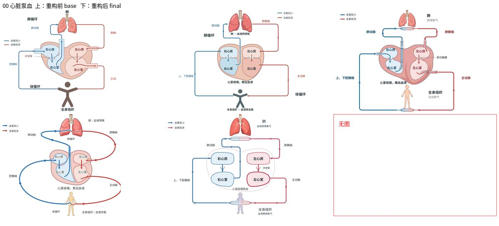
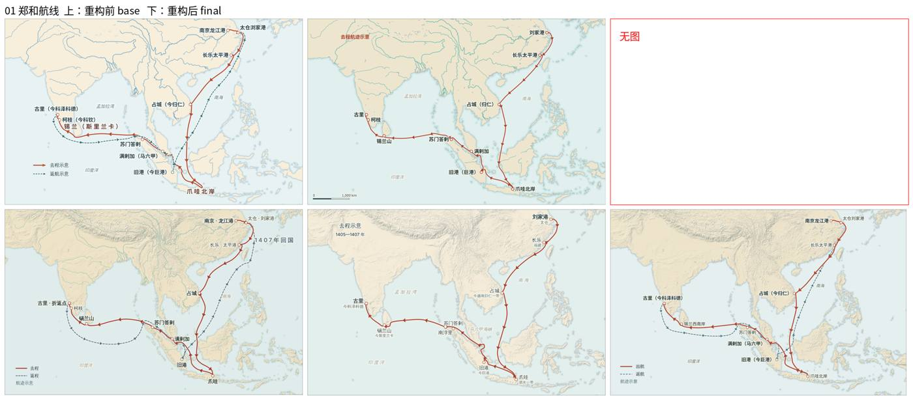
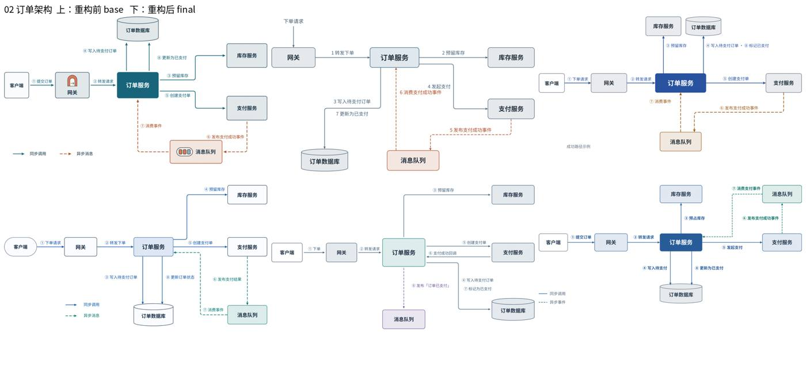
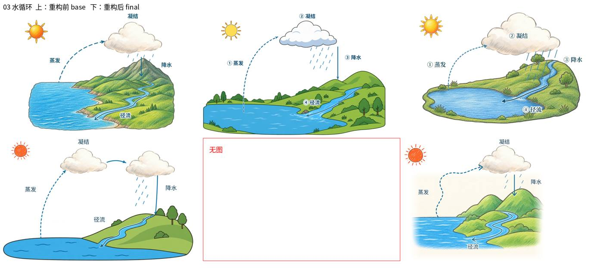
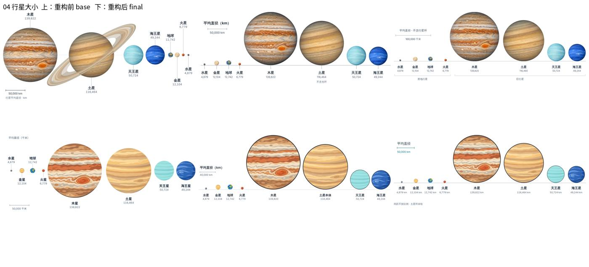
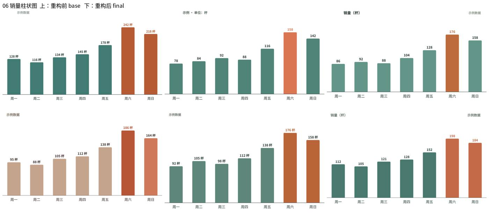

# 素材库重构：重构前后对照

日期：2026-11-22。重构前是 `7c6d542`（main），重构后是本分支。

## 结论

- **模型消耗不再随素材库增长。** 系统提示词与工具定义合计在现有素材下从约 10.7k tokens 降到 9.2k tokens。旧版每多 1000 个画法、风格或效果约增加 3 万 tokens，增加 1 万个时约 35 万 tokens，超出上下文。新版在任何规模下都是同一份前缀（单测检查逐字节不变）。
- **真实模型实测（gpt-6.2-sol-xnj，medium，8 个题目 × 3 轮）：单次创作的作者开销 −23%（$0.0719 → $0.0552），输入 tokens −19%，输出 tokens −33%，首张画面提前约 8 秒（35.6s → 27.1s），工具调用出错 0.33 → 0.04 次/运行。** 画面质量与重构前相当（见下方对照图）。总耗时均值被一次服务方 15 分钟无响应拉高，只看完成的运行，中位数 43.8s → 44.8s，基本持平。
- **规模：10 万条素材时，素材服务启动 6.0s → 0.07s，常驻内存 796MB → 约 4MB，检索 p50 56ms → 9ms、p95 79ms → 31ms，深分页 38ms → 35ms。**
- **检索质量：开发集召回率@5 0.94 → 1.00、MRR 0.94 → 1.00；留出集召回率@5 0.87 → 0.89，MRR 0.87 → 0.85（基本持平）。** 留出集上 precision@5 下降、误判为直接匹配的条数略增，原因是新版在同样的条数上限内多返回了 related 级别的候选。这一点没有改善，下面单独说明。

## 实测方法

| 项目 | 设置 |
|---|---|
| 模型 | `gpt-6.2-sol-xnj`，effort `medium`，speed `default`；生图 `gpt-image-2.6-flare-xnj`；联网搜索 `deepseek-api-xnj`。都取自线上站点的模型配置（默认标签） |
| 题目 | 8 个，覆盖科普插图、地图航线、系统架构图、儿童插图、真实比例、海报、柱状图、故事场景（`materials/eval/bench/prompts.json`） |
| 轮次 | 每个版本每题 3 轮，共 24 次运行，同一台机器、同一个截图服务 |
| 自动回答 | 模型提问时回答“你来决定，按你推荐的第一个方案画”（实际 0 次） |
| 记录 | 每次运行的状态、耗时、首张画面时间、工具调用、tokens、费用、最终画面截图 |

两个版本各自使用独立的数据目录和素材服务。重构后的素材服务从内容项目构建的素材包导入。

## 真实模型实测结果

所有运行的均值（失败的运行也计入用量）：

| 指标 | 重构前 | 重构后（中间迭代） | 重构后（最终） | 变化（前→最终） |
|---|---:|---:|---:|---:|
| 完成 / 总数 | 23 / 24 | 23 / 24 | 22 / 24 | 见“失败的运行” |
| 作者费用（美元/次） | 0.0719 | 0.0612 | **0.0552** | −23% |
| 生图费用（美元/次） | 0.0505 | 0.0339 | 0.0158 | 生图张数波动，不归因于重构 |
| 输入 tokens | 71,439 | 70,053 | **57,692** | −19% |
| 未命中缓存的输入 tokens | 9,424 | 9,709 | **8,750** | −7% |
| 输出 tokens | 4,214 | 3,092 | **2,843** | −33% |
| 首张画面（秒） | 35.6 | 30.8 | **27.1** | −8.5s |
| 总耗时（秒） | 72.4 | 60.0 | 92.8 | 被一次 15 分钟无响应拉高 |
| 工具调用次数 | 6.96 | 8.13 | 6.88 | 持平 |
| 工具调用出错 | 0.33 | 0.29 | **0.04** | |
| 看图次数 | 1.92 | 1.88 | 1.88 | |

只看完成的运行（均值 / 中位数）：

| 指标 | 重构前（23 次） | 重构后最终（22 次） |
|---|---|---|
| 总耗时（秒） | 52.1 / 43.8 | 43.9 / 44.8 |
| 首张画面（秒） | 37.1 / 26.7 | 29.6 / 26.3 |
| 作者费用（美元） | 0.0676 / 0.0625 | 0.0602 / 0.0599 |
| 输入 tokens | 73,520 / 67,074 | 62,937 / 57,712 |
| 输出 tokens | 3,715 / 2,906 | 3,101 / 3,080 |

“中间迭代”是第一版实现的实测结果。它暴露了两个问题，最终版已修正：

- 找到画法后要再用一轮读卡片，比旧版的目录多一轮，于是给 `find_materials` 加了 `cards: true`。
- `set_brief` 的风格描述限制在 80 字，2/24 次被拒，于是去掉了这个限制。

分题均值（重构前 → 重构后最终）：

| 题目 | 作者费用 | 输入 tokens | 工具调用 |
|---|---|---|---|
| 心脏泵血 | 0.120 → 0.071 | 99k → 52k | 9.0 → 5.3 |
| 郑和航线 | 0.121 → 0.103 | 74k → 89k | 7.3 → 10.7 |
| 订单架构 | 0.064 → 0.056 | 73k → 53k | 8.0 → 7.3 |
| 水循环 | 0.094 → 0.038 | 82k → 45k | 8.0 → 5.3 |
| 行星大小 | 0.098 → 0.075 | 116k → 66k | 9.7 → 7.0 |
| 咖啡海报 | 0.032 → 0.050 | 47k → 68k | 5.3 → 8.3 |
| 销量柱状图 | 0.020 → 0.024 | 34k → 44k | 4.0 → 6.7 |
| 月夜狐狸 | 0.026 → 0.025 | 46k → 44k | 4.3 → 4.3 |

需要库画法的题目（航线、柱状图）多了搜索和读卡片的调用。旧版目录常驻在提示词里，这两题因此稍贵；其余题目从更短的前缀中受益。每题只跑了 3 轮，单题差异大多在运行间的波动范围内。可靠的是总体方向：输入和输出 tokens 都下降，费用下降。

### 失败的运行

- 重构前 `01-r3`：模型输出被截断（`CutOff`）。
- 重构后 `00-r3`：模型请求本身 15 分钟没有响应，运行被超时取消，没有任何工具调用。
- 重构后 `03-r2`：模型调用了一个不存在的 `parallel` 工具，旧代码对未知工具直接终止运行，这是重构前就有的问题。本分支已改为把它作为错误回给模型，让运行继续，并补了单测。

三次失败都与素材库无关。

### 画面对照

每张图上排是重构前的 3 轮，下排是重构后最终版的 3 轮（“无图”是失败的运行）：










人工对照看下来，两版的准确度（流向、比例、数字、标注）、构图和库画法的使用都相当：地图都用了地图画法，架构图都用了节点与箭头，柱状图都用了柱状图画法。没有发现因为不再列目录而漏用库画法的情况。

## 检索评估（离线）

开发集 93 条（`materials/eval/queries.json`，调参时看过），留出集 50 条（`heldout.json`，在加同义词等改进之前写好，之后没有按它调参）。同义词表（`content/seed/synonyms.json`）有意不收留出集用到的词。素材库规模 773 条。

| 指标 | 开发集 前 → 后 | 留出集 前 → 后 |
|---|---|---|
| 召回率@5 | 0.940 → **1.000** | 0.872 → **0.894** |
| MRR | 0.935 → **1.000** | 0.872 → 0.851 |
| precision@5 | 0.832 → 0.786 | 0.721 → 0.674 |
| 有答案却无结果 | 4.8% → **0%** | 6.4% → 6.4% |
| 库里没有的东西被当成直接匹配 | 0 → 0 | 0 → 0 |
| 每条查询被误判为 exact/close 的条数 | 0.16 → 0.27 | 0.30 → 0.32 |
| p50 / p95（毫秒） | 0.28/0.95 → 0.45/1.64 | 0.43/0.88 → 0.45/1.30 |

主要改进：

- 名称完全相同才算 `exact`，只是别名相同降为 `close`（例如“帆船”不再把别名里有帆船的灯塔样张标成 exact）。
- 素材源维护的同义词表（“库存”能找到仓库，“行星轨道”能找到轨道画法）。
- 从请求里识别“透明背景”“侧面”“俯视”等条件，不当关键词搜，不满足的降为 `related`。
- 库里没有的词照样计入覆盖度，并通过 `unknown` 告诉作者“青苹果”里的“青”没有对应素材。
- 单字查询（“马”）能命中多字名称。
- 权限过滤在截断候选之前生效：一个用户有 300 张私人“苹果”，也不会挤掉别人看到的公共结果（有单测）。

没有改善的地方：

- 留出集的 precision@5 和误判条数没有变好。新版在 5 条上限内多给了一些 `related` 候选，有的是标注没覆盖的合理结果（例如“流程”找到时序图），有的确实是噪声。
- 语义类请求（“家谱树”“SWOT”“程序员”）新旧都找不到。按方案，向量召回要等有证据再加；这些留出集的失败就是证据，下一步可以加一个可插拔的语义通道。
- 在 773 条的小库上，新版单次检索比旧版的全内存扫描多约 0.2–0.7ms，绝对值都在 2ms 以内；规模变大后新版明显更快（见下节）。

## 规模压测

用素材包里的词合成 2 万 / 10 万条图片素材（五分之一公开，其余分属 500 个用户），各在独立进程中测（`materials/eval/scale.ts`）：

| 规模 | 指标 | 重构前 | 重构后 |
|---|---|---:|---:|
| 2 万 | 启动 | 1,489 ms | 9 ms |
| 2 万 | 启动后常驻内存增量 | 246 MB | 4 MB |
| 2 万 | 检索 p50 / p95 | 7.4 / 16.9 ms | 2.9 / 16.0 ms |
| 10 万 | 启动 | 5,997 ms | 1–67 ms |
| 10 万 | 启动后常驻内存增量 | 796 MB | 2–6 MB |
| 10 万 | 检索 p50 / p95 / 最大 | 55.9 / 79.1 / 103 ms | 9.6 / 31.2 / 46 ms |
| 10 万 | 第 400 页（每页 48） | 37.7 ms | 34.7 ms |

## 提示词前缀

| 素材库新增的画法、风格、效果数 | 重构前（tokens） | 重构后（tokens） |
|---:|---:|---:|
| 0 | 10,690 | 9,227 |
| 100 | 14,084 | 9,227 |
| 1,000 | 44,443 | 9,227 |
| 10,000 | 350,383 | 9,227 |

（按每 4 个字符约 1 token 估算，含工具定义。）

## 复现

```sh
# 构建并导入素材包
pnpm --dir content build /tmp/pack
MATERIALS_DATA=/tmp/lib pnpm --dir materials library import /tmp/pack
# 检索评估（第三个参数换成 heldout 跑留出集）
pnpm exec tsx materials/eval/search.ts /tmp/lib out.json queries
# 规模压测
pnpm exec tsx materials/eval/scale.ts fill /tmp/scale 100000
pnpm exec tsx materials/eval/scale.ts measure /tmp/scale
# 真实模型实测：先起一套服务，模型配置是 GET /api/admin/models 的结果，含密钥，不要放进仓库
DRAWY_BENCH_MODELS=/path/to/models.json node materials/eval/bench/bench.mjs <名字> http://127.0.0.1:8080 3
python3 materials/eval/bench/aggregate.py <前> <后>
```

`results.json` 是本报告的原始汇总数据。

## 方案中尚未完成的部分

- **内容项目还在本仓库的 `content/` 里。** 它已经和应用完全解耦：应用和素材服务只认素材包，Dockerfile 用单独的阶段构建素材包。本次会话只能访问 DrawY 一个仓库，无法新建闭源仓库，所以要把 `content/` 移到私有仓库，再由那边发布素材包。另外，素材文件在 Git 历史里仍然存在。
- **作品的素材升级入口。** 已保存的作品固定在取入时的版本，但还没有“把这件作品的素材升级到最新版”的界面操作。
- **语义召回通道。** 留出集的失败说明值得做，但这次没有加。
- **卡片按字段读取、单次创作的素材上下文累计上限。** 现在是每次调用有上限，并按 id 去重，还没有整次创作的累计上限。
- **素材库页面按类型分栏。** 接口已支持 `type` 过滤，页面仍按四种载荷分栏。
