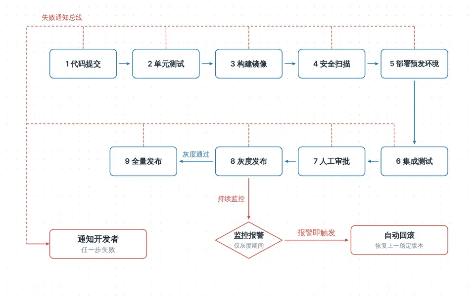
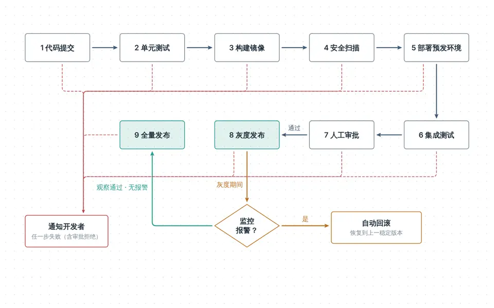
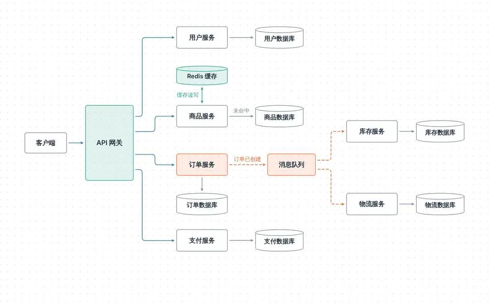
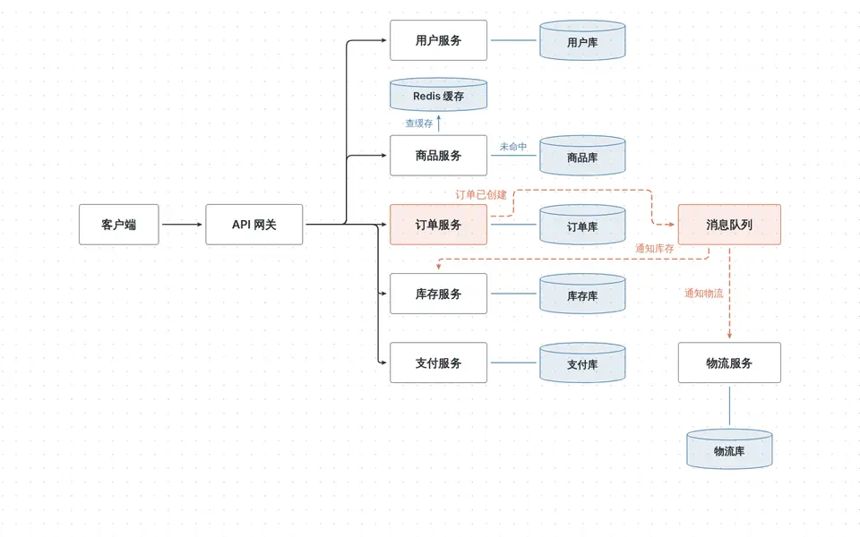
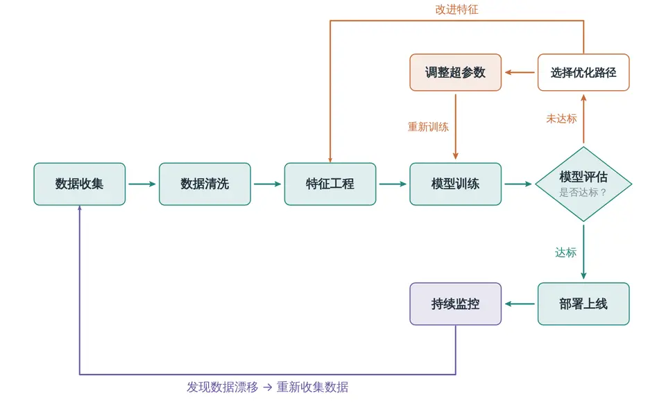
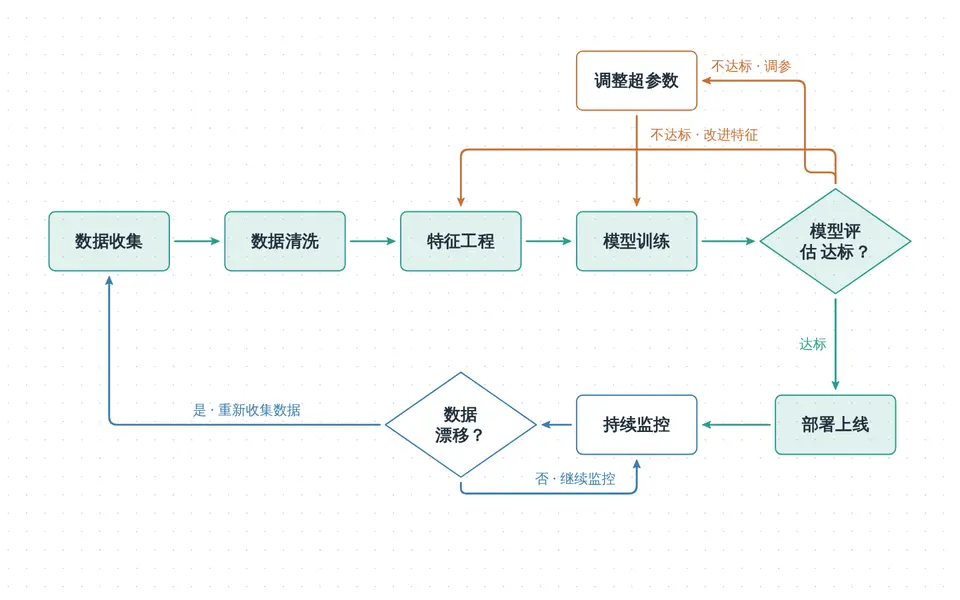
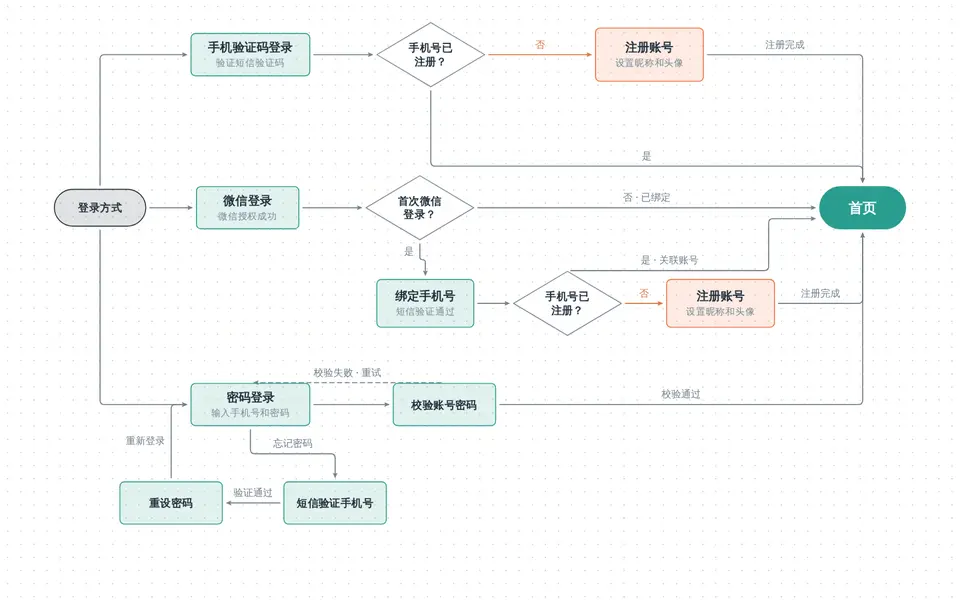
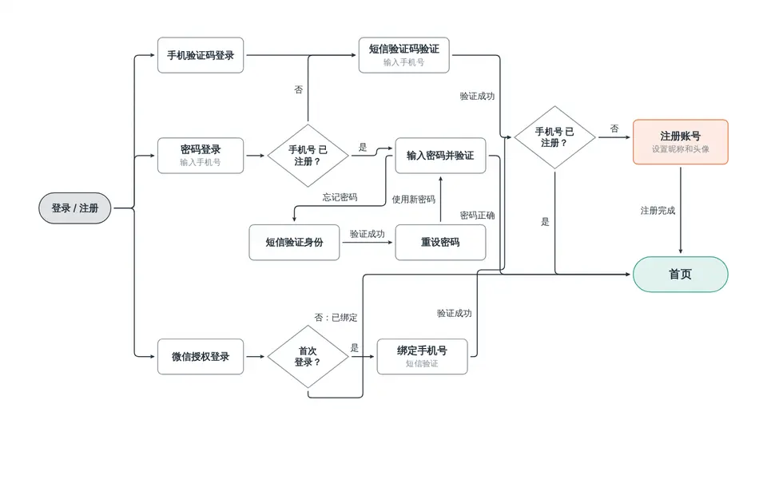
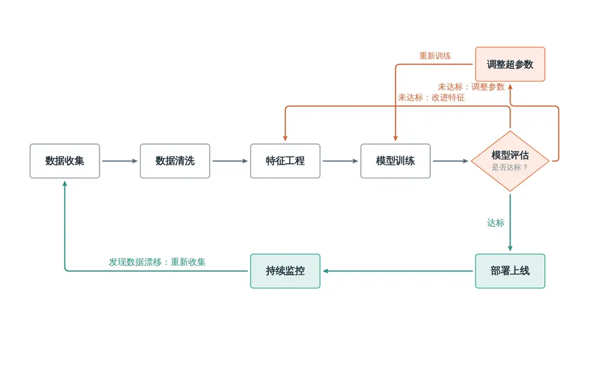
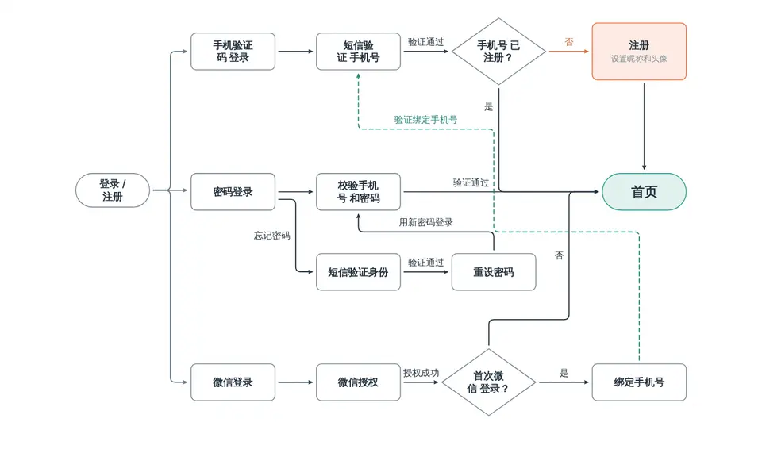

# 结构化图：降本提速与连线整洁 前后对比

> 2026-11-11 · 绘制模型 gpt-6.1-sol（ChatGPT OAuth，medium 强度）· 本地完整服务（素材、截图、主程序）· 改动前 `8c47c2e`，改动后为本分支

## 结论

同样的 6 个结构化图请求，改动前后各跑 3 轮（每轮 6 个，共 36 次运行，全部完成）：

| 每轮 6 个图合计（3 轮平均） | 改动前 | 改动后 | 变化 |
|---|---|---|---|
| 总耗时 | 484 秒 | 368 秒 | **−24%** |
| 总费用 | $0.414 | $0.302 | **−27%** |
| 模型轮次 | 36.7 | 22.7 | **−38%** |
| 输入 token | 61.9 万 | 35.2 万 | −43% |
| 输出 token | 18.2 千 | 12.9 千 | −29% |
| 首个画面出现（平均） | 51.2 秒 | 43.8 秒 | −14% |
| 保存次数 | 12.3 | 10.0 | −19% |
| 手写走线的连线（`at`/`bend`/`first`） | 64% | 21% | 作者不再自己排线 |

连线质量（对最终作品逐条量出，18 件对 18 件）：

| 指标 | 改动前 | 改动后 |
|---|---|---|
| 连线穿过无关方框（长度） | 110 | **0** |
| 颜色或虚实不同的连线叠在一起（长度） | 312 | **2** |
| 连线文字压在方框或别的线上（处） | 12 | 7 |
| 无关连线贴着走（长度） | 15 | 47 |
| 无关连线交叉（采样计） | 4 | 15 |
| 绕到图外、导出时被裁掉的连线 | 有（如 mlops 的回路） | 0（视角和导出把连线算进范围） |

改动前不少图同样干净，靠的是作者手工排线：64% 的连线写了 `at`、`bend` 或 `first`，还要多保存、多看图来修。改动后作者只说“谁连到谁”，排线交给运行时，所以轮次和费用降下来。交叉和贴线的计数比改动前高，主要来自 CI/CD 的“任一步失败→通知”这种一对多汇入，以及登录流程里多条线汇入“首页”。这类图交叉难免，改动前作者会手画总线来避开。

## 改了什么

1. **保存即查看**（`modules/agent`）：一轮里最后一次 `write_work` 保存后立刻截图查看，结果放在写入结果的 `look` 里。改动前 sol 每次保存后都单独再花一轮调用 `view_canvas`，每次约 4 秒，还要把整段上下文再读一遍。
2. **直角连线自动布线**（`modules/runtime/route.ts`）：`route: "elbow"` 的连线由运行时统一在稀疏网格上做 A* 寻路。它会绕开中间的方框，自己选从哪条边出入；同一模块发出或汇入、且外观相同的连线合成主干，颜色或虚实不同的不合并；带条件文字的分支各走各的边或端口；与别的连线相交的路线再到整幅图范围里找一次，有绕到外面的路就绕；最后把不该重叠的线错开。
3. **连线文字自动找位置**：每条带文字的连线依次找空位，避开方框、所有连线和已放好的文字，库里的 `arrow` 写在那里。
4. **取景与导出包含连线**：画布视角、导出裁边和截图报告都用“模块加连线实际画到的范围”，绕到外面的回路不再被裁掉。
5. **提示词与指南**：告诉作者直角连线会自己找路，不要写 `at`/`bend`/`first`，也不要自己画总线；条件写成连线文字；主路径排成一行或一列。

## 前后对比（同一请求，各取第 1 轮）

### CI/CD 流水线（9 步，任一步失败通知开发者，灰度报警自动回滚）

改动前，作者自己写了一个“失败通知总线”画法模块，再把连线一条条接上去，用了 7 轮（2 次保存、2 次看图）。改动后，汇入“通知开发者”的虚线自动合成上下两条总线，从左侧汇入，3 轮、一次保存就完成了。

| 改动前 | 改动后 |
|---|---|
|  |  |

### 微服务架构

| 改动前 | 改动后 |
|---|---|
|  |  |

### 机器学习流程（含回路）

改动后的两条“不达标”分支都从菱形顶角出发并相交，因为作者给这两条都写了 `at: "top"`，而运行时会保留作者指定的边。所以指南删掉了“判定分支可以指定顶点”这条例外，第 4 轮复测见下文。

| 改动前 | 改动后 |
|---|---|
|  |  |

### 登录流程（三种登录方式，多处判定汇入首页）

这是 6 个图里最复杂的一个。改动后单个图的平均耗时从 133 秒降到 70 秒，轮次从 8.7 降到 3.7。多条线汇入“首页”的地方仍然偏密，是自动布线还能改进的地方。

| 改动前 | 改动后 |
|---|---|
|  |  |

## 第 4 轮复测：不再让作者指定判定分支的边

前 3 轮里，作者仍会给判定菱形的分支写 `at`（指南原来允许“判定的是/否各用一个顶点”），结果两条分支挤在同一个顶点上。指南改成一律不写之后又跑了一轮：

| 指标 | 改动前（3 轮平均） | 改动后（3 轮平均） | 第 4 轮 |
|---|---|---|---|
| 总耗时 | 484 秒 | 368 秒 | 324 秒 |
| 总费用 | $0.414 | $0.302 | $0.279 |
| 模型轮次 | 36.7 | 22.7 | 24 |
| 首个画面出现（平均） | 51.2 秒 | 43.8 秒 | 38.5 秒 |
| 手写走线的连线 | 64% | 21% | 6%（86 条里 5 条） |
| 交叉 / 文字冲突（6 件合计） | 1.3 / 4.0 | 5.0 / 2.3 | 5 / 1 |

这一轮里，分支从菱形不同的顶点出发，登录流程也比前几轮清爽。只跑了一轮，耗时和费用的差别还在波动范围内。

| 机器学习流程 | 登录流程 |
|---|---|
|  |  |

## 分图数据（3 轮平均）

| 图 | 耗时 前→后 | 费用 前→后 | 轮次 前→后 | 保存 前→后 |
|---|---|---|---|---|
| 组织架构 org | 58.7 → 48.8 秒 | $0.061 → $0.052 | 5.0 → 4.0 | 1.3 → 1.3 |
| 微服务架构 arch | 81.7 → 60.8 秒 | $0.081 → $0.058 | 5.3 → 3.3 | 1.7 → 1.3 |
| 请假审批 leave | 56.0 → 64.3 秒 | $0.060 → $0.058 | 5.3 → 4.3 | 1.7 → 2.3 |
| ML 流程 mlops | 62.1 → 59.7 秒 | $0.043 → $0.045 | 5.0 → 4.0 | 1.3 → 2.0 |
| CI/CD cicd | 93.2 → 65.0 秒 | $0.078 → $0.041 | 7.3 → 3.3 | 3.0 → 1.3 |
| 登录流程 login | 132.6 → 69.8 秒 | $0.091 → $0.047 | 8.7 → 3.7 | 3.3 → 1.7 |

越复杂、连线越多的图收益越大（CI/CD 和登录流程的费用约减半）。简单的图本来就一两次写完，变化在轮次间的波动范围内。

## 方法与口径

- 6 个请求：公司组织架构、电商微服务架构、员工请假审批、CI/CD 流水线、App 登录注册流程、机器学习项目流程。作者提问时统一回答“你来决定，按常见做法画”。
- 每轮先起一套全新的数据目录和服务（素材服务从对应版本的 `materials/seed` 播种），3 个请求并发。改动前用 `8c47c2e` 的独立工作区。
- 耗时取运行的 `elapsedMs`（从开始到结束），费用按运行记录的用量和 API 价格表用 `costOf` 计算（OAuth 实际不计费，这里只作比较）。
- 连线质量由脚本在 Chromium 里渲染最终作品，沿每条连线的 SVG 路径每 2px 取样后量出。“无关”指两条连线不共用任何一端的模块；“采样计”的交叉是取样折线段的相交次数，一处交叉可能计 1～2 次。改动前的作品用改动前的运行时渲染，所以没有“连线范围”可比，“绕到外面”一项按截图人工判断。
- 中途发现测试脚本没能重启素材服务，改动后的前几轮用的是旧版箭头画法，那几轮的数据已全部作废重跑，上表只用修好之后的 3 轮。
